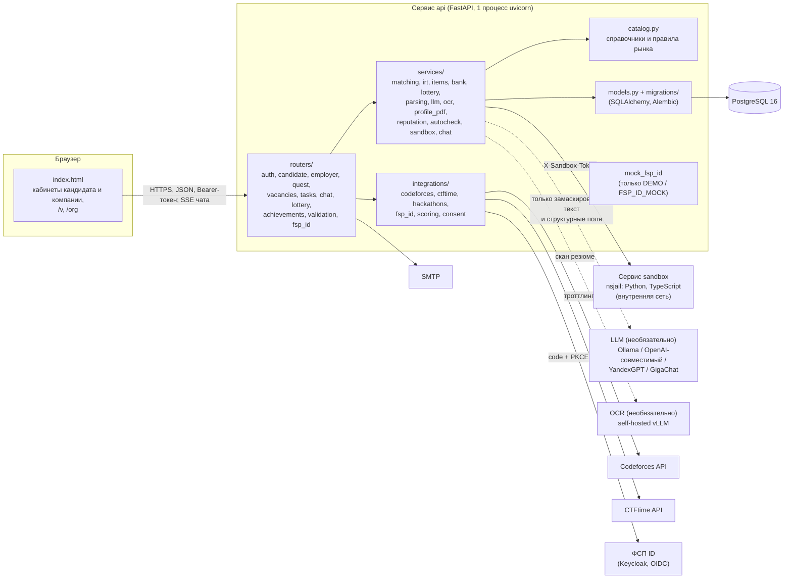
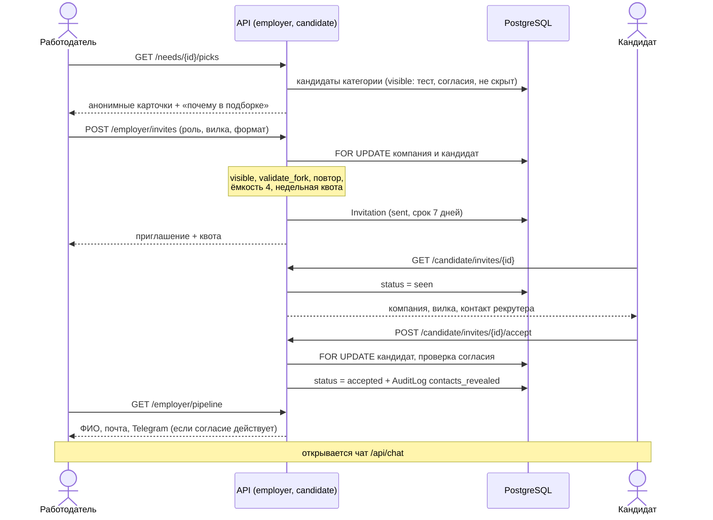
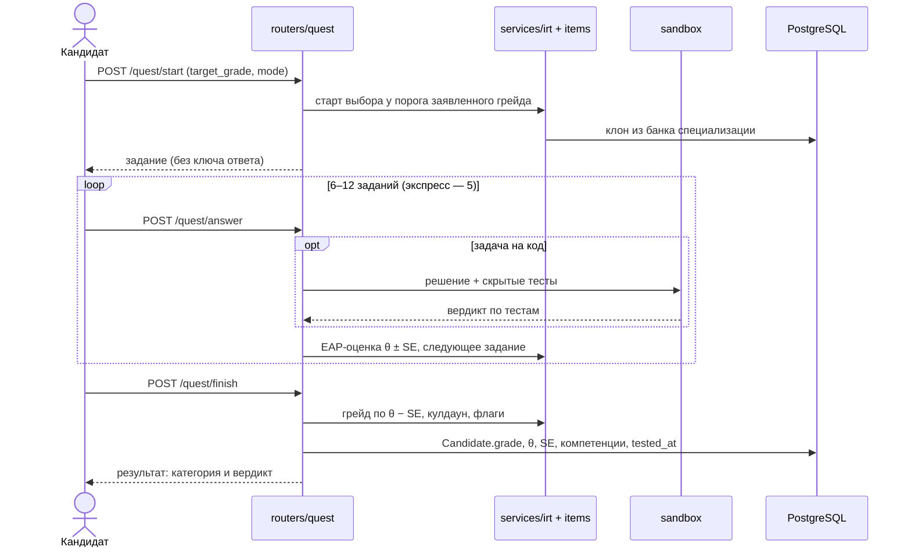

# 1. Архитектура решения

«ФСП Карьера» — веб-платформа обратного найма ИТ-специалистов. Кандидат один раз проходит адаптивный тест и попадает в категорию «специализация · трек · грейд». Работодатель описывает потребность, получает анонимную подборку с объяснением и сам отправляет конкретному человеку приглашение с обязательной вилкой зарплаты. Контакты кандидата раскрываются только после его согласия.

Раздел описывает, что делает система (функциональная архитектура), из каких частей она собрана (компонентная архитектура), как устроены данные и что сделано для нефункциональных требований. Механики теста, подбора, валидации, интеграции с ФСП, API и безопасность подробно разобраны в разделах 2–10; здесь на них только ссылки.

## 1.1. Функциональная архитектура

### Роли

| Роль | Кто это | Как входит | Где работает |
|---|---|---|---|
| Кандидат | ИТ-специалист, ищет работу | код на почту или ФСП ID (OIDC) | кабинет `/candidate…` |
| Работодатель | рекрутер компании | код на почту или SSO через Keycloak | кабинет `/employer…` |
| Организатор | сотрудник ФСП или организатор соревнования | токен `ORGANIZER_TOKEN` из окружения или пользователь с ролью `admin` | страница `/org` (импорт протоколов) |
| Публичный доступ | жюри, любой посетитель | без входа | дашборд валидации `/v`, публичная проверка лотереи, публичный план теста по вакансии (только при `DEMO=1`) |

Роль хранится в `users.role` (`candidate`, `employer`, `admin`). Кабинеты кандидата и компании — отдельные адреса: в одном браузере можно держать оба кабинета в соседних вкладках, у каждого свой токен.

### Сквозной сценарий (ТЗ, п. 3.3)

Основной путь — выход на контакт по инициативе работодателя:

1. **Регистрация.** Кандидат вводит почту на `/candidate/signup` и получает шестизначный код (`POST /api/auth/email` → `POST /api/auth/verify`). Аккаунт создаётся только после подтверждения адреса. Альтернатива — вход через ФСП ID (раздел 5).
2. **Опрос.** Анкета профиля: специализация (12 направлений из `catalog.SPECS`), трек, предполагаемый грейд (`catalog.GRADES`: Intern, Junior, Middle, Senior, Lead), навыки, стаж, ожидания по зарплате, формат работы, город. Поля можно предзаполнить из PDF-резюме (`POST /api/candidate/cv`). Здесь же даются согласия 152-ФЗ (раздел 9). Сохранение — `POST /api/candidate/profile`.
3. **Тест.** Адаптивный тест на заявленный грейд (`POST /api/quest/start` → серия `POST /api/quest/answer` → `POST /api/quest/finish`): 6–12 заданий из банка специализации, оценка уровня по IRT. Есть экспресс-режим из 5 заданий, он даёт только предварительную категорию. Механика — раздел 2.
4. **Категория.** По итогу теста кандидату присваивается грейд и с ним категория «специализация · трек · грейд». Без пройденного теста кандидат работодателю не виден нигде (`matching.visible`).
5. **Подборка или поиск.** Работодатель описывает потребность свободным текстом. Система разбирает текст в структуру (`POST /api/employer/needs/parse`), работодатель её проверяет и сохраняет (`POST /api/employer/needs`), после чего получает ранжированную подборку с объяснением (`GET /api/employer/needs/{id}/picks`). Другой путь — поиск по всему банку с фильтрами (`GET /api/employer/search`). Механика подбора — раздел 3.
6. **Приглашение.** Работодатель открывает анонимную карточку кандидата и отправляет приглашение: роль, описание, вилка «от–до», формат работы (`POST /api/employer/invites`). Действуют регуляторы: недельная квота компании, не больше 4 открытых приглашений у кандидата, срок ответа 7 дней.
7. **Принятие.** Кандидат видит приглашение с компанией, вилкой и контактом рекрутера ещё до ответа. Он принимает приглашение (`POST /api/candidate/invites/{id}/accept`) или отклоняет его с причиной.
8. **Контакты.** После принятия работодатель видит ФИО, почту и Telegram кандидата в статусах приглашений (`GET /api/employer/pipeline`), открывается внутренний чат. Раскрытие пишется в журнал `AuditLog` (`contacts_revealed`).

Дополнительные сценарии:

- **Отклик на вакансию.** Компания публикует вакансию с обязательной вилкой. Кандидат, прошедший тест, откликается сам (`POST /api/vacancies/{id}/apply`). До ответа компания видит только анонимную карточку. Контакты и чат открываются, когда компания приняла отклик. Так защищаемся от фиктивных вакансий, которые собирают контакты (раздел 11).
- **Задания работодателя.** Короткие задачи («решить» или «предложить подход») лежат на витрине для специализации или прикладываются к приглашению. Ответ с эталоном проверяет система (`services/autocheck.py`), открытый ответ оценивает работодатель. Оценка попадает в карточку кандидата как свежий сигнал, но на грейд и место в выдаче не влияет.
- **Чат.** Переписка кандидата и компании без обмена контактами вне платформы. Доступен, пока приглашение принято кандидатом или отклик принят компанией. Новые сообщения доставляются через SSE (`GET /api/chat/stream`).
- **Квалифицированная лотерея.** Работодатель задаёт порог требований. Пул прошедших порог замораживается, публикуется хеш секрета (`sha256(seed)`), затем бросается жребий. Результат может проверить кто угодно по публичному адресу `GET /api/lottery/{id}/public`. Механика — раздел 3.
- **Отзыв о компании.** По принятому приглашению кандидат может оставить отзыв. Отзывы меняют только квоту компании, а при сигнале «вакансии не было» блокируют её до ручной проверки (`services/reputation.py`, раздел 11).
- **Импорт протоколов.** Организатор загружает протокол соревнования ФСП, хакатона или CTF в формате CSV или JSON (`POST /api/achievements/import`). Достижения привязываются к кандидатам, которые дали согласие на внешние данные (раздел 5).

### Карта функций по кабинетам

**Кабинет кандидата** (`/candidate…`): приглашения (главный экран), тест и его результат, профиль с резюме и PDF-профилем, вакансии и мои отклики, чат, задания, настройки (согласия, приватность, уведомления, ФСП ID, Codeforces и CTFtime, выгрузка и удаление данных).

**Кабинет компании** (`/employer…`): подборка по потребностям (главный экран), новая потребность, поиск по банку, карточка кандидата и форма приглашения, статусы приглашений, чат, вакансии и отклики, задания, данные компании.

**Публичные страницы:** главная с двумя входами («Кандидатам» и «Компаниям»), `/v` — дашборд валидации, `/org` — импорт протоколов организатором.

### Соответствие функциональным требованиям ТЗ (п. 2.1 и 2.2)

Пути в таблице — от `backend/app/`, фронт — `frontend/index.html`.

**Личный кабинет «Кандидат»**

| Требование ТЗ | Как реализовано | Где в коде |
|---|---|---|
| Профиль и резюме: форма или PDF с автораспознаванием (ФИО, контакты, стек, грейд, роли, стаж, софт-скиллы), PDF-профиль | Разбор PDF правилами по справочникам, LLM — по желанию (без неё всё работает). Распознаются контакты, навыки, стаж, подсказка грейда, роли, софт-скиллы, места работы. Сканы без текста распознаёт OCR, если он включён. Стандартизированный PDF-профиль генерируется на сервере | `services/parsing.py` (`parse_cv`), `services/ocr.py`, `services/profile_pdf.py`; `POST /api/candidate/cv`, `POST /api/candidate/profile`, `GET /api/candidate/profile.pdf` |
| Тестирование: опрос, выбор грейда, тест; результат определяет категорию | Анкета профиля (специализация, трек, заявленный грейд), тест на выбранный грейд (`target_grade`), адаптивный 2PL IRT; грейд и категория ставятся по итогу | `routers/quest.py`, `services/irt.py`, `services/items.py`, `services/bank/` |
| Регулярные задания от работодателя (желательно) | Витрина заданий специализации и задание в приглашении; автопроверка по эталону или оценка работодателя; сигнал в карточке | `routers/tasks.py`, `services/autocheck.py` |
| Категория и грейд: статус, история, пересдача выше или ниже с ограничением частоты | Текущая категория в кабинете, история попыток; повышение только новой попыткой и не чаще раза в 90 дней (`UPGRADE_COOLDOWN_DAYS`); принудительного понижения нет, нижний грейд кандидат принимает сам | `GET /api/candidate/me`, `GET /api/quest/history`, `POST /api/quest/accept-lower`, `catalog.UPGRADE_COOLDOWN_DAYS` |
| Приглашения: вакансия и зарплата, принять или отклонить | Список и карточка приглашения с вилкой, компанией, контактом рекрутера и объяснением «почему вас пригласили»; принятие, отказ с причиной | `routers/candidate.py` (`/invites…`) |
| Вакансии и отклик (желательно) | Список вакансий с фильтрами, отклик, список своих откликов со статусами, отзыв отклика | `routers/vacancies.py` |
| Настройки: приватность, согласия, связь с ФСП ID | Три раздельных согласия, статус «открыт / скрыт», «скрыть профиль от компаний» по ИНН, уведомления, привязка и отвязка ФСП ID | `PATCH /api/candidate/consents`, `/status`, `/hidden-from`, `/notif`; `routers/fsp_id.py` |
| Кандидат видит только свои приглашения и отклики | Все эндпоинты кабинета берут кандидата из токена (`deps.current_candidate`) и проверяют владельца записи (404 на чужую) | `deps.py`, `candidate._own_invite`, `vacancies.withdraw` и др. |

**Личный кабинет «Работодатель»**

| Требование ТЗ | Как реализовано | Где в коде |
|---|---|---|
| Профиль компании: описание, направление, контакты | ИНН (с проверкой контрольной суммы), название, описание, сайт, контакты рекрутера; автопроверки «почта на домене сайта» | `POST/GET /api/employer/company` |
| Описание потребности | Свободный текст → структура (специализация, трек, грейд, обязательные и желательные навыки, вилка, формат, город); категорию можно поправить; по потребности строится план теста | `POST /api/employer/needs/parse`, `/needs/category`, `/needs`; `POST /api/quest/plan` |
| Подборка: рекомендованные категории, кандидаты, обоснование | Ранжированный список анонимных карточек с текстом «почему в подборке» и разбивкой оценки; соседние категории со счётчиками | `GET /api/employer/needs/{id}/picks`, `GET /api/employer/candidates/{public_id}`; `services/matching.py` |
| Поиск по банку с фильтрами (специализация, грейд, категория, стек, достижения ФСП) | Вся база без привязки к потребности; фильтры по специализации, треку, грейду, навыкам, ФСП, Codeforces, хакатонам, формату, городу; фасеты | `GET /api/employer/search` |
| Выход на контакт: приглашение с предложением и зарплатой без обязательной вакансии; статусы | Приглашение из подборки, поиска или лотереи; потребность необязательна; статусы приглашений | `POST /api/employer/invites`, `GET /api/employer/pipeline` |
| Публикация вакансий, отклики (желательно) | Создание, правка, закрытие, продление (срок публикации 30 дней), отклики и ответ на них | `routers/vacancies.py` |
| Контакты не видны до принятия приглашения или отклика | Карточка — белый список полей без ФИО и контактов; контакты отдаются только по принятому приглашению или отклику и при действующем согласии | `matching.card`, `employer._row`, `vacancies._shown` |

**Поиск и подбор**

| Требование ТЗ | Как реализовано | Где в коде |
|---|---|---|
| Выдача — по категориям из теста, а не по резюме | Грейд категории берётся только из теста (`category_grade`); без теста кандидата нет в выдаче | `matching.tested`, `category_grade`, `visible`, `eligible` |
| Ранжирование по силе подтверждённого профиля и соответствию потребности, с объяснением | Оценка соответствия: θ с поправкой на погрешность, покрытие навыков, достижения; итог учитывает вероятность принятия и нагрузку кандидата; к каждой карточке — объяснение | `matching.score_candidates`, `matching.rank`; раздел 3 |
| Фильтрация без потери подборки | Фильтры подборки (`filters`: формат, свободен, ФСП, Codeforces) сужают уже ранжированный список, порядок сохраняется | `employer.picks` |

**Данные и правила видимости (п. 2.2)**

| Правило ТЗ | Как реализовано |
|---|---|
| Вилка «от–до» обязательна в вакансии и приглашении | `employer.validate_fork`: обе границы, нижняя не ниже 25-го перцентиля рынка, ширина не больше 40 %; отдельно схема запроса ограничивает любую сумму `catalog.SALARY_MAX` (10 млн ₽ на руки, тип `employer.Salary`) |
| Приглашение содержит описание, зарплату, компанию и способ связи; контакты кандидата — после принятия или отклика | Контакт рекрутера виден кандидату сразу, контакты кандидата — после `accepted` |
| Статусы приглашений и откликов видят обе стороны | Приглашение: `sent → seen → accepted / declined / expired`; отклик: `sent → seen → accepted / declined`, кандидат может отозвать (`withdrawn`) |
| Регистрация по почте с подтверждением | Код на почту, пользователь создаётся только после проверки кода (`deps.send_code`, `deps.verify`) |

## 1.2. Компонентная архитектура

Решение — модульный монолит с явным разделением слоёв. Фронт отделён от API, слой хранения — PostgreSQL. Исполнение чужого кода вынесено в отдельный изолированный сервис. Всё собирается `docker compose` из трёх сервисов: `db`, `api`, `sandbox`.

### Фронтенд

Один файл `frontend/index.html` без сборки: разметка, стили по брендбуку ФСП и скрипт. Ассеты (шрифт JetBrains Mono, иконки, манифест) лежат в `frontend/assets/`. Страницу раздаёт тот же сервер, что и API, поэтому CORS не нужен. Наружу отдаются только `/` и `/assets` (`main.py`).

Маршрутизация — History API. Таблица `ROUTES` переводит адрес в ключ экрана и обратно. Основные адреса:

| Кабинет | Адреса |
|---|---|
| Кандидат | `/candidate` (приглашения), `/candidate/login`, `/candidate/signup`, `/candidate/profile`, `/candidate/test`, `/candidate/test/run`, `/candidate/test/result`, `/candidate/invites/<id>`, `/candidate/vacancies[/<id>]`, `/candidate/applications`, `/candidate/tasks[/<id>[/<приглашение>]]`, `/candidate/chat[/<id>]`, `/candidate/settings` |
| Компания | `/employer` (подборка), `/employer/login`, `/employer/signup`, `/employer/company`, `/employer/needs/new`, `/employer/search`, `/employer/candidates/<id>[?need=<id>]`, `/employer/candidates/<id>/invite`, `/employer/invites`, `/employer/vacancies[/<id>]`, `/employer/tasks[/<id>]`, `/employer/chat[/<id>]` |
| Публичные | `/`, `/v`, `/org` |

Кабинет без входа уводит на вход своей роли с `?next=` и после входа возвращает на исходный экран. Сервер отдаёт `index.html` только на явных префиксах `/candidate…`, `/employer…`, `/v`, `/org`, без перехвата всех адресов: опечатка в `/api/…` по-прежнему получает JSON-ответ 404.

### Бэкенд

FastAPI, Python ≥ 3.12, синхронный SQLAlchemy 2.0 с драйвером psycopg. Слои:

| Слой | Каталог | Назначение |
|---|---|---|
| Роутеры | `backend/app/routers/` | HTTP API по ролям и фичам: `candidate`, `employer`, `quest` (тест), `vacancies`, `tasks`, `chat`, `lottery`, `achievements` (внешние профили и импорт протоколов), `validation`, `fsp_id` (вход через ФСП ID), `mock_fsp_id` (мок провайдера); вход по коду — `deps.py` |
| Сервисы | `backend/app/services/` | Логика: подбор (`matching.py`), IRT (`irt.py`), банк заданий (`items.py` + сценарные банки специализаций `bank/`), задачи на код (`code_items.py`) и клиент песочницы (`sandbox.py`), лотерея, разбор резюме и потребностей (`parsing.py`), клиент LLM (`llm.py`), OCR, PDF-профиль, репутация компаний, автопроверка заданий, чат, валидация |
| Интеграции | `backend/app/integrations/` | Codeforces, CTFtime, импорт протоколов хакатонов и ФСП (`hackathons.py`), клиент ФСП ID (`fsp_id.py`), веса достижений (`scoring.py`), согласие на внешние данные (`consent.py`); общий HTTP-слой с троттлингом (`common.py`) |
| Справочники | `backend/app/catalog.py` | Специализации, треки, грейды и их пороги, навыки, компетенции, рынок зарплат, квоты, сроки, версия текста согласия |
| Данные | `backend/app/models.py`, `backend/migrations/` | Схема SQLAlchemy и ревизии Alembic. При старте API применяет все ревизии (`alembic upgrade heads`) под advisory-блокировкой Postgres и засевает банк заданий теста (`items.seed_items`) |
| Доступ | `backend/app/deps.py` | Токены, вход по коду, зависимости FastAPI для проверки роли (раздел 9) |

Документация API генерируется FastAPI по OpenAPI и доступна на `/docs` (раздел 6).

### Хранилище

PostgreSQL 16 (`postgres:16-alpine`), данные — в именованном томе `pgdata`. Эмбеддинги (если включена LLM) хранятся массивом `ARRAY(Float)` в строках кандидата и потребности, косинусное сходство считается в приложении (numpy) по пулу категории. Расширений Postgres (pgvector и т. п.) нет.

### Песочница задач на код

Отдельный контейнер `sandbox` (`sandbox/`, HTTP-сервис на stdlib Python). Каждый тест решения запускается в своём nsjail: Python 3.11 или TypeScript на Node 22. Контейнер сидит во внутренней сети compose (`internal: true`), портов на хост и выхода наружу у него нет. С песочницей говорит только `api` по общему секрету `SANDBOX_TOKEN`. Без токена тест идёт без задач на код. Модель безопасности — раздел 9, механика задач — раздел 2.

### Внешние компоненты (все необязательны для запуска)

| Компонент | Зачем | Без него |
|---|---|---|
| LLM (`LLM_PROVIDER`: `ollama`, `openai_compatible`, `yandexgpt`, `gigachat`) | разбор потребности и резюме, реранк топ-30 подборки, эмбеддинги | всё работает на правилах (`LLM_PROVIDER=none` по умолчанию); раздел 10 |
| OCR (`OCR_URL`, self-hosted vLLM с vision-моделью) | распознавание сканов резюме без текстового слоя | скан → 422 «заполните поля вручную» |
| Codeforces, CTFtime | рейтинг и места в соревнованиях | достижений из этих источников нет, штрафа нет |
| ФСП ID (Keycloak OIDC) | вход и привязка ФСП ID, подтверждённые достижения из реестра | вход по коду почты; на стенде — встроенный мок `/mock-fsp-id`; раздел 5 |
| SMTP | письма с кодом входа и уведомления о приглашениях | вне `DEMO=1` вход по почте отвечает 503; в демо код приходит в ответе |

### Поток: приглашение и раскрытие контактов

### Поток: тест и присвоение категории

## 1.3. Модель данных

Схема описана в `backend/app/models.py`, изменения — только ревизиями Alembic (`backend/migrations/versions/`, корень `0001_baseline`).

| Сущность (таблица) | Что хранит | Ключевые связи | ПДн |
|---|---|---|---|
| `User` (`users`) | аккаунт: почта входа, роль, sha256 токена и срок, `fsp_id`, флаг подтверждения почты кодом | 1:1 с `Candidate` или `Company` | почта, ФСП ID |
| `Candidate` (`candidates`) | профиль: анонимный `public_id`, специализация, трек, заявленный грейд, ожидания, формат, город, навыки, роли, софт-скиллы, резюме; результат теста (грейд, θ, SE, компетенции, подтверждённые навыки, срок повышения); три согласия с версиями; статус и «скрыть от» | → `User`; ← достижения, внешние аккаунты, приглашения, отклики, сессии теста, сообщения | **ФИО, почта, Telegram, текст и имя файла резюме**; город, ожидания по зарплате |
| `ExternalAccount` | привязка Codeforces или CTFtime: handle, sha256 кода подтверждения, рейтинг | → `Candidate` (каскадное удаление) | handle |
| `Event`, `Achievement` | соревнование (ФСП, хакатон, CTF, Codeforces) и подтверждённое достижение: место, результат, разряд, вес | `Achievement` → `Candidate`, `Event` | косвенно (команда, роль) |
| `Company` | компания: ИНН, название, описание, сайт, контакты рекрутера, флаг проверки, квота, блок по отзывам | → `User` | ФИО, почта, Telegram рекрутера |
| `Need` | потребность работодателя: текст и структура после разбора | → `Company` | — |
| `Invitation` | приглашение: роль, вилка, формат, описание, задача, статус и даты, причина отказа, отметки сторон | → `Company`, `Candidate`, `Need`, `Lottery` | комментарий к отказу |
| `Lottery` | жеребьёвка: порог, пул псевдонимов, хеш секрета, коммитмент, раскрытый секрет, выбранные | → `Company`, `Need` | — (псевдонимы `sha256(salt + public_id)`) |
| `Item`, `QuestSession` | задание банка IRT (семейство, a, b, содержимое с ключом) и сессия теста (ответы, θ, SE, грейд попытки, флаги) | `QuestSession` → `Candidate` | ответы кандидата |
| `Vacancy`, `Application` | вакансия с обязательной вилкой и сроком публикации; отклик со статусом и отметкой раскрытия контактов | `Application` → `Vacancy`, `Candidate` | заметка к отклику |
| `Task`, `TaskSubmission` | задание работодателя (эталон — только серверу и автору) и решение кандидата с оценкой | → `Company`, `Candidate`, `Invitation` | текст ответа |
| `Message` | сообщение чата кандидат ↔ компания | → `Company`, `Candidate` | текст переписки |
| `AuditLog` | журнал операций с ПДн: кто, что, о ком, когда; только добавление, без внешних ключей | идентификаторы | нет (только id и основания) |
| `ConsentEvent` | журнал согласий: цель, выдано или отозвано, версия текста; без внешнего ключа — переживает удаление | `candidate_id` | нет |
| `LoginChallenge`, `FspLogin` | ожидающий вход по коду (HMAC кода) и поток входа через ФСП ID (sha256 state, куки, билета) | `FspLogin` → `User` | почта в `LoginChallenge` |
| `RetiredPublicId` | `public_id` удалённых кандидатов, чтобы не выдавать их повторно | — | — |

Принцип разделения: персональные данные кандидата (`name`, `email`, `tg`, резюме) живут только в `Candidate` и не участвуют в ранжировании. Анонимная карточка для работодателя собирается белым списком полей (`matching.card`). Поиск по банку даже не читает эти колонки из БД (`employer.SEARCH_SKIP`). Поле `truth` («скрытая правда» синтетики для валидации) в API не отдаётся.

## 1.4. Нефункциональные требования

### Один процесс API и почему

API работает строго одним процессом uvicorn (`WEB_CONCURRENCY=1` в `backend/Dockerfile` и `docker-compose.yml`). В памяти процесса живут:

- подписчики SSE чата (`services/chat.Hub`) — уведомления «есть новое»;
- троттлинг запросов к Codeforces и CTFtime (`integrations/common.py`: не чаще раза в 2 с и 0,5 с к хосту);
- случайный ключ `SECRET_KEY`, если он не задан в окружении: на нём держатся HMAC кодов входа и общий демо-токен;
- блокировка «одна проверка кода на сессию» (`quest._one_check`) и кэш `/health` песочницы;
- блокировка одновременного пересчёта валидации;
- коды и ключи мок-провайдера ФСП ID.

Второй воркер сломал бы доставку сообщений чата, коды входа и лимиты. Запаса одного процесса хватает с избытком (см. ниже). Это осознанное упрощение MVP, путь масштабирования описан ниже.

### Производительность

Нагрузочный прогон — `backend/loadtest/locustfile.py` (locust, команда запуска — в докстринге). 50 одновременных пользователей обоих кабинетов с паузой 1–3 с, полный сид (1500 кандидатов, 250 потребностей), один процесс uvicorn, 2 минуты:

| Показатель | Значение |
|---|---|
| Ошибки | 0 из 3424 запросов |
| Пропускная способность | ~29 запросов в секунду |
| Подборка, p50 / p95 / p99 | 90 / 170 / 240 мс |
| Поиск по банку, p50 / p95 / p99 | 120 / 190 / 240 мс |
| Карточка кандидата, p50 / p95 / p99 | 29 / 99 / 140 мс |
| Все запросы, p50 / p95 / p99 | 27 / 140 / 190 мс |
| Предел одного процесса без пауз | ~72 запроса в секунду, p95 1,2 с, 0 ошибок (запас ×2,5) |

Ресурсы под этой нагрузкой: стек `docker compose` занимает ~1–1,5 ядра и до ~320 МБ памяти (api до 253 МиБ, db до 61 МиБ; в простое 119 и 34 МиБ). GPU не нужен. Песочница — отдельный контейнер с потолком 4 CPU / 3 ГБ, занята только во время проверки решений. Цифры сняты на машине разработчика (`table.md`, строка «Нагрузочная проверка»). Под требование ТЗ «десятки одновременных пользователей» запас есть.

### Масштабирование

Модули слабо связаны и общаются через БД, поэтому при росте их можно выносить по частям:

| Что | Сейчас | При росте |
|---|---|---|
| Несколько воркеров API | один процесс | постоянный `SECRET_KEY` из окружения; SSE чата — Redis pub/sub; троттлинг внешних API, `_one_check`, кэш песочницы и блокировка валидации — Redis или advisory-блокировки Postgres |
| Песочница | privileged-контейнер на том же хосте | отдельная ВМ или gVisor / Firecracker; горизонтально — несколько экземпляров за общим секретом |
| LLM и OCR | внешние по конфигурации | отдельный сервис инференса; контракт «`None` → правила» уже есть |
| Письма | фоном в том же процессе, без повторов | outbox-таблица и воркер с повтором |
| Поиск по эмбеддингам | numpy по пулу категории | pgvector или внешний векторный индекс (ревизией Alembic) |
| Ограничение частоты запросов | только по адресу почты для кода входа | rate limit на reverse proxy |

Перечень — из строк ➖ и ⬜ в `table.md`. Для MVP он не нужен.

### Адаптивность и мобильная версия

Вёрстка адаптивная: телефон, планшет и десктоп (ТЗ п. 3.5 делает это необязательным для MVP, критерии п. 6 считают плюсом). Что сделано:

- шапка в одну строку на ширине до 900 px: логотип, тема и круглая аватарка с меню профиля (у кандидата — «Тест», «Профиль», «Настройки и приватность», «Выйти»; при входе в оба кабинета — переключатель между ними); разделы кабинета прокручиваются строкой;
- таблицы на телефоне превращаются в карточки «подпись — значение»;
- фильтры и боковые панели сворачиваются;
- поля ввода на сенсорном экране 16 px (iOS не увеличивает страницу), клавиатура подбирается под поле (`inputmode`);
- зона нажатия не меньше 36 px;
- чат: плавающий кружок в правом нижнем углу (красная точка — есть непрочитанные) открывает мини-окно (на телефоне почти во весь экран), «Раскрыть» — полный экран: либо список диалогов, либо открытый диалог на всю высоту;
- в тесте шапка задания и кнопка «Дальше» прилипают к краям экрана;
- манифест и иконка: стенд добавляется на домашний экран как приложение.

Проверено e2e-сценарием `frontend/e2e/09-mobile.spec.js` на ширинах 320, 375, 768 px и на телефоне боком: горизонтальной прокрутки страницы нет нигде. Это эмуляция Chromium. На живых iOS Safari и Android Chrome вручную ещё не проверяли (`table.md`, ⬜).

### Тёмная тема

Цвета заданы токенами на `:root`. Тема берётся из системной настройки (`prefers-color-scheme`), а переключатель в шапке задаёт её явно. Выбор хранится в `localStorage` и применяется до отрисовки страницы. Контраст текста не ниже 4,5:1 (WCAG AA). Сценарий — `frontend/e2e/10-theme.spec.js`. Ограничение: логотип в тёмной теме инвертируется CSS-фильтром, точного тёмного варианта ассета нет (`table.md`, ➖).

### Рей — талисман теста

Джек-рассел-терьер Рей нарисован CSS из `span`-ов (`ray()` и стили `.ray*` в `index.html`), иконка вкладки — его мордочка (`assets/ray.svg`). Он сидит на вводной теста, бежит после отправки ответа, ложится и засыпает после долгой паузы без действий, радуется в конце теста и на результате, бежит в индикаторе загрузки экрана. Реакция не зависит от верности ответа: её проверяет сервер, фронт её не знает. У каждого состояния есть подпись для скринридера, при `prefers-reduced-motion` остаётся только поза. Сценарий — `frontend/e2e/10-ray.spec.js`.

### Качество и проверяемость

- Покрытие тестами бэкенда и фронта — не ниже 80 % (бэкенд — 98 %, фронт — 86,0 % строк JS по README).
- Каждый набор бэкенд-тестов идёт в своей базе.
- CI (`.github/workflows/ci.yml`) прогоняет тесты бэкенда, самопроверки модулей, тесты песочницы против настоящего nsjail и синтаксис JS.

Подробности — разделы 7 и 8.
