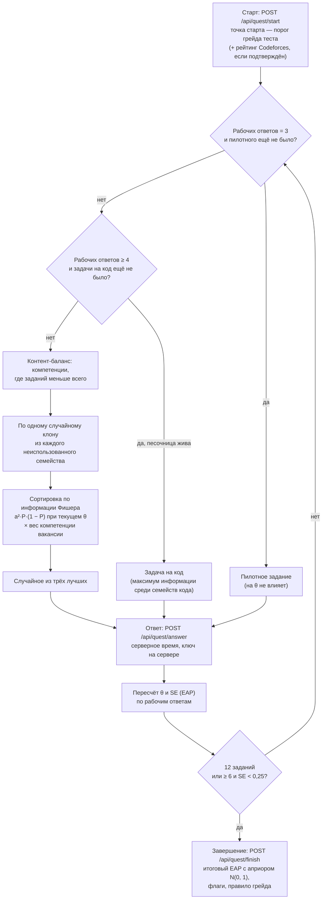
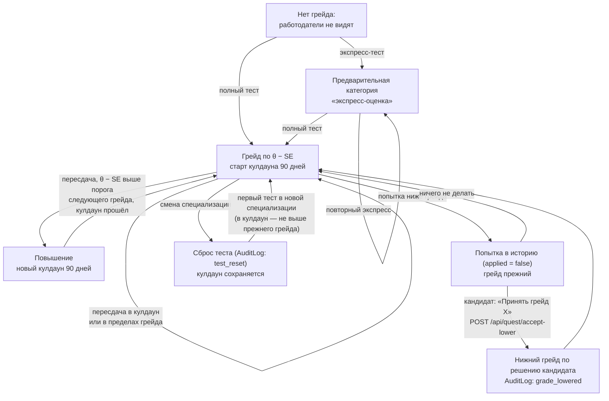

# 2. Механика тестирования кандидатов

Раздел описывает, как кандидат получает категорию «специализация · трек · грейд»: из чего состоит банк заданий, как адаптивный тест выбирает задания и оценивает уровень, по каким правилам присваивается, повышается и понижается грейд и почему тест устойчив к утечке заданий (ТЗ, разделы 2 и 3.4; критерий оценки № 2). Процедура валидации и все её результаты — в разделе 4. Здесь из неё приведены только цифры, которые нужны для аргументации. Как категория и θ участвуют в подборе — раздел 3.

## 2.1. Коротко

- **Тест обязателен и единственный задаёт категорию.** Заявленный грейд — только цель теста. Пока кандидат не прошёл тест, работодатели его не видят: ни в подборке, ни в поиске, ни в лотерее. Пригласить его нельзя, сам откликнуться он тоже не может (`matching.tested`, `matching.visible`).
- **Нет единого набора заданий.** Банк состоит из **параметрических семейств**. Семейство — шаблон сцены, который эксперт написал один раз. Из него детерминированно получаются 5–8 **клонов** с разными данными. У семейства 3–4 **варианта механики**: разные дефекты или разные причины одного симптома. Сложность (параметр b) задана на семейство, поэтому клоны сопоставимы по трудности, а утечка одного клона не раскрывает остальные.
- **Тест адаптивный.** Модель — 2PL IRT, оценка уровня — EAP, следующее задание выбирается по максимуму информации. Кандидаты одного уровня получают разные траектории: другие семейства, другие клоны, случайный выбор из трёх лучших. Всего в банке 1912 рабочих заданий 12 специализаций, в сессии — до 12.
- **Задачи на код исполняются в своей песочнице** (nsjail) на скрытых тестах. Тесты пересоздаются из сида клона и в базе не лежат.
- **Правильность не раскрывается.** Ни во время теста, ни после кандидат не узнаёт, какие ответы верны: ключ задания наружу не уходит. Набрать «базу ответов» по собственным попыткам нельзя.
- **Грейд присваивается осторожно и принудительно не понижается.** Правило: θ − SE ≥ порога грейда. Повышение возможно не чаще раза в 90 дней. Попытка ниже текущего грейда в профиль не идёт, нижний грейд кандидат может принять только сам.
- **Античит.** Таймер с серверным временем, флаги несогласованности ответов (`inconsistent`), слишком быстрых ответов (`too_fast`) и вставленного кода (`code_pasted`). LLM-читер в симуляции получает Junior (раздел 2.7).

Где это в коде:

| Что | Файл |
|---|---|
| IRT: вероятность ответа, EAP, выбор задания, остановка, флаги, правило грейда | `backend/app/services/irt.py` |
| Банк: семейства Backend, простые шаблоны, генерация клонов, засев, план теста под вакансию | `backend/app/services/items.py` |
| Сценарные семейства остальных специализаций | `backend/app/services/bank/*.py` |
| Задачи на код и скрытые тесты | `backend/app/services/code_items.py`, `backend/app/services/sandbox.py`, `sandbox/` |
| API теста: старт, ответ, завершение, история, принятие нижнего грейда, план под вакансию | `backend/app/routers/quest.py` |
| Пороги грейдов, кулдаун, справочник компетенций | `backend/app/catalog.py` |
| Сброс теста при смене специализации | `backend/app/routers/candidate.py`, функция `_reset_test` |
| Регулярные задания работодателей и автопроверка | `backend/app/routers/tasks.py`, `backend/app/services/autocheck.py` |

## 2.2. Путь кандидата

ТЗ требует обязательный путь: опрос по отрасли и специализации, выбор предполагаемого грейда, тест на заявленный грейд. Отрасль у платформы одна — ИТ; внутри неё справочник делит роли на восемь разработческих специализаций и четыре нетехнические (аналитика, управление, дизайн, администрирование и поддержка), поэтому «опрос по отрасли» сводится к выбору специализации и трека. В продукте путь выглядит так.

1. **Профиль (опрос).** На экране профиля кандидат выбирает специализацию из справочника `catalog.SPECS` (12 направлений, см. 2.3), трек (язык, стек или подроль из `catalog.TRACKS`) и заявленный грейд (`grade_claimed`: Intern, Junior, Middle, Senior или Lead). Там же указываются навыки, стаж и ожидания. Навыки можно заполнить вручную или распознать из PDF-резюме. Без согласия на обработку данных профиль не сохраняется.
2. **Выбор грейда теста.** На стартовом экране теста есть переключатель «На какой грейд проходите тест». По умолчанию выбран заявленный грейд, его можно сменить на любой другой (`target_grade` в `POST /api/quest/start`). Грейд теста определяет только **точку старта** адаптивного выбора и вердикт «подтверждён / ниже / выше заявленного». На итоговую оценку он не влияет: итог считается с нейтральным априором (2.4).
3. **Тест.** Кандидат выбирает полный тест или экспресс-тест. Задания идут сценами сюжета специализации, например «Смена дежурного» у Backend или «Миграция в облако» у DevOps / SRE (`items.STORY`). Сюжет можно выключить, задания при этом остаются теми же.
4. **Результат.** Кандидат получает категорию «специализация · трек · грейд», θ ± SE, профиль по шести компетенциям с сильными и слабыми сторонами, перцентиль в категории, подтверждённые тестом навыки, вердикт относительно заявленного грейда и дату, с которой возможно повышение (`GET /api/quest/result`). Кандидат видит все свои попытки (`GET /api/quest/history`): даты, режим, θ, SE, грейд и пометку, применена ли попытка.

### Полный и экспресс-тест

| | Полный тест (`mode: "full"`) | Экспресс-тест (`mode: "express"`) |
|---|---|---|
| Назначение | Присвоение и подтверждение грейда | Знакомство за 3–5 минут, например для жюри |
| Число заданий | От 6 до 12 (`irt.MIN_ITEMS`, `irt.MAX_ITEMS`), остановка по SE < 0,25 (`irt.SE_STOP`) | Ровно 5 (`irt.EXPRESS_ITEMS`), без остановки по SE |
| Типы заданий | Все: вопросы, разметка строки кода, ревью, одна задача на код | Только вопросы и разметка строки (`irt.EXPRESS_KINDS` = `choice`, `mark`) |
| Время на задание | Из банка: 240 с на вопрос, 300 с на разметку, 360 с на ревью, 900 с на задачу на код (`items.TIME_LIMIT`) | 60 с на любое задание (`quest.EXPRESS_TIME_LIMIT_S`) |
| Пилотное задание | Есть, если в банке специализации есть пилотные (2.4) | Нет |
| Точность | Средняя SE 0,32–0,33 (README «Результаты валидации») | SE ≈ 0,47; грейд выше Middle почти не присваивается (README) |
| Что даёт | Грейд, кулдаун повышения, подтверждённые тестом навыки | Только **предварительную категорию** с пометкой «экспресс-оценка» (`Candidate.grade_express`) |

Правила экспресс-теста (`quest.finish`):

- Он ставит грейд, только если у кандидата грейда ещё нет. Существующий грейд он не меняет ни вверх, ни вниз, в том числе свой прошлый экспресс-грейд: попытка уходит в историю с `applied = False` и пояснением.
- Кулдаун повышения он не запускает.
- Навыков он не подтверждает: по одному заданию на компетенцию этого делать нельзя, поэтому в карточке остаются только заявленные навыки.
- Полный тест после экспресса считается **первым присвоением**: результат применяется сразу, и с него начинается кулдаун.
- Работодатель видит кандидата с экспресс-оценкой с пометкой «экспресс-оценка». В подборе θ штрафуется на величину, пропорциональную SE, поэтому экспресс-кандидат стоит заметно ниже (раздел 3).

Экспресс-тест введён для знакомства с продуктом. ТЗ требует, чтобы категорию определял тест, поэтому экспресс даёт только предварительную, явно помеченную категорию. Его правило грейда то же (θ − SE ≥ порога), но при большой SE оно осторожнее. Самопроверка `python -m app.services.irt` следит, чтобы для каждой специализации экспресс завышал грейд не чаще полного теста (с допуском 3 п. п.).

## 2.3. Банк заданий

### Специализации и компетенции

Справочник специализаций составлен по общепринятым в ИТ ролям (ТЗ разрешает команде сделать это самостоятельно). В нём восемь разработческих направлений и четыре нетехнические ИТ-роли. У каждой специализации шесть компетенций (`catalog.COMPETENCIES`). Тест оценивает каждую из них отдельно, по ним же строится профиль кандидата.

| Специализация | Компетенции |
|---|---|
| Backend | Диагностика инцидентов, Базы данных и транзакции, Ревью кода, Проектирование API, Конкурентность, Алгоритмы |
| Frontend | Отладка UI, Производительность, Ревью кода, Архитектура клиента, Доступность, Алгоритмы |
| Mobile | Отладка, Жизненный цикл приложения, Ревью кода, Сеть и офлайн, Производительность, Алгоритмы |
| ML / DS | Постановка задачи, Валидация моделей, Дрейф данных, Feature engineering, MLOps, Алгоритмы |
| Data Eng / Analytics | SQL, Моделирование данных, Пайплайны, Качество данных, Визуализация, Алгоритмы |
| DevOps / SRE | Диагностика инцидентов, Сети, Kubernetes, CI/CD, Наблюдаемость, План отката |
| QA | Тест-дизайн, Приёмка релиза, Автотесты, API-тестирование, Баг-репорты, Регресс |
| Security | Веб-уязвимости, Ревью кода, Сети, Криптография, Реагирование, Реверс |
| Analysis (системный и бизнес-аналитик) | Выявление требований, Моделирование процессов, Интеграции и API, Данные и SQL, Спецификации, Анализ изменений |
| Management (project и product) | Планирование и сроки, Риски, Метрики продукта, Приоритизация, Стейкхолдеры, Процессы команды |
| Design (UX/UI и продуктовый) | Исследования, Юзабилити, Доступность, Дизайн-системы, Прототипирование, Метрики и эксперименты |
| SysAdmin / Support | Диагностика инцидентов, Сети, Учётные записи и доступ, Резервное копирование, Серверы и ОС, Работа с обращениями |

### Типы заданий

| Тип (`kind`) | Что делает кандидат | Как проверяется | Лимит времени |
|---|---|---|---|
| `choice` — вопрос с вариантами | Читает ситуацию и, как правило, панель с данными (логи, график, код), выбирает один из четырёх вариантов | Совпадение с ключом | 240 с |
| `mark` — разметка кода | Отмечает в листинге строку с дефектом | Номер строки входит в список допустимых | 300 с |
| `review` — ревью кода | Отмечает строку с дефектом и пишет комментарий | Номер строки; комментарий сохраняется, но на оценку пока не влияет | 360 с |
| `code` — задача на код | Пишет функцию на Python или TypeScript, может запускать её на открытых примерах | Исполнение в песочнице на 10–15 скрытых тестах, засчитано только при прохождении всех | 900 с |

Задания — это рабочие ситуации, а не определения из учебника. Сцена показывает панель данных, которую фронт рисует сам (`payload.panel`): ленту логов, график с метками или листинг кода. Кандидат ставит диагноз по этим данным, как на дежурстве или ревью. Например, в семействе `be_inc_env` выкладка застряла, а в логах в зависимости от варианта видно одно из трёх: `KeyError` по переменной окружения, `OOMKilled` или `ImagePullBackOff`. Кандидат должен назвать причину.

### Семейства, варианты и клоны

**Семейство** — функция-шаблон `render(rng)`, зарегистрированная декоратором `items.family` (или `items.simple` для простых вопросов). Семейство привязано к специализации, компетенции и типу задания и несёт экспертные параметры IRT: различающую способность a и сложность b.

**Вариант механики** (`items._variant`) — одна из 3–4 разных ситуаций внутри семейства: другой дефект, другая причина того же симптома, другая деталь условия. Клоны распределяются по вариантам по кругу (номер клона mod число вариантов). Правильные ответы других вариантов попадают в дистракторы клона (`items._options`). Поэтому ответ, запомненный по одному клону, на клоне другого варианта неверен, причём он прямо стоит среди вариантов и выглядит правдоподобно.

**Клон** — результат `render` с детерминированным сидом «семейство:номер клона» (`items.generate_bank`). Клоны различаются вариантом механики, подставленными данными (имена сервисов, версии, числа, время в логах, место дефекта в коде) и порядком вариантов ответа. Если клон совпал по содержанию с уже выпавшим, он перегенерируется с другим сидом. Число клонов на семейство: 8 у Backend (`items.CLONES`), 5 у остальных специализаций (`items.CLONES_DEFAULT`), 4 у пилотных семейств (`items.CLONES_PILOT`).

**Почему сложность клонов сопоставима.** Параметры клона наследуются от семейства с малым шумом: b — ±0,1, a — ±5 % (`generate_bank`: `b + uniform(−0,1, 0,1)`, `a × uniform(0,95, 1,05)`). Разброс b клонов внутри семейства в валидации — около 0,05 (README). Сопоставимость задаётся конструкцией: клоны одного семейства проверяют одно умение на одинаковом по объёму материале и отличаются данными и конкретным дефектом. В этом и состоит отличие от генерации нейросетью, у которой сложность каждого задания неизвестна. Честная оговорка: варианты механики по трудности не строго равны, и при проверке банка отмечено несколько семейств, где один вариант проще (`table.md`, строка «Варианты механики меняют сложность клона»). Разброс 0,05 заложен в генерацию, а не измерен на живых ответах. План — калибровать b отдельно по варианту вместе с общей калибровкой (2.11).

**Обновление банка.** Банк засевается при каждом старте API (`items.seed_items`, под advisory-блокировкой Postgres). Пустой банк засевается целиком. В засеянный добавляются новые семейства, а изменённые клоны обновляются на месте. id задания не меняется, потому что на него ссылаются ответы в истории.

### Состав банка

Подсчёт по `items.FAMILIES` и `items.generate_bank()` на текущем коде:

| Специализация | Рабочих семейств без задач на код (вопросы / разметка / ревью) | Семейств задач на код | Пилотных семейств | Клонов на семейство | Заданий в банке (с пилотными) |
|---|---|---|---|---|---|
| Backend | 29 (20 / 7 / 2) | 5 | 2 сценарных + 1 на код | 8 | 284 |
| Frontend | 28 (22 / 6 / 0) | 5 | 1 на код | 5 | 169 |
| Mobile | 28 (21 / 7 / 0) | 5 | 1 на код | 5 | 169 |
| ML / DS | 28 (21 / 7 / 0) | 5 | 1 на код | 5 | 169 |
| Data Eng / Analytics | 28 (23 / 5 / 0) | 5 | 1 на код | 5 | 169 |
| DevOps / SRE | 28 (22 / 6 / 0) | — | — | 5 | 140 |
| QA | 28 (23 / 5 / 0) | — | — | 5 | 140 |
| Security | 28 (19 / 9 / 0) | — | — | 5 | 140 |
| Analysis | 28 (19 / 9 / 0) | — | — | 5 | 140 |
| Management | 28 (23 / 5 / 0) | — | — | 5 | 140 |
| Design | 28 (21 / 7 / 0) | — | — | 5 | 140 |
| SysAdmin / Support | 28 (23 / 5 / 0) | — | — | 5 | 140 |
| **Итого** | | | | | **1940**, из них рабочих **1912** |

На каждую компетенцию приходится не меньше трёх рабочих семейств (тест `test_bank_size_per_competency`). Сложность b семейств разнесена от −1,8 до 2,9, так что у каждой компетенции есть простые, средние и сложные задания. Сложные семейства уровня Senior и Lead (b 2,4–2,9) есть в банках всех 12 специализаций (`bank/*.py`, у Backend часть — в `items.py`). Различающая способность a задана экспертно по типу задания:

| Тип семейства | a |
|---|---|
| Сценарные задания с логами, графиками или кодом (271 семейство) | 1,9–2,5 |
| Простые вопросы без панели (`items.simple`, по одному на компетенцию у специализаций кроме Backend, 66 семейств) | 1,7 |
| Задачи на код | 1,5–1,7 |
| Пилотные | 1,5 |

Сценарные задания с контекстом различают уровни лучше голых вопросов, поэтому a у них выше. У задач на код a занижено намеренно: LLM решает их почти всегда (2.7).

Качество клонов проверяют тесты банка (`backend/tests/test_bank.py`):

- генерация детерминирована, а клоны каждого семейства попарно различаются по содержанию;
- **утечка клона**: тот, кто запомнил ответ одного клона и выбирает на другом клоне самый похожий вариант (или строку кода), решает его не чаще чем в 35 % пар (`LEAK_MAX = 0,35`, проверка для каждого семейства). При одном варианте механики эта доля была бы 1,0, при трёх вариантах на пять клонов она около 0,2;
- правильный вариант не выдаёт себя длиной: он строго самый длинный не больше чем в 40 % клонов специализации и в 60 % клонов семейства;
- у каждой специализации есть панели с логами, графиками и кодом, а также задания-разметки, и не меньше половины заданий содержит панель;
- у всех клонов a ∈ [1,4; 2,7] и b ∈ [−2,5; 3,0], у каждого вопроса ровно четыре разных варианта, ключ корректен.

### Задачи на код

У пяти специализаций с компетенцией «Алгоритмы» (Backend, Frontend, Mobile, ML / DS, Data Eng / Analytics; `code_items.SPECS`) в полный тест входит одна задача на код. Семейства и параметры (`code_items.py`, README «Песочница»):

| Семейство | Что проверяет | Чем отличаются клоны | a | b |
|---|---|---|---|---|
| `code_hash_count` | подсчёт частот словарём | самое частое (при равенстве — меньшее) / первый уникальный / сколько значений встречается ≥ k раз | 1,5 | −1,4 |
| `code_prefix_sums` | префиксные суммы | отрезок [l, r] с 0 / полуинтервал [l, r) / [l, r] с 1 | 1,6 | −1,0 |
| `code_brackets` | стек | правильность / глубина вложенности; набор скобок; пропуск прочих символов | 1,6 | −0,6 |
| `code_binary_search` | бинарный поиск по запросам | < x / ≤ x / первый ≥ x / в отрезке [lo, hi] | 1,7 | 0,0 |
| `code_two_pointers` | два указателя | пары с суммой ≤ t / < t / ≥ t | 1,7 | 0,6 |
| `code_rotated_search` (пилотное) | поиск в циклически сдвинутом массиве | индекс или −1 / есть ли | 1,5 | 1,2 |

У каждого клона своё имя функции, своя деталь условия и свои данные. Кандидат видит условие, сигнатуры на Python и TypeScript и 1–2 открытых примера. Скрытых тестов 10–15: примеры, крайние случаи, случайные и один большой на 10⁵ элементов, на котором решение за O(n·q) не укладывается в лимит. Тесты **не хранятся в базе**: при проверке они пересоздаются из сида клона (`code_items.hidden_tests`), ожидаемые ответы считает эталонное решение на Python. Наружу не уходят ни сид, ни тесты, ни эталон. «Запустить на примерах» (`POST /api/quest/run`) прогоняет только открытые примеры: не больше 20 удачных запусков на задачу, не чаще раза в 3 с, на оценку это не влияет. Засчитано, только если пройдены все скрытые тесты, что для 2PL даёт бинарный исход, как у остальных заданий. Устройство и модель безопасности песочницы — README «Песочница» и раздел 9.

Если песочница недоступна, задание помечается `void` и не засчитывается ни в плюс, ни в минус. Если песочница перегружена, кандидат получает 503 «отправьте ещё раз», а время ответа фиксируется по первой отправке. Если песочница отклонила само решение (размер, недопустимые символы), ответ считается неверным, а не `void`. Так нарочно испорченным решением задачу не пропустить. Без настроенной песочницы (`SANDBOX_URL`, `SANDBOX_TOKEN`) задачи на код в тест не выдаются.

## 2.4. Адаптивный тест на IRT

### Модель

Используется **двухпараметрическая логистическая модель IRT (2PL)**. IRT (Item Response Theory, теория ответа на задание) описывает вероятность верного ответа через уровень кандидата θ и параметры задания (`irt.prob`):

P(верно | θ) = 1 / (1 + e^(−a·(θ − b)))

- **θ** — уровень кандидата на общей шкале специализации: 0 — средний уровень, единица шкалы — одно стандартное отклонение;
- **b** — сложность задания: θ, при котором вероятность верного ответа равна 50 %;
- **a** — различающая способность: насколько резко растёт вероятность верного ответа при переходе θ через b. Чем больше a, тем лучше задание отделяет кандидатов ниже b от кандидатов выше b.

Уровень оценивается методом **EAP** (expected a posteriori, `irt.eap`): апостериорное распределение θ считается на сетке из 161 точки от −4 до 4 с нормальным априором, оценка θ — среднее этого распределения, **SE** (стандартная ошибка) — его стандартное отклонение. SE показывает точность оценки: чем больше заданий и чем лучше они нацелены на уровень кандидата, тем SE меньше.

### Цикл сессии

**Старт.** Адаптивный выбор начинается у порога грейда, на который кандидат проходит тест (`irt.start_prior`, `irt.grade_anchor`). Там информация теста максимальна именно для вопроса «подтвердил грейд или нет». У Intern порога нет, поэтому старт берётся на 0,7 ниже порога Junior. Если у кандидата есть подтверждённый аккаунт Codeforces, старт — среднее порога и оценки по рейтингу (`irt.cf_prior`: 1500 → 0, ±600 → ±1, с обрезкой и половинным весом). Точка старта только ускоряет выбор заданий. **Итоговая оценка считается с нейтральным априором N(0, 1)** (`quest._estimate`), поэтому ни заявленный грейд, ни рейтинг Codeforces, ни достижения ФСП на грейд не влияют. Это закреплено тестом `test_cf_and_focus_do_not_change_grade`: одинаковые ответы дают одинаковые θ, грейд и компетенции, хотя у одного из кандидатов рейтинг CF 2600 и фокус вакансии.

**Выбор задания** (`irt.next_item`):

1. **Контент-баланс.** Сначала каждая из шести компетенций получает хотя бы одно задание, дальше допускается перекос не больше чем на одно задание. Без этого тест мог бы целиком уйти в одну компетенцию с самыми информативными заданиями.
2. **Одно семейство — один раз за сессию.** Два клона одного семейства в сессии не встречаются.
3. **Случайный клон семейства**: из каждого подходящего семейства берётся один случайный клон.
4. **Максимум информации Фишера.** Информация I(θ) = a²·P·(1 − P) показывает, насколько ответ на задание уточнит оценку при текущем θ. Она максимальна, когда b близко к θ.
5. **Случайное из трёх лучших** (`irt.TOP_K = 3`, приём randomesque). Задание выбирается случайно среди трёх лучших семейств, а не строго лучшее. Это ограничивает засвечивание самых информативных заданий: иначе кандидаты одного уровня получали бы одни и те же семейства.

**Задача на код** выдаётся отдельным слотом после четырёх рабочих заданий (`irt.CODE_AT = 4`), когда θ уже грубо оценён. Она одна за сессию и выбирается по тому же максимуму информации среди семейств кода (`irt.choose`).

**Пилотное задание** выдаётся после трёх рабочих (`quest.PILOT_AT = 3`), одно за сессию и только в полном тесте. На θ и грейд оно не влияет: ответ сохраняется для будущей калибровки параметров новых семейств. Пилотная задача на код занимает и слот задачи на код этой сессии. Сейчас пилотные семейства есть у Backend (`be_pilot_stampede`, `be_pilot_percentiles`) и задача на код `code_rotated_search` у пяти специализаций с «Алгоритмами». У семи остальных специализаций пилотных заданий нет (`table.md`, план — добавить по образцу Backend).

**Остановка** (`irt.should_stop`): 12 рабочих заданий, или не меньше 6 при SE < 0,25. На текущем банке сессия обычно идёт все 12 заданий со средней SE 0,32–0,33 (README). На главной странице длительность полного теста обозначена как 40–60 минут.

**Оценка по компетенциям** (`irt.competency_estimates`) — тот же EAP, но только по заданиям одной компетенции и с априором N(общий θ; 0,7). На двух-трёх заданиях оценка компетенции стягивается к общему θ и не скачет. Компетенции дают профиль сильных и слабых сторон. Навык считается подтверждённым тестом, если θ соответствующей компетенции не ниже max(порог грейда − 0,5; порог Junior) (`quest._skills`, соответствие «компетенция → навыки» — `quest.COMP_SKILLS`, `quest.TRACK_SKILLS`).

### Что кандидат видит во время теста

- Ответ сохраняется сразу. Правильность и текущий θ до конца теста не показываются. Ключ задания (`payload.key`) наружу не уходит: ни в задании, ни в результате, ни в истории (`quest._public`; тесты `_no_leak` в `test_quest.py`).
- Незаконченную сессию нельзя перезапустить ради новых заданий. `POST /api/quest/start` при незаконченной сессии возвращает её же с текущим заданием (у кандидата не больше одной активной сессии, уникальный частичный индекс `uq_quest_active`).
- Время считается на сервере (`served_at` при выдаче, `server_ms` при ответе), клиентский таймер только показывает остаток. На сеть даётся запас 30 с (`quest.TIMEOUT_GRACE_S`). Ответ, пришедший позже лимита плюс 30 с, засчитывается как неверный.

## 2.5. Присвоение и изменение грейда

### Пороги

Грейд присваивается по правилу **θ − SE ≥ порога** (`catalog.grade_from_theta`): берётся старший грейд, порог которого не выше нижней границы оценки θ − SE.

| Грейд | Порог θ − SE (`catalog.GRADE_TH`) |
|---|---|
| Intern | нет порога (всё, что ниже Junior) |
| Junior | −0,5 |
| Middle | 0,5 |
| Senior | 1,5 |
| Lead | 2,3 |

Пороги заданы командой экспертно на шкале θ. Синтетика использует те же полосы грейдов: истинный θ Middle лежит в [0,5; 1,5), Senior — в [1,5; 2,3) и так далее (`seed/generate.py`, `THETA_BAND`). Вычитание SE — **запас против дрожания и завышения**. Грейд присваивается, только если тест уверен, что уровень не ниже порога. Цена этого запаса — систематическая ошибка вниз: в симуляции грейд выше истинного получают не больше 1,5 % в строке матрицы ошибок, но часть Senior и Lead получает грейд ниже (2.8). Это осознанный выбор. Завышенный грейд обманывает работодателя и подрывает доверие к категории. Заниженный кандидат может поправить пересдачей, когда пройдёт кулдаун.

### Правила

| Ситуация | Что происходит | Где |
|---|---|---|
| Первое присвоение (грейда нет или был только экспресс) | Применяется результат полного теста: θ − SE ≥ порога. С этого момента идёт кулдаун 90 дней | `quest.finish`, `irt.decide_grade` |
| Пересдача после кулдауна, результат выше | Грейд повышается, если θ − SE выше порога нового грейда. Кулдаун 90 дней запускается заново | `irt.decide_grade` |
| Пересдача после кулдауна, результат в том же грейде | Обновляются θ, SE и компетенции, грейд прежний | `quest.finish` |
| Пересдача во время кулдауна | Грейд не повышается. Обновляется только θ, и только если он ниже прежнего: так нельзя пересдавать ради лучшего θ внутри грейда | `quest.finish` |
| Измеренный грейд ниже текущего | Попытка **в профиль не идёт** (`applied = False`): грейд, θ и место в выдаче прежние. Кандидат видит результат попытки и предложение «Принять грейд X» | `quest.finish`, `quest._lower_offer` |
| Кандидат сам принимает нижний грейд | `POST /api/quest/accept-lower` применяет θ, SE и компетенции этой попытки. Кулдаун не сдвигается, в `AuditLog` пишется `grade_lowered` | `quest.accept_lower` |
| Экспресс-тест | Предварительная категория, только если грейда нет. Кулдаун не запускает, существующий грейд не меняет | `quest.finish` |
| Смена специализации в профиле | Тест сбрасывается: грейд, θ, компетенции, подтверждённые навыки, экспресс-пометка и подтверждения работодателей. Незаконченная попытка удаляется. До нового теста кандидат работодателям не виден. В `AuditLog` пишется `test_reset` без персональных данных | `candidate._reset_test` |
| Первый тест после смены специализации, пока идёт кулдаун | Применяется, но грейд не выше того, что был до смены (`quest.reset_cap`), кулдаун не продлевается | `quest.finish`, `quest.reset_cap` |

### Обоснование

- **Повышение — новой попыткой, а не автоматическим прыжком.** Постановщики в ответах на вопросы предпочли, чтобы повышение шло отдельным тестом. Так и сделано: грейд повышается только по результату новой попытки, которую кандидат начал сам и для которой может выбрать грейд теста выше текущего. Прыжок через грейд не запрещён: если θ − SE выше порога Senior, а текущий грейд Junior, кандидат получит Senior. Каждое повышение требует запаса SE над порогом нового грейда.
- **Интервал 90 дней** (`catalog.UPGRADE_COOLDOWN_DAYS`) — пример из ТЗ («не чаще одного раза в три месяца»). Кулдаун не даёт пересдавать тест до удачной случайности: при SE около 0,3 серия попыток рано или поздно дала бы грейд выше истинного. Кулдаун запускается только полным тестом (первым присвоением или фактическим повышением), экспресс-тест его не запускает.
- **Неудача не сжигает попытку и не наказывает.** ТЗ требует, чтобы грейд принудительно не понижался, поэтому слабая попытка (усталость, плохой день) ничего не меняет в профиле. Понизиться можно только добровольно, например чтобы попасть в категорию, где больше подходящих приглашений. В интерфейсе для этого есть кнопка «Принять грейд X» с подтверждением.
- **Тест на грейд ниже** (ТЗ: «может пройти тест на уровень ниже»). Кандидат выбирает грейд теста ниже текущего. Адаптивный выбор стартует с этого уровня, а результат, если он ниже текущего грейда, становится предложением «Принять грейд X».
- **Сброс при смене специализации.** θ разных специализаций измерен на разных банках и разных компетенциях, поэтому перенос результата был бы некорректен. Кулдаун при сбросе сохраняется, а первый тест в новой специализации ограничен прежним грейдом. Иначе сменой специализации туда и обратно можно было бы обойти кулдаун. Остаточная лазейка — пересдавать θ внутри того же грейда через двойную смену специализации. Она описана в `table.md` как осознанное упрощение: грейд защищён потолком, а каждый круг стоит двух сбросов и невидимости до нового теста.

## 2.6. Устойчивость к распространению заданий

### Почему не единый набор и не генерация нейросетью

ТЗ отвергает оба крайних подхода. Единый набор быстро разойдётся по рынку вместе с ответами. Генерация уникальных заданий нейросетью под каждого кандидата не гарантирует сопоставимой сложности и объективности. Наш подход сочетает сильные стороны обоих.

| Свойство | Единый набор | LLM под каждого | Параметрические семейства + адаптивный IRT (наш) |
|---|---|---|---|
| Сопоставимая сложность между кандидатами | да | нет: сложность каждого задания неизвестна | да: b и a заданы на семейство, клоны отличаются данными и вариантом механики с разбросом b ±0,1 |
| Объективная шкала результата | да | нет | да: θ на общей шкале 2PL, независимо от того, какие задания выпали |
| Устойчивость к утечке | нет | да | да: 1912 рабочих заданий, 3–4 варианта механики в семействе, адаптивные траектории, ключи не раскрываются |
| Проверка корректности заданий до выдачи | да | нет: ошибку в задании никто не видел | да: все клоны генерируются заранее и проверяются тестами банка, эталоны задач на код прогоняются в настоящей песочнице |
| Зависимость от внешнего сервиса | нет | да | нет: банк генерируется детерминированно, без LLM |

Аналитическая работа (сюжет, механика дефекта, правильный ответ и правдоподобные ошибки) выполняется один раз, при написании шаблона. Вариативность затем даёт код. Поэтому на выходе получаются много разных заданий, но известного качества и сложности.

### Модель угроз и защита

| Угроза | Защита | Что остаётся |
|---|---|---|
| Утечка конкретного задания с ответом (скриншот, пересказ) | Клоны семейства различаются вариантом механики и данными. Правильный ответ утёкшего клона на другом клоне стоит среди дистракторов. Запомненный ответ решает другой клон не чаще чем в 35 % пар (проверка для каждого семейства, `test_clone_answer_does_not_leak`) | Если утекли все клоны семейства с ответами, это семейство скомпрометировано. Лекарство — пополнение банка новыми семействами и вариантами (засев идёт на старте без потери истории) |
| Сбор «базы ответов» сообществом | Кандидат не узнаёт правильность своих ответов ни во время теста, ни после: ключи наружу не уходят, в результате только θ, компетенции и грейд. Чтобы собрать базу, нужно восстанавливать ключи по косвенным признакам на 1912 заданиях | Эксперт, знающий ответ, может опубликовать решения. Это то же, что научить кандидата, и защищает от этого объём и вариативность банка, а не секретность |
| Одинаковый тест у кандидатов одного уровня | Адаптивный выбор с контент-балансом, случайный клон семейства, случайный выбор из трёх лучших семейств. Траектории расходятся с первых заданий | По природе адаптивного теста семейства, самые информативные для типичного уровня, выпадают чаще остальных. Контроль экспозиции по счётчикам выдачи — следующий шаг |
| Пересдача до удачи | Кулдаун 90 дней на повышение, правило θ − SE. В кулдаун пересдача может только понизить θ внутри грейда | Обход сменой специализации ограничен потолком прежнего грейда (2.5) |
| Перезапуск сессии ради других заданий | Незаконченная сессия возвращается та же, с тем же текущим заданием. Активная сессия у кандидата одна | — |
| Подсказчик или LLM рядом с кандидатом | Таймер с серверным временем. Задания на диагностику по логам, графикам и коду, где LLM помогает мало. Флаги `inconsistent`, `too_fast`, `code_pasted` (ниже). Умеренный вес задач на код | Полностью закрывает только прокторинг, его в MVP нет (`table.md`) |
| Подбор скрытых тестов задачи на код | Скрытые тесты не хранятся и не передаются, «на примерах» — только открытые примеры, до 20 запусков | — |
| Обход проверки кода сбоем песочницы | `void` только при недоступности песочницы. Решение, которое песочница отклонила, — неверный ответ. Журнал nsjail ведётся отдельно от вывода решения, поэтому подделать «сбой» нельзя | — |

### Флаги для разбора

После завершения теста `irt.suspicion_flags` и `quest.finish` проставляют флаги:

- **`inconsistent`** — несогласованный профиль ответов: сложные задания решены, а простые нет. Критерий — статистика person-fit l_z (Drasgow и соавт., 1985), стандартизованное логарифмическое правдоподобие ответов при оценённом θ. Флаг ставится при l_z < −1,96, считается от шести ответов. Это типичный след подсказок на сложных заданиях.
- **`too_fast`** — не меньше двух ответов быстрее 15 % лимита времени задания (по серверному времени).
- **`code_pasted`** — верное решение задачи на код, больше половины которого вставлено из буфера. Счётчик вставок ведёт клиент, поэтому это только сигнал, его можно обойти (`table.md`).

Любой из этих флагов, а также грейд Senior и выше без пройденного «разбора решения» ставит флаг `review_required`. Флаги сохраняются в попытке (`QuestSession.flags`) и возвращаются в результате теста. **На грейд они не влияют**: флаг — повод для разбора, а не наказание, потому что ложные срабатывания неизбежны. Сам «разбор решения» (короткое интервью по решённым заданиям) пока не реализован. Это помечено в коде как осознанное упрощение (`# ponytail` в `quest.finish`).

## 2.7. Симуляция LLM-читера

Чтобы проверить, насколько тест устойчив к кандидату, который отвечает с помощью LLM, валидация (`validation.cheater`) прогоняет адаптивные сессии на банке Backend с моделью ответов «читера». Вероятности заданы вручную, без прогона настоящей LLM (`validation._cheater_p`):

- вопрос с вариантами без контекста — 0,9 независимо от сложности;
- ревью и разметка кода с тонкими дефектами — как у человека с θ = −0,5;
- задачи с контекстом (логи, графики) — как у человека с θ = −0,3;
- задачи на код со стандартными алгоритмами — 0,95 независимо от сложности.

Результат (README «Результаты валидации», 200 сессий на строку):

| Тип заданий | Грейд читера |
|---|---|
| Вопросы с вариантами | Senior |
| Ревью кода | Intern |
| Задачи с контекстом | Intern |
| Задачи на код (песочница) | Junior |
| Смешанный адаптивный тест | Junior |

Выводы:

- Тест только из вопросов с вариантами LLM прошёл бы на Senior. Именно поэтому банк строится на сценариях с логами, графиками и кодом, где нужно ставить диагноз по данным, а не вспоминать определение.
- Задачи на код LLM решает почти всегда. Тест только из них дал бы Junior с θ ≈ +0,95, а выше его держат лишь пять семейств и большая SE. Поэтому задача на код одна из 6–12 заданий, а её a (1,5–1,7) ниже, чем у сценарных заданий.
- Смешанный адаптивный тест даёт читеру Junior.
- Проверка несогласованности ловит 30 % читеров при 2 % ложных тревог у честных кандидатов. Без задач на код на той же синтетике было 45 % и 0 %: решённая читером задача на код совместима по сложности со средним θ и вытесняет задание, на котором профиль ответов расходится сильнее. Это компенсируют флаги `too_fast` и `code_pasted` (`table.md`).

Ограничение: модель читера задана руками. Следующий шаг — заменить её долями верных ответов реальной LLM на банке.

## 2.8. Качество теста

Процедура валидации, её допущения и полные таблицы — в разделе 4. Ниже — цифры, которые относятся к критерию № 2 (README «Результаты валидации», один прогон, seed 42).

**Согласованность при пересдаче** (симуляция на банке Backend, 200 кандидатов, пересдача на других клонах и по другой траектории):

- грейд в профиле после пересдачи не меняется у 88,5 % кандидатов (с учётом правил: повышение по θ − SE, без принудительного понижения);
- сырая оценка грейда по θ − SE совпадает у 76 %;
- корреляция истинного и оценённого θ — 0,95.

**Разделяющая сила** (200 симулированных кандидатов на грейд, банки всех 12 специализаций по кругу, сессия как в продукте):

- точное совпадение грейда — 57,7 %, в пределах ±1 грейда — 99 %, 96,9 % ошибок приходится на соседний грейд, κ с квадратичными весами — 0,877;
- если считать грейд по самой оценке θ, без запаса SE, точность 75 %. Разница с 57,7 % — цена осторожного правила θ − SE: ошибки почти только вниз, грейд выше истинного — не больше 1,5 % в строке;
- AUC оценки θ между соседними грейдами: Intern|Junior 0,966, Junior|Middle 0,948, Middle|Senior 0,919, Senior|Lead 0,914. AUC — вероятность того, что случайный кандидат старшего грейда получит θ выше случайного кандидата младшего;
- по специализациям: точно 49–66 %, ±1 грейд — 97,5–100 %, SE 0,32–0,33.

Senior и Lead чаще получают грейд ниже истинного (точно 42,5 % и 29,5 %). При SE около 0,3 правилу θ − SE нужен запас над порогом. Это осознанная защита от завышения. Варианты на обсуждение с постановщиками перечислены в `table.md`: θ − 0,5·SE для повышения до Senior и выше или удлинение теста.

**Дискриминативность заданий** (1912 рабочих заданий):

- параметр a: медиана 2,19 (Q1–Q3 1,84–2,29), у всех заданий a ≥ 1,44, что по шкале Baker соответствует «высокой» различающей способности;
- точечно-бисериальная корреляция ответа с суммой остальных (r_pb, item-rest) на калибровочной выборке из 500 симулированных кандидатов: медиана 0,48, слабых заданий (r < 0,2) 1,9 %.

Честная оговорка из README: a и b заданы при составлении банка и не откалиброваны на живых ответах, а r_pb считается на ответах, смоделированных по той же 2PL. Поэтому эти цифры проверяют согласованность банка и механики, но не его калибровку на реальных людях. Экспертной разметки ФСП пока нет.

Внешний сигнал корректности грейда заложен в продукт. После принятого приглашения работодатель может отметить «грейд подтвердился», «не подтвердился» или «наняли» (`POST /api/employer/invites/{id}/feedback`, `catalog.FEEDBACK`). Подтверждения увеличивают счётчик `employer_confirmed` в карточке кандидата. Отметка «не подтвердился» пока только сохраняется, очередь перепроверки не реализована.

## 2.9. Как из описания вакансии формируется тест

ТЗ просит «подготовить несколько описаний вакансий и на их основе показать, как система формирует задания и тесты». Банк заданий общий для специализации, а категория кандидата одна для всех работодателей. Поэтому вакансия не создаёт новых заданий. Она определяет, **какие компетенции, какой диапазон сложности и какие семейства банка** тест проверит под эту потребность. Так результат остаётся сопоставимым между кандидатами, а тест — под вакансию.

**Как это работает** (`items.plan_for_need`):

1. Текст вакансии разбирается в структуру: специализация, трек, грейд, обязательные и желательные навыки (`parsing.parse_need`; правила и справочник навыков, по желанию LLM, см. раздел 10).
2. Навыки переводятся в веса компетенций по таблице `items.SKILL_COMP`. Например, PostgreSQL относится к «Базам данных и транзакциям» и «SQL», Kafka — к «Конкурентности» и «Пайплайнам». Обязательный навык добавляет к весу 0,25, желательный — 0,1, потолок веса — 1,5.
3. Диапазон сложности — порог грейда вакансии ± 1 по шкале b.
4. Подбираются семейства банка этой специализации в диапазоне сложности. Они упорядочиваются по весу компетенции и близости b к порогу, для каждого показывается пример условия (отдельный сид, такого клона в банке нет).
5. Оцениваются число заданий и время.

**Где это видно.** Работодатель на экране новой потребности получает панель «Как система проверит кандидатов» (`POST /api/quest/plan` по сохранённой потребности или по структуре, поправленной на экране). При `DEMO=1` есть публичный предпросмотр по тексту без входа и без LLM (`POST /api/quest/plan/preview`).

**Как это влияет на тест кандидата.** Если кандидат начинает тест из приглашения (`invitation_id` в `POST /api/quest/start`), веса компетенций вакансии сохраняются в сессии (`QuestSession.focus`). Они умножают информацию задания при выборе (2.4), поэтому тест чаще берёт задания по компетенциям вакансии. **На оценку и грейд фокус не влияет**: θ считается по всем ответам одинаково, грейд — по тем же порогам (тест `test_cf_and_focus_do_not_change_grade`).

**Пример** — результат `plan_for_need` на текущем коде (разбор правилами, песочница включена). Вакансия: «Ищем backend-разработчика уровня Middle на Python в команду платежей. Обязательно: PostgreSQL, Kafka, Docker. Желательно Kubernetes.»

- Разбор: Backend · Python · Middle; обязательные — Python, PostgreSQL, Kafka, Docker; желательные — Kubernetes.
- Веса компетенций: Диагностика инцидентов 1,35 (Docker, Kubernetes); Базы данных и транзакции 1,25 (PostgreSQL); Ревью кода 1,25 (Python); Конкурентность 1,25 (Kafka); Проектирование API 1,0; Алгоритмы 1,0.
- Диапазон сложности b: от −0,5 до 1,5 (порог Middle 0,5 ± 1).
- Первые семейства плана: `be_inc_rollback` и `be_inc_pool` (диагностика), `be_db_lost_update` (разметка, БД), `be_cc_race` (разметка, конкурентность), `be_rv_mutable_default` и `be_rv_double_charge` (ревью кода), `be_db_migration`, `be_cc_gather`; всего 14 семейств.
- Заданий в тесте — 12, оценка времени в плане — 48 минут.

Для вакансии «Нужен senior DevOps / SRE: Kubernetes, Terraform, Prometheus, Linux. Будет плюсом Kafka.» план другой. Веса: Диагностика инцидентов и План отката по 1,5, остальные компетенции по 1,25. Диапазон b — от 0,5 до 2,5 (порог Senior 1,5 ± 1). Семейства начинаются с `ops_rb_replace` (план отката) и `ops_inc_throttle` (диагностика). Время — около 37 минут. Синтетика содержит 250 потребностей разных специализаций (`seed/generate.py`), и для любой из них план строится так же.

## 2.10. Регулярные короткие задания от работодателей

ТЗ (п. 2.1) предлагает периодически давать кандидату короткую задачу от работодателя, чтобы профиль оставался актуальным. Реализация — `backend/app/routers/tasks.py`.

- **Кто создаёт.** Работодатель (`POST /api/tasks`) указывает название, текст, специализацию, компетенцию (по желанию), формат («решить» или «предложить подход»), ориентировочное время и тип ответа. Задание может быть публичным, тогда оно лежит на витрине для всех кандидатов специализации. Непубличное задание привязано к потребности, и его видят только кандидаты с действующим приглашением по этой потребности. Кроме того, задание можно приложить к приглашению вместо первого созвона.
- **Как доходит до кандидата.** Без механик давления: ни пушей, ни серий — это осознанное отступление от формулировки ТЗ «система периодически предлагает»: рассылки заданий нет. Задание лежит на витрине (`GET /api/tasks/showcase`, экран `/candidate/tasks`), куда кандидат заходит сам, или приходит вместе с конкретным приглашением (постановщики в ответах подтвердили: «адресно»). Решать задания можно только после теста, потому что работодатель видит решение вместе с категорией. Попытка на задание одна.
- **Автопроверка** (`backend/app/services/autocheck.py`). Если у задания есть эталон, система проверяет ответ сама. Поддерживаются типы: текст (с нормализацией регистра, «ё», пробелов и пунктуации по краям или посимвольно), число с допуском, один вариант, набор вариантов, регулярное выражение (с таймаутом и ограничением сложности шаблона против ReDoS). Эталон хранится только на сервере, кандидат видит лишь «совпало / не совпало». Открытый ответ (`open`) оценивает работодатель по шкале «сильное решение / нормально / слабо». Он же может переоценить автопроверку, и его оценка главнее.
- **Влияние на профиль.** Последнее оценённое решение становится **свежим сигналом** в карточке кандидата у всех работодателей: «решил задачу N дней назад, оценка …» (`tasks.task_signal`). Неверный автоответ в сигнал не идёт: одна неудачная попытка не перекрывает прежнюю оценку, её видит только компания-автор. **На грейд и место в выдаче сигнал не влияет.** Грейд задаёт только стандартизированный тест, а задания работодателей не калиброваны и несопоставимы между компаниями.
- **Ограничения** (`table.md`): эталон можно перебирать новыми аккаунтами (попытка одна на аккаунт), план — ограничение по почте или ФСП ID и ротация вариантов. Задания с исполнением кода по тестам работодателя — следующий шаг: песочница для этого уже есть.

## 2.11. Ограничения и план развития

| Ограничение | Почему так в MVP | План |
|---|---|---|
| Параметры a и b всех семейств заданы экспертно и не откалиброваны на живых ответах | Живых кандидатов на хакатоне нет, эталонной разметки нет (ТЗ) | Пересчёт a и b методом максимального маргинального правдоподобия (MML/EM), когда наберётся около 300 ответов на семейство. Новые семейства сначала идут пилотными: ответы на них собираются без влияния на грейд (`table.md`) |
| Варианты механики внутри семейства могут различаться по сложности | b задан на семейство | Калибровать b по варианту (номер варианта = номер клона mod число вариантов) |
| Пилотные задания есть не у всех специализаций | Пилотные семейства пока написаны только для Backend и задач на код | Добавить пилотные семейства остальным специализациям по образцу `be_pilot_*` |
| Цифры качества получены на синтетике и по той же 2PL, на которой построен тест | Внешних данных нет | Валидация на живых ответах и сверка с экспертной оценкой ФСП; в симуляции разделяющей силы — доля завышенных заявок грейда, как в синтетике (раздел 4) |
| Модель LLM-читера задана вручную | Прогон реальной LLM по банку не делался | Заменить долями верных ответов реальной модели на банке |
| Комментарий к ревью кода не оценивается | Автоматическая оценка свободного текста ненадёжна | Оценка комментария работодателем или LLM с проверкой по рубрике |
| «Разбор решения» для Senior+ и флагов — только флаг `review_required` | Отдельный сервис интервью не входил в MVP | Асинхронный разбор: 3–4 вопроса по решённым заданиям |
| Нет прокторинга (камера, экран) | За рамками MVP | Прокторинг для подтверждения Senior и Lead |
| Senior и Lead присваиваются осторожно (точно 42,5 % и 29,5 %) | Правило θ − SE защищает от завышения | Обсудить с постановщиками θ − 0,5·SE для повышения до Senior+ или 14 заданий у кандидатов, близких к порогу |
| Одна категория на кандидата | Постановщики: для MVP достаточно одной | Отдельный тест и свой кулдаун на каждую категорию |
| Контроль экспозиции заданий только случайным выбором из трёх лучших | Достаточно для объёма MVP | Счётчики выдачи и ограничение экспозиции популярных семейств (Sympson–Hetter), ротация семейств |
