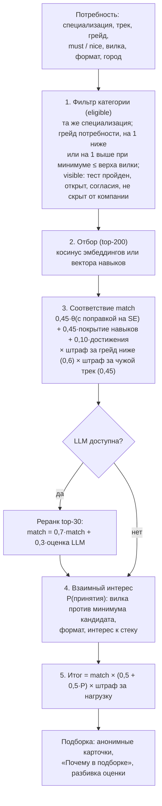
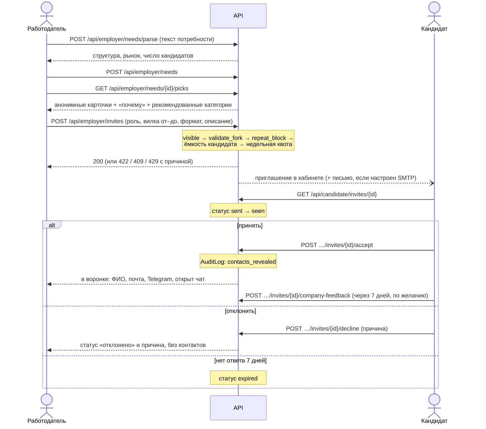
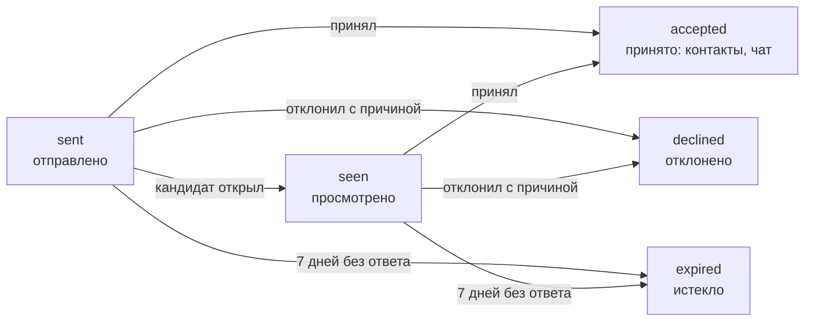

# 3. Механика подбора и логика категоризации

Раздел описывает, как кандидат попадает в категорию, как работодатель получает ранжированную подборку и как происходит выход на контакт. Механика тестирования, которая задаёт грейд, описана в разделе 2, процедура валидации и её результаты — в разделе 4.

Идея продукта — обратный найм. Кандидат не ищет вакансии и не пишет сопроводительных писем. Он один раз проходит тест и попадает в категорию. Работодатель описывает потребность, получает анонимную подборку с объяснением оценки и сам отправляет конкретному человеку приглашение-оффер. Вилка зарплаты в приглашении обязательна. Контакты кандидата работодатель видит только после того, как кандидат принял приглашение.

Термины:

- **θ (тета)** — оценка уровня кандидата по шкале IRT (Item Response Theory, модель «ответ зависит от уровня человека и сложности задания»). Ноль — средний уровень популяции.
- **SE** — стандартная ошибка оценки θ. Чем меньше SE, тем точнее измерение.
- **Потребность** — описание того, кого ищет работодатель: специализация, трек, грейд, обязательные и желательные навыки, вилка, формат работы, город. Вакансией потребность не является и кандидатам не публикуется.
- **Приглашение** — адресный оффер конкретному кандидату с описанием роли, вилкой «от–до», форматом и способом связи с компанией.

## 3.1. Категория кандидата

### Справочник

Категория — связка «специализация · трек · грейд», например «Backend · Python · Middle». Справочник лежит в `backend/app/catalog.py`.

| Измерение | Значения | Сколько |
|---|---|---|
| Специализация (`SPECS`) | Backend, Frontend, Mobile, ML / DS, Data Eng / Analytics, DevOps / SRE, QA, Security, Analysis, Management, Design, SysAdmin / Support | 12: восемь разработческих и четыре нетехнические ИТ-роли |
| Трек (`TRACKS`) — стек или подроль внутри специализации | Backend: Python, Go, Java / Kotlin, Node.js, C# / .NET; Frontend: React, Vue, Angular; Mobile: iOS, Android, Flutter; ML / DS: Classic ML, CV, NLP / LLM; Data Eng / Analytics: Data Engineering, BI / Analytics; DevOps / SRE: Kubernetes, Cloud; QA: Manual, Automation; Security: AppSec, Pentest; Analysis: System, Business; Management: Project, Product; Design: UX/UI, Product Design; SysAdmin / Support: SysAdmin, Support | 30 |
| Грейд (`GRADES`) | Intern, Junior, Middle, Senior, Lead | 5 |

Всего 30 × 5 = 150 категорий. Справочник составлен командой по общепринятым в ИТ ролям, как разрешает ТЗ. Постановщики в письменных ответах подтвердили, что для MVP достаточно связки «специализация + грейд» и что широта справочника оценку не повышает (`table.md`, раздел «Письменные ответы постановщиков»).

Рядом в `catalog.py` лежат справочники, на которые опирается подбор:

- навыки `SKILLS`: 51 каноническое название с синонимами («k8s», «кубер» → Kubernetes);
- компетенции `COMPETENCIES`: по шесть на специализацию, их измеряет тест;
- рыночные перцентили зарплат `MARKET_MOSCOW` с множителями по специализации (`SPEC_MULT`) и городу (`CITY_MULT`).

### Как кандидат попадает в категорию

1. **Опрос.** В профиле кандидат выбирает специализацию и трек из справочника и заявляет предполагаемый грейд (`POST /api/candidate/profile`). Резюме может подсказать специализацию и навыки (`services/parsing.py`), но решение остаётся за кандидатом.
2. **Тест.** Адаптивный тест по банку заданий специализации измеряет θ ± SE и θ по каждой компетенции (раздел 2).
3. **Грейд категории только по тесту.** Грейд присваивается, если θ − SE не ниже порога грейда (`catalog.GRADE_TH`: Junior −0,5, Middle 0,5, Senior 1,5, Lead 2,3; ниже Junior — Intern). Вычитание SE защищает от завышения: при неуверенном измерении кандидат получает грейд ниже.
4. **Навыки, подтверждённые тестом.** Навык из профиля считается подтверждённым, если θ связанной с ним компетенции не ниже порога (`routers/quest.py`, `_skills`). Остальные навыки из профиля остаются заявленными.

Заявленный грейд категорию не задаёт. Он нужен только как цель теста: с него начинается выбор заданий, а результат показывается вердиктом «подтверждён / ниже / выше». Если тест показал грейд ниже заявленного, кандидат попадает в категорию по тесту, а работодатель видит в карточке оба значения, например «заявлен Senior, тест — Middle».

**Без теста кандидата не видно.** Правило задают функции `matching.tested`, `matching.category_grade` и `matching.visible`. Кандидат без пройденного теста не появляется в подборке, в поиске по банку и в лотерее, его нельзя пригласить, и сам он не может откликнуться на вакансию. В кабинете ему прямо сказано, что работодатели не увидят его до теста.

**Экспресс-тест** (5 заданий по минуте) даёт только предварительную категорию с пометкой «экспресс-оценка» и только тому, у кого грейда ещё нет. Работодатель видит пометку в карточке (поле `express`).

**Смена специализации** сбрасывает грейд, θ и подтверждённые навыки (`candidate._reset_test`, событие `test_reset` в журнале). До нового теста кандидат работодателям не виден. Правила повышения грейда, кулдаун 90 дней и запрет принудительного понижения описаны в разделе 2.

Помимо теста, работодатель видит **уровни доверия** к профилю (`card.trust`): тест пройден, разбор решения пройден, сколько раз кандидата подтвердили работодатели (отметки «грейд подтвердился» и «наняли» после принятого приглашения). Отдельно показывается свежий сигнал по заданиям от работодателей (`task_signal`). На грейд и место в выдаче он не влияет.

## 3.2. Потребность работодателя: от текста к структуре

Работодатель пишет потребность обычным текстом, например: «Нужен бэкенд на Python, мидл, Kafka и PostgreSQL обязательно, Kubernetes будет плюсом, гибрид в Москве, до 300 тысяч».

1. **Разбор** — `POST /api/employer/needs/parse` → `parsing.parse_need`. Сначала работают правила:
   - навыки ищутся по справочнику синонимов;
   - навык, стоящий после маркеров «хорошо бы», «будет плюсом», «желательно», «nice to have», попадает в желательные, остальные — в обязательные;
   - специализация, трек, грейд, формат, город и суммы определяются регулярными выражениями.
2. **LLM (если включена).** Ответ модели принимается, только если значения есть в справочниках (`SPECS`, `TRACKS`, `GRADES`, `FORMATS`, `SKILLS`); исключение — город: он берётся из ответа модели свободным текстом до 64 символов и только если правила город не нашли. Суммы модели используются, только если правила не нашли ни одной суммы. Перед вызовом текст проходит маскировку ПДн (`parsing.mask_pii`). Без модели всё работает на правилах (раздел 10).
3. **Персональные признаки отбрасываются.** Упоминания возраста, пола, вуза, фото и национальности вырезаются ещё до разбора (`parsing._strip_personal`). Работодатель видит подсказку «Персональные признаки не используются в подборе: …».
4. **Достройка вилки по рынку** (`parsing.fill_fork`):
   - «до X» → нижняя граница = min(медиана, X / 1,25), но не ниже 25-го перцентиля (p25);
   - «от X» → верхняя граница = max(медиана, X · 1,25);
   - вилка не указана → от медианы до 75-го перцентиля (p75).
   Каждое такое допущение показывается подсказкой. Не указан грейд — ставится Middle с подсказкой.
5. **Правка и сохранение.** Работодатель правит структуру на экране. Для исправленной категории `POST /api/employer/needs/category` возвращает рыночные перцентили, число кандидатов в категории и подсказку о положении вилки относительно рынка. `POST /api/employer/needs` сохраняет потребность: навыки приводятся к справочнику, при включённой модели считается эмбеддинг (только по структурным полям: специализация, трек, грейд, навыки).

### Рекомендованные категории

Вместе с подборкой (`GET /api/employer/needs/{id}/picks`, поле `categories`) работодатель получает до пяти категорий (`employer._categories`):

- **точная** — трек и грейд потребности;
- **два соседних трека** того же грейда, где больше всего открытых кандидатов, с пометкой «Соседний трек: стек …, навыки частично переносимы»;
- **тот же трек грейдом ниже и выше**, с пометкой, укладывается ли вилка в рынок этого грейда.

Для каждой категории указаны число видимых кандидатов (только прошедшие тест, открытые, с согласием на публикацию) и оценка вероятности принятия при текущей вилке. Кнопка соседней категории ведёт в поиск по банку с теми же специализацией, треком и грейдом.

## 3.3. Ранжирование подборки

Конвейер реализован в `backend/app/services/matching.py` (`rank` = `eligible` + `score_candidates`).

### Шаг 1. Фильтр категории

Функция `matching.eligible` оставляет кандидатов, у которых совпадает специализация и выполнено одно из условий по грейду (грейд — по тесту):

- **грейд потребности** — основной пул;
- **на один ниже** — попадает в выдачу, но со штрафом ×0,6 (`LOWER_GRADE_PEN`): «стек совпал, грейд ниже»;
- **на один выше** — только если минимум кандидата помещается в верх вилки. Если верхней границы нет, сравнение идёт с медианой рынка. Штрафа нет: дороговизну учитывает вероятность принятия.

Кроме того, кандидат должен быть видимым (`matching.visible`):

- статус «открыт к предложениям»;
- тест пройден;
- действуют согласия на обработку и на публикацию в текущей редакции текста (`matching.consent_ok`);
- компания не внесена кандидатом в список «скрыть профиль от».

Чужие треки той же специализации в пул попадают, но получают штраф ×0,45 (`TRACK_PEN`), если в потребности задан трек.

### Шаг 2. Отбор кандидатов (retrieval)

Отбор сужает пул до 200 кандидатов (`RETRIEVE_K`) по косинусной близости:

- **эмбеддинги** — если они есть у потребности и у всех кандидатов пула с одинаковой размерностью;
- **иначе вектор навыков** по справочнику. В потребности обязательный навык весит 1,0, желательный — 0,5. У кандидата подтверждённый тестом навык весит 1,0, заявленный — 0,5.

В режиме по умолчанию (`LLM_PROVIDER=none`) отбор всегда идёт по навыкам. Какой способ сработал, видно в объяснении (`retrieval`: `embedding` или `skills`).

### Шаг 3. Соответствие (match)

`matching._relevance` считает три части и складывает их с весами `W_THETA = 0,45`, `W_COVER = 0,45`, `W_ACH = 0,10`.

| Часть | Формула | Смысл |
|---|---|---|
| θ с поправкой на SE | σ((θ − 0,5·SE − порог грейда потребности) / 0,5), σ — логистическая функция; для Intern порог берётся не ниже −1,5 | На пороге грейда — 0,5; на 0,5 выше порога — 0,73. Неточное измерение (большая SE) снижает оценку |
| Покрытие навыков | Средневзвешенный «кредит» по навыкам потребности: обязательный навык весит 1, желательный 0,5. Кредит: подтверждён тестом — 1,0; только заявлен — 0,4; подтверждён близкий навык (Kafka ↔ RabbitMQ, PostgreSQL ↔ MySQL, FastAPI ↔ Django, Java ↔ Kotlin, TypeScript ↔ JavaScript) — 0,3 | Подтверждённое тестом весит в 2,5 раза больше заявленного в резюме |
| Достижения | Сигнал ∈ [0, 1] по подтверждённым достижениям (`integrations/scoring.signal`) | Влияет только на место внутри категории, не на грейд |

Сумма умножается на штрафы шага 1: грейд ниже ×0,6, чужой трек ×0,45.

**Сигнал достижений** (подробности источников — раздел 5). Иерархии соревнований нет: вес определяется только результатом кандидата — победитель 0,8, призёр 0,6, финалист 0,35, участник отбора 0,05. Несколько соревнований складываются с убывающей отдачей: k-е по силе входит с множителем 0,5ᵏ. Поэтому десяток онлайн-явок не сравняется с одним призовым местом. Рейтинг Codeforces — отдельное слагаемое: 1200 и ниже — 0, 3000 и выше — 1. Учитываются только подтверждённые достижения. Спортивный разряд и дисциплина ФСП показываются в карточке как факты, на вес не влияют.

**LLM-реранк (необязательный).** Если модель включена и в потребности есть навыки, топ-30 (`RERANK_K`) отправляется в модель. В запрос уходят только структурные поля: публичный id, грейд, трек, θ, подтверждённые и заявленные навыки. ФИО и текста потребности в запросе нет. Оценка модели подмешивается с долей 0,3 (`LLM_BLEND`) и с теми же штрафами за грейд и трек. При сбое модели подборка считается без неё.

### Шаг 4. Взаимный интерес

Подборка, в которой все работодатели зовут одних и тех же сильных кандидатов, а те отказывают по зарплате, бесполезна обеим сторонам. Поэтому итог учитывает оценку того, что кандидат примет приглашение (`matching.accept_prob`):

- r = (верх вилки − минимум кандидата) / минимум, обрезается до ±0,5;
- z = −0,55 + 7·r (при r < 0 наклон вдвое круче) − 1,2, если формат не подходит, − 1,4·(1 − доля обязательных навыков, которые есть у кандидата);
- P = 1 / (1 + e^(−z)).

Примеры: вилка на 30 % выше минимума — P ≈ 0,82; верх вилки равен минимуму — ≈ 0,37; вилка на 10 % ниже минимума — ≈ 0,12. Если в потребности нет верхней границы, берётся медиана рынка.

**Минимум кандидата уточняется по его отказам** (`matching._effective_min`). Если кандидат отклонил приглашение с причиной «Зарплата», его эффективный минимум поднимается до верха отклонённой вилки + 5 %.

Коэффициенты подобраны вручную по макету и помечены в коде как упрощение (`# ponytail`). Следующий шаг — дообучить логистическую регрессию на реальных принятиях и отказах.

### Шаг 5. Итог и нагрузка

Итог = match × (0,5 + 0,5·P) × штраф за нагрузку (`matching.final_score`).

- Вероятность принятия сдвигает итог в пределах ×0,5…×1 и не может перебить соответствие: слабый кандидат с высокой P не обгонит сильного.
- Штраф за нагрузку (`catalog.load_penalty`) — за открытые приглашения кандидата: каждое снижает итог на 15 % (0 → 1,0; 1 → 0,85; 2 → 0,7; 3 → 0,55). При четырёх, то есть заполненной ёмкости, множитель 0,3: кандидат остаётся в выдаче, но опускается вниз, а пригласить его нельзя (см. 3.5).

Порядок выдачи — по итогу, при равенстве — по публичному id, то есть детерминированно (`matching.order_key`).

**Что не участвует в ранжировании:** ФИО, почта, Telegram, пол, возраст, вуз, текст резюме, а также роли и софт-скиллы со слов кандидата. Они видны в карточке справочно, с пометкой «со слов кандидата, в оценке не участвуют». Это инвариант проекта (`CLAUDE.md`): функции оценки этих полей не читают. Тест `tests/test_privacy.py` обходит все ответы, которые видит работодатель, и проверяет, что ПДн в них нет.

## 3.4. Объяснимость, анонимная карточка и поиск по банку

### «Почему в подборке»

Для каждого кандидата `score_candidates` собирает объяснение (`explanation`), которое показывается в подборке и в карточке кандидата (`GET /api/employer/candidates/{public_id}?need_id=…`):

- **краткое «почему»** — совпавшие подтверждённые навыки и сильнейшая компетенция с перцентилем, например: «Совпадение стека Python, Kafka; базы данных и транзакции — 91-й перцентиль»;
- **пробелы человеческим языком** (`matching.gaps`): «Kafka не подтверждён тестом», «Kafka: опыт с RabbitMQ, близкий навык подтверждён» или просто название отсутствующего навыка;
- **вилка против ожиданий:** «Ожидания от … на руки — внутри вашей вилки» или «— выше вашей вилки: вероятность принятия ниже»;
- **формат и город;**
- **достижения:** лучшее подтверждённое по каждому источнику — ФСП, хакатон, CTFtime, Codeforces. Если достижений нет, показывается текст: «Внешних достижений нет. Это не снижает позицию: оценка по тесту»;
- **разбивка итога** (`breakdown`): соответствие × (0,5 + 0,5 · P) × поправка на нагрузку = итог. В API отдаются все слагаемые с весами (`parts`);
- **компетенции** с θ ± SE.

Кандидат во входящем приглашении тоже видит строку «Почему вы» — то же краткое объяснение.

### Анонимная карточка

`matching.card` собирается по белому списку полей:

- публичный id (например, A-1042);
- категория, заявленный грейд, пометка экспресс-оценки, перцентиль, θ ± SE;
- подтверждённые и заявленные навыки, пробелы;
- бейджи достижений и спортивный разряд;
- минимальная зарплата, формат и город;
- нагрузка, уровни доверия.

ФИО, почты, Telegram и резюме в карточке нет. Постановщики в письменных ответах допускали показ ФИО и мест работы, но команда осознанно оставила анонимность до принятия приглашения. Это защищает от предвзятости и от сбора контактов фиктивными компаниями (`table.md`).

### Фильтры без потери подборки

У подборки есть фильтры (`filters` в `GET …/picks`):

- `fmt` — подходит формат;
- `free` — у кандидата не заполнена ёмкость;
- `fsp` — есть подтверждённое достижение ФСП;
- `cf` — есть подтверждённый аккаунт Codeforces.

Фильтр только сужает уже посчитанное ранжирование. Порядок сохраняется, и у каждого кандидата остаётся его место в полной подборке (`rank`). Сняли фильтр — вернулась та же подборка. Число кандидатов без фильтров отдаётся в поле `total`.

### Поиск по банку

`GET /api/employer/search` ищет по всей базе без привязки к потребности. Требование ТЗ — «поиск по банку кандидатов с фильтрацией по специализации, грейду, категории, стеку и наличию достижений ФСП».

- **Фильтры:** специализация, трек, грейд (по тесту), навыки (`skills`), достижения ФСП (`fsp`), Codeforces (`cf`), хакатоны (`hackathon`), формат, город, свободный текст `q`, из которого извлекаются навыки справочника.
- **Ранжирование по силе подтверждённого профиля** (`matching.strength`): θ − 0,5·SE + 0,5·сигнал достижений. Если заданы навыки, добавляется среднее покрытие по ним.
- **Фасеты** по специализации и грейду считаются без собственного фильтра. Работодатель видит, сколько кандидатов будет, если сменить грейд, и уточняет запрос, не теряя остальные условия.
- **Видимость** та же, что в подборке: только кандидаты с пройденным тестом и согласием на публикацию.

## 3.5. Выход на контакт: приглашение-оффер

Это смысловой центр продукта. Инициатива у работодателя. Кандидат видит условия до начала общения, а контакты раскрываются только с его согласия.

### Состав приглашения

Приглашение отправляется через `POST /api/employer/invites`. Привязка к потребности необязательна, как требует ТЗ («без обязательной привязки к опубликованной вакансии»).

Приглашение содержит:

- роль и описание предложения;
- вилку «от–до» в рублях на руки;
- формат («Гибрид, Москва, 2 дня в офисе»);
- необязательное задание вместо первого созвона;
- название компании и способ связи с рекрутером: имя, почта, Telegram. Контакты рекрутера — не ПДн кандидата, поэтому они видны кандидату сразу.

Кандидату показываются факты о компании (`employer.company_trust`): «почта на домене подтверждена» или «не подтверждена», а также, если не сходятся контрольные цифры ИНН, «ИНН: контрольные цифры не сходятся». Если верх вилки ниже минимума кандидата, он видит пометку об этом.

### Правила вилки — `employer.validate_fork` и проверки приглашения

Ошибки блокируют отправку (422), предупреждения нет.

| Правило | Тип | Зачем |
|---|---|---|
| Обе границы указаны | ошибка | ТЗ: вилка «от–до» обязательна в приглашении и вакансии |
| От ≤ до | ошибка | |
| Нижняя граница ≥ 25-го перцентиля рынка для специализации, грейда кандидата и города (`catalog.market`) | ошибка | Отсекает заниженные офферы «на всякий случай» |
| Ширина: (до − от) / от ≤ 40 % (`FORK_MAX_WIDTH`) | ошибка | Вилка «от 100 до 500 тысяч» ничего не сообщает кандидату |
| Верх вилки ниже минимума кандидата | предупреждение | Работодатель видит оценку: «вероятность принятия упадёт примерно до …» |
| Кандидат не рассматривает этот формат (проверка в обработчике приглашения, не в `validate_fork`) | предупреждение | |

Отдельно, ещё до `validate_fork`, любая сумма от пользователя ограничена 10 млн ₽ в месяц (`catalog.SALARY_MAX`, тип `employer.Salary`): это проверка схемы запроса, ответ — 422 со списком ошибок pydantic «проверьте, нет ли лишних нулей» (формат — раздел 6).

Рыночные перцентили — `catalog.MARKET_MOSCOW`, это таблица по грейду с множителями специализации и города. Для Backend в Москве: Middle — 210 / 260 / 310 тыс. ₽ (p25 / p50 / p75), Senior — 320 / 390 / 460 тыс. ₽. Таблица экспертная, реальных данных рынка в ней нет (`# ponytail` в коде).

### Проверки при отправке

Проверки идут в таком порядке, под блокировкой строк компании и кандидата, поэтому параллельные запросы не обходят лимиты:

1. Кандидат видим (`visible`) — иначе 404.
2. Вилка проходит `validate_fork` — иначе 422 со списком ошибок.
3. Повторное приглашение разрешено (`employer.repeat_block`) — иначе 409 с причиной:
   - открытое приглашение от этой компании уже есть — «Кандидат уже приглашён»;
   - кандидат уже принял приглашение по этой потребности — повтор по ней навсегда закрыт. Без потребности или по другой потребности пригласить можно;
   - кандидат отклонил приглашение этой компании — повтор не раньше чем через 30 дней (`REINVITE_AFTER_DECLINE_DAYS`) по любой потребности. Дата показывается в карточке;
   - истёкшее без ответа приглашение не мешает: в карточке есть кнопка «Пригласить снова», квота тратится заново.
4. Ёмкость кандидата: не больше 4 открытых приглашений (`CANDIDATE_CAP`) — иначе 409.
5. Недельная квота компании — иначе 429 «Квота на неделю исчерпана … Обновится в понедельник».

### Статусы и срок ответа

- Обе стороны видят актуальный статус: кандидат — в `GET /api/candidate/invites`, работодатель — в воронке `GET /api/employer/pipeline`.
- Срок ответа — 7 дней (`INVITE_TTL_DAYS`). Кандидат видит, сколько дней осталось. Истечение ленивое (`matching.expire_invites`): статус обновляется при обращении к приглашениям кандидата или компании.
- Отказ — с причиной из справочника: «Зарплата», «Стек», «Формат», «Сейчас не ищу», «Компания» (`DECLINE_REASONS`). Компания видит только причину, комментарий кандидата ей не показывается. Отказ по зарплате поднимает эффективный минимум кандидата в следующих подборках (шаг 4).

### Раскрытие контактов

- **До принятия** работодатель видит только анонимную карточку.
- **При принятии** (`POST /api/candidate/invites/{id}/accept`) в журнал `AuditLog` пишется событие `contacts_revealed` с идентификаторами приглашения и компании, без ПДн. Работодатель видит в воронке ФИО, почту и Telegram, открывается внутренний чат.
- **Контакты снова скрываются,** если кандидат отозвал согласие на обработку, внёс компанию в «скрыть профиль от» или компанию заблокировали по отзывам. Правило одно для воронки и для чата — `chat.may_talk`. Работодатель видит причину, например «кандидат отозвал согласие».
- Принятие проверяет согласие под блокировкой строки кандидата, поэтому отзыв согласия не проскочит между проверкой и раскрытием.

### После принятия

- **Отметка работодателя** — «грейд подтвердился», «не подтвердился» или «наняли» (`POST /api/employer/invites/{id}/feedback`). Первая и третья увеличивают счётчик «подтверждён работодателем» в уровнях доверия.
- **Отзыв кандидата о компании** — через 7 дней после принятия, по желанию и один раз: «всё честно», «не вышли на связь», «условия не совпали», «вакансии не было». На стенде с `DEMO=1` отзыв доступен сразу. Отзыв влияет только на квоту и блок компании, кандидату репутация компании не показывается. Подробно — в разделе 11.
- **Чат** (`routers/chat.py`) открыт, пока приглашение принято. Нужен, чтобы стороны договорились, не обмениваясь контактами вне платформы.

### Ёмкость кандидата и квота работодателя

| Регулятор | Значение | Где |
|---|---|---|
| Ёмкость кандидата | не больше 4 открытых приглашений (sent / seen) | `CANDIDATE_CAP` |
| Недельная квота компании | 10 приглашений; сброс в понедельник 00:00 МСК | `QUOTA_BASE`, `employer.quota` |
| Бонус квоты | 12 в неделю, если в прошлые недели принято ≥ 50 % закрытых приглашений | `QUOTA_BONUS`, `QUOTA_BONUS_AT` |
| Неподтверждённая компания | 3 в неделю, без бонуса | `UNVERIFIED_QUOTA` |
| Штраф по отзывам кандидатов | 3 в неделю, без бонуса | `FEEDBACK_PENALTY_QUOTA` (раздел 11) |
| Компания заблокирована | 0 | `reputation.check_block` |

Квота и её остаток видны работодателю в кабинете.

## 3.6. Квалифицированная лотерея

**Проблема.** Внутри узкого порога кандидаты статистически неразличимы: интервалы θ ± SE перекрываются. Ранжировать их дальше — ложная точность, в которую легко просачиваются предубеждения и знакомства. Вдобавок все работодатели зовут одних и тех же «звёзд» из верха выдачи.

**Решение — квалифицированная лотерея** (threshold lottery по Frey & Osterloh): детерминированный порог, затем слепой жребий среди прошедших. Код — `services/lottery.py` и `routers/lottery.py`.

1. **Порог.** Работодатель задаёт его от своей потребности (`lottery.effective_threshold`). Специализация, трек, грейд не ниже грейда потребности − 1, обязательные навыки потребности (они должны быть подтверждены тестом), верх вилки и формат берутся из потребности. Клиент может только ужесточить порог: поднять минимальный грейд, добавить θ − SE ≥ X, добавить навыки, снизить верх вилки. Ослабление отклоняется (422).
2. **Кто входит в пул всегда:**
   - кандидат открыт;
   - действуют согласия на обработку и публикацию;
   - тест пройден;
   - компания не в «скрыть от»;
   - по умолчанию у кандидата не заполнена ёмкость.

   Исключаются кандидаты, у которых есть открытое приглашение этой компании, а также те, кто за последние 90 дней отклонил её приглашение или оставил его без ответа (`lottery.COOLDOWN_DAYS`).
3. **Заморозка (`POST /api/lottery/`).** Пул фиксируется как отсортированный список псевдонимов sha256(соль + public_id)[:16]. Соль своя у каждой лотереи и наружу не отдаётся, поэтому псевдонимы не связать с карточками и с другими лотереями. Публикуются sha256(seed) и commitment — sha256 канонического JSON с порогом, пулом, числом мест и хешем зерна.

   Ограничения:
   - пул должен быть больше числа мест — иначе жребий не нужен;
   - пул не больше 500 — иначе порог слишком мягкий;
   - мест от 1 до 50;
   - одна жеребьёвка на потребность. Перебросить жребий до удобного результата нельзя (409).
4. **Жребий (`POST /api/lottery/{id}/draw`).** Зерно seed раскрывается. Порядок — сортировка пула по sha256(seed + псевдоним), берутся первые N.
5. **Приглашение выбранных** идёт обычным потоком (`POST /api/employer/invites` с `lottery_id`), со всеми правилами вилки, ёмкости и квоты. Сама лотерея квоту не тратит. Пригласить по `lottery_id` кандидата, которого не вытянул жребий, нельзя (422).

**Как проверить честность.** `GET /api/lottery/{id}/public` открыт без авторизации. Он отдаёт порог, псевдонимы пула, хеш зерна, commitment, после розыгрыша — само зерно и выбранных. Любой может проверить:

- sha256(seed) совпадает с хешем, опубликованным до розыгрыша;
- commitment совпадает с порогом, пулом и числом мест;
- сортировка пула по sha256(seed + псевдоним) даёт опубликованных выбранных.

Это и есть `lottery.verify_draw`. Самопроверка модуля — `uv run python -m app.services.lottery`.

Ограничение: оператор платформы технически видит seed до розыгрыша. Следующий шаг — брать зерно из внешнего маяка случайности (drand). Это отмечено в коде.

## 3.7. Вакансии и отклики (дополнительный сценарий)

ТЗ называет классический отклик дополнительным сценарием: кандидат, пока не получивший приглашений, может проявить инициативу. Реализация — `routers/vacancies.py`.

- **Публикация** — `POST /api/vacancies`. Вилка обязательна и проверяется тем же `validate_fork`, что и приглашение: обе границы, не ниже p25 рынка, ширина ≤ 40 %.
- **Список вакансий** открыт всем. Залогиненному кандидату вакансии сортируются по той же формуле соответствия, что и подборка (`vacancies.fit`), и показывается пометка, если вилка ниже его минимума.
- **Отклик** — только после теста и при действующем согласии на обработку. Мягкий лимит — 10 откликов за 7 дней (`APPLICATIONS_PER_WEEK`), иначе 429 с датой, когда можно откликнуться снова. Повторный отклик на ту же вакансию — 409.
- **Статусы отклика:** sent → seen → accepted | declined. Пока нет ответа, кандидат может отозвать отклик (withdrawn).
- **Контакты — только после принятия.** До ответа компания видит анонимную карточку кандидата (как в поиске) и его заметку, в которой замаскированы ФИО, почта, телефон, Telegram и ссылки. ФИО, контакты и чат открываются, только когда компания приняла отклик («Пригласить на интервью»). Раскрытие пишется в журнал один раз. Просмотр и отказ контактов не открывают. Так фиктивная вакансия не соберёт контакты откликнувшихся.
- **Срок жизни** вакансии — 30 дней (`VACANCY_TTL_DAYS`). Истёкшая скрыта и не принимает отклики. Компания продлевает её кнопкой (`POST /api/vacancies/{id}/extend`).
- **Лимит открытых вакансий:** 2 у неподтверждённой компании, 10 у подтверждённой (`VACANCY_LIMIT_*`). Сверх лимита — 409.
- **«Отвечает на N % откликов».** Кандидат видит долю откликов за 90 дней, которые компания приняла или отклонила. Отозванные не учитываются. Доля показывается от 5 откликов, на меньшем числе она случайна.

## 3.8. Регуляторы рынка и зачем они нужны

В обратном найме главный риск — перекос внимания. Работодатели видят одну и ту же верхушку выдачи и засыпают сильных кандидатов приглашениями. Те перестают отвечать, а остальные кандидаты не получают ничего. Регуляторы держат рынок в равновесии.

| Регулятор | Значение | Против чего |
|---|---|---|
| Ёмкость кандидата | 4 открытых приглашения; полная ёмкость → множитель 0,3 в выдаче и 409 при отправке | Завал «звёзд»; кандидат отвечает на каждое приглашение, а не игнорирует поток |
| Штраф за нагрузку | −15 % за каждое открытое приглашение | Плавно разносит приглашения по выдаче ещё до заполнения ёмкости |
| Недельная квота | 10 (12 при доле принятых ≥ 50 %, 3 у неподтверждённой компании) | Массовая рассылка «всем подряд»; бонус поощряет точные приглашения |
| Срок ответа | 7 дней, затем «истекло» | Висящие приглашения не занимают ёмкость бесконечно |
| Повторное приглашение | 30 дней после отказа; никогда — по уже принятой потребности | Навязчивость |
| Обязательная вилка | ≥ p25 рынка, ширина ≤ 40 % | Кандидат видит реальные условия до общения |
| Взаимный интерес | итог × (0,5 + 0,5·P) | Приглашения, которые почти наверняка отклонят |
| Лимит откликов | 10 в неделю | Отклики «вслепую» перегружают работодателей |
| Лотерея | порог + жребий | Ложная точность и непотизм внутри неразличимой группы |

**Результаты симуляции рынка** (README «Результаты валидации»; синтетика, seed 42, 4 недели; методика — раздел 4):

| | Без лимитов | Только квота | Квота + ёмкость + взаимный интерес |
|---|---|---|---|
| Доля принятых | 6,9 % | 7,6 % | 11,9 % |
| Охват кандидатов | 87,9 % | 71,2 % | 70,6 % |
| Коэффициент Джини | 0,43 | 0,54 | 0,53 |

Полный набор регуляторов поднимает долю принятых приглашений с 6,9 % до 11,9 %. Без лимитов Джини ниже, потому что приглашений отправляется в 2,4 раза больше (5302 против 2205). При сопоставимом объёме («только квота») ёмкость снижает концентрацию.

**Качество выдачи на эталонном наборе пар «потребность — кандидат»** (README; эталон и метрики — раздел 4):

| Версия подбора | P@10 | nDCG@10 |
|---|---|---|
| Навыки (поиск) | 0,253 | 0,554 |
| + структурный реранк | 0,392 | 0,699 |
| + взаимный интерес | **0,393** | **0,732** |

P@10 — доля релевантных кандидатов в первой десятке. nDCG@10 — качество порядка первой десятки с учётом степени релевантности (1 — идеальный порядок). Потолок P@10 на этих данных — 0,500, потому что у части потребностей меньше 10 годных кандидатов. Три версии — это варианты `embed`, `rerank` и `full` функции `score_candidates`. Их же можно запросить в API через параметр `variant` у `GET …/picks`.

## 3.9. Кандидат без истории ФСП

ТЗ требует корректно обрабатывать случай, когда истории ФСП у кандидата нет. Принцип: достижения поднимают кандидата внутри категории, но их отсутствие не штрафуется.

- **Грейд и категория** определяются только тестом. Достижения на них не влияют ни в какую сторону (`integrations/scoring.py`: «Нет достижений → 0 без штрафа»).
- **В соответствии** сигнал достижений весит 0,10, тест и навыки — 0,90. Без достижений слагаемое равно нулю, а не отрицательно. Сильный по тесту кандидат без ФСП обходит более слабого с победой в соревновании. При прочих равных выше тот, у кого есть подтверждённые достижения, — так и требует ТЗ.
- **В карточке** у такого кандидата написано: «Внешних достижений нет. Это не снижает позицию: оценка по тесту».
- **Фильтры `fsp` и `cf`** включает сам работодатель. По умолчанию подборка их не применяет.
- **В синтетике** достижения есть примерно у 30 % кандидатов. Эталон и метрики раздела 4 считаются по всей популяции, включая кандидатов без достижений.

## 3.10. Ограничения MVP

- Рыночные перцентили и коэффициенты вероятности принятия экспертные, на реальных данных не откалиброваны (`# ponytail` в `catalog.py` и `matching.accept_prob`).
- Качество подбора измерено на синтетике с эталоном, посчитанным правилами по скрытым полям. Экспертной разметки ФСП пока нет (`table.md`, строка «Экспертная разметка „золотых“ пар»). Подробно — раздел 4.
- У кандидата одна категория. Несколько категорий постановщики назвали плюсом, это развитие: отдельный тест и кулдаун на каждую (`table.md`, строка «Несколько категорий у одного кандидата»).
- Релевантность дисциплины ФСП специализации (соревнование по ИБ важнее для специалиста по безопасности) не учитывается. План — множитель для смежных дисциплин без штрафа остальным (`table.md`, строка «Релевантность дисциплины ФСП специализации кандидата»).
- LLM-кэш реранка, подписчики чата и троттлинг живут в памяти одного процесса API (раздел 1).
