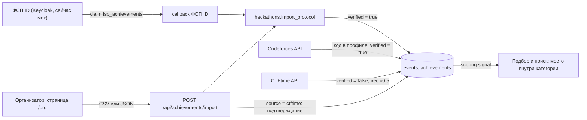
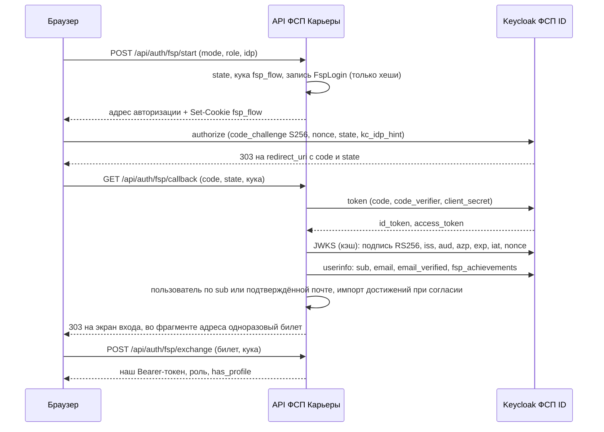
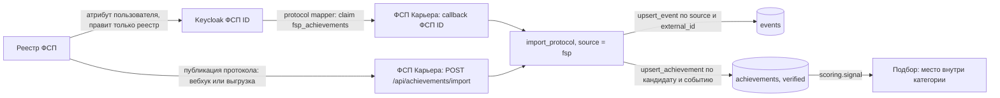

# 5. Интеграция с реестром ФСП

ТЗ не даёт ни API, ни структуры данных реестра ФСП: команда сама решает, какие сведения о достижениях получать и как показывать их работодателю. Обязательно одно — корректно обрабатывать кандидата без истории ФСП. В этом разделе описано, что реализовано в MVP, какие данные мы берём и почему, и что понадобится от ФСП для боевой интеграции.

Коротко о подходе. Любой источник достижений — реестр ФСП, протокол хакатона, Codeforces, CTFtime — сводится к одной модели: **событие** (соревнование) и **строки протокола** (кто из кандидатов какое место занял). Запись в базу у всех источников идёт через две общие функции, `common.upsert_event` и `common.upsert_achievement` (`backend/app/integrations/common.py`), а вес считается только функциями `backend/app/integrations/scoring.py`. Реестр ФСП подключается как ещё один такой источник. Для этого не нужно менять подбор: меняется только то, откуда приходят строки.

## Принципы

| Принцип | Как реализовано |
|---|---|
| Достижения влияют только на место внутри категории, но не на грейд | Категорию и грейд задаёт только тест (см. раздел 2). Достижения входят в оценку соответствия с весом 0,10 и в силу профиля при поиске по банку, но кандидата в другую категорию не переносят (см. ниже «Влияние на ранжирование») |
| Нет достижений — нет штрафа | Сигнал кандидата без достижений равен 0. Отрицательного слагаемого в формуле нет, поэтому оценка такого кандидата определяется тестом и навыками. Работодатель видит в карточке: «Внешних достижений нет. Это не снижает позицию: оценка по тесту» |
| В ранжирование идут только подтверждённые данные | В сигнал входят только достижения с `verified = true` (`matching.achievement_signal`). Подтверждают их доверенные источники: протокол организатора, ФСП ID, официальное API Codeforces после проверки владения. Заявленное кандидатом участие в CTF-команде без подтверждения организатором в сигнал не входит |
| Иерархии соревнований нет | По итогам QA-сессии с постановщиками все соревнования считаются равно важными. Вес зависит только от результата кандидата в соревновании, уровень события хранится как факт и на вес не влияет |
| Отдельное согласие на внешние данные | Без действующего согласия `consent_external` (152-ФЗ) ничего из внешних источников не записывается, а отзыв согласия удаляет всё полученное (см. «Согласие на внешние данные») |

## Модель данных

Схема — `backend/app/models.py`.

**Событие** (`Event`, уникально по паре `source` + `external_id`):

| Поле | Смысл | Влияет на вес |
|---|---|---|
| `source` | `fsp`, `hackathon`, `ctftime` или `codeforces` | нет |
| `external_id` | идентификатор события в источнике: номер в реестре ФСП, id события CTFtime, id контеста Codeforces | нет |
| `title`, `date`, `url`, `tags` | название, дата, ссылка на протокол, направления | нет |
| `level` | `international`, `national`, `regional` или `local`, только описательно | нет |
| `discipline` | дисциплина ФСП из справочника `catalog.DISCIPLINES`: продуктовое программирование, алгоритмическое программирование, программирование систем информационной безопасности, программирование беспилотных авиационных систем, программирование робототехники (синонимы вроде «БАС» и «кибербезопасность» распознаются) | нет |
| `participants` | число участников | косвенно: нужно, чтобы определить «финалиста» по месту, если результат в протоколе не указан |

**Достижение** (`Achievement`, одно на пару «кандидат — событие»):

| Поле | Смысл |
|---|---|
| `place`, `team`, `role` | место, команда, роль в команде |
| `result` | результат: `winner` (победитель), `prize` (призёр), `finalist` (финалист), `participant` (участник отбора) |
| `sport_rank` | спортивный разряд или звание по протоколу (`catalog.SPORT_RANKS`: ЗМС, МС, КМС, 1–3 разряд, 1–3 юношеский разряд); на вес не влияет |
| `weight` | вес ∈ [0, 1] |
| `verified` | подтверждено доверенным источником |

### Почему именно эти данные

- **Результат и место** — главный сигнал: они показывают, насколько кандидат выделился среди других участников того же соревнования. Именно это работодатель хочет знать о «спортивном» опыте.
- **Число участников** нужно, чтобы отличить финалиста от простого участника, когда организатор не указал результат явно: финалист — место не ниже `participants // 10`, то есть топ-10 % таблицы (`scoring.FINALIST_SHARE`).
- **Дисциплина и разряд** — факты для работодателя: он видит направление и квалификацию по ЕВСК. В вес они не входят, потому что дисциплины не ранжируются друг относительно друга.
- **Уровень и дата** хранятся для карточки. Уровень не входит в вес по решению постановщиков, дата в вес тоже не входит (давность результата пока не учитывается).
- **Команда и роль** — контекст: что кандидат делал в команде (backend, ML, капитан).

ФИО и контакты участников из протокола мы не храним: строка сопоставляется с кандидатом по почте входа или ФСП ID, после чего остаются только идентификатор кандидата и поля выше.

### Вес и сводный сигнал

Вес одного соревнования — `scoring.place_weight`: результат из протокола важнее вывода по месту.

| Результат | Как определяется, если в протоколе пусто | Вес |
|---|---|---|
| победитель | 1-е место | 0,8 |
| призёр | 2–3-е место | 0,6 |
| финалист | место в пределах первых 10 % участников | 0,35 |
| участник отбора | всё остальное: место ниже, нет места или ниже 3-го места при неизвестном числе участников | 0,05 |

У победы вес 0,8, а не 1,0: остаётся запас под повторяемость результата и рейтинг, и сигнал не насыщается от одной строки протокола.

Сводный сигнал кандидата — `scoring.signal` (через `scoring.combine`). Соревнования сортируются по весу, k-е по силе (k = 0, 1, …) входит с множителем 0,5ᵏ, дальше вклады объединяются по правилу noisy-OR: `1 − ∏(1 − wₖ·0,5ᵏ)`. Число соревнований учитывается с убывающей отдачей, поэтому онлайн-явками профиль не набить. Сколько ни набирай участий с весом 0,05, их вклад не превысит ≈ 0,1 — меньше одного выхода в финал (0,35). Одна победа и два призовых места дают ≈ 0,88.

Рейтинг Codeforces — отдельное слагаемое без дисконта: он уже обобщает сотни раундов. Вес рейтинга — `(рейтинг − 1200) / 1800`, ограниченный отрезком [0, 1]: 1200 — стартовый рейтинг новичка, 3000 — legendary grandmaster (`scoring.rating_weight`). Итог: `1 − (1 − сигнал соревнований)·(1 − вес рейтинга)`. Самопроверка модуля — `uv run python -m app.integrations.scoring`, тесты — `backend/tests/test_integrations.py::test_weights_sane`.

## Влияние на ранжирование и показ работодателю

**Подборка по потребности** (`services/matching.py`, подробно в разделе 3). Сначала фильтр категории: специализация и грейд по тесту. Только внутри отобранного пула считается соответствие:

`match = (0,45·θ-оценка + 0,45·покрытие навыков + 0,10·сигнал достижений) × штрафы за грейд и трек`

(`W_THETA`, `W_COVER`, `W_ACH`). Поэтому достижения поднимают кандидата внутри категории, но не переводят его в другую категорию и не меняют грейд. Кандидату без достижений вклад 0, без штрафа.

**Поиск по банку** (`GET /api/employer/search`). Сила профиля — `θ − 0,5·SE + 0,5·сигнал` плюс покрытие навыков, если они заданы (`matching.strength`). Здесь θ — оценка уровня кандидата по тесту в модели IRT, SE — её стандартная ошибка.

**Что видит работодатель** (анонимная карточка `matching.card`, только подтверждённые достижения):

- `badges` — лучшее достижение по каждому источнику (ФСП, хакатон, CTF, Codeforces): название, место, результат, дисциплина, разряд; на экране — бейджи с подсказкой;
- `fsp` — лучшее подтверждённое достижение ФСП (строка), `sport_rank` — высший разряд по протоколам ФСП, `cf` — рейтинг Codeforces;
- в объяснении оценки (`explanation.parts`) — вклад достижений `achievement` и веса формулы, чтобы было видно, сколько дал этот сигнал;
- фильтры: в подборке — «есть ФСП» и «есть Codeforces» (`filters=fsp,cf`), в поиске по банку — `fsp`, `cf`, `hackathon` (требование ТЗ о фильтре «наличие подтверждённых достижений ФСП»);
- если достижений нет — фраза «Внешних достижений нет. Это не снижает позицию: оценка по тесту».

Кандидат в своём профиле (`GET /api/achievements`) видит все свои достижения по источникам, их веса, отметку «подтверждено» и сводный сигнал. Сигнал там считается так же, как в подборе, — только по подтверждённым.

## Каналы поступления данных



| Канал | Источник (`source`) | Кто подтверждает | Где в коде |
|---|---|---|---|
| ФСП ID | `fsp` | реестр ФСП через Keycloak (claim) | `integrations/fsp_id.py`, `routers/fsp_id.py` |
| Импорт протоколов | `fsp`, `hackathon`, `ctftime` | организатор (`ORGANIZER_TOKEN` или роль `admin`) | `integrations/hackathons.py`, `routers/achievements.py`, страница `/org` |
| Codeforces | `codeforces` | официальное API после проверки владения | `integrations/codeforces.py` |
| CTFtime | `ctftime` | только организатор: импорт протокола с `source=ctftime` | `integrations/ctftime.py` |

### ФСП ID: вход через Keycloak по OpenID Connect

ТЗ говорит, что ФСП ID будет работать на базе Keycloak. Мы реализовали настоящий клиент OpenID Connect (OIDC): Authorization Code + PKCE S256. Боевой Keycloak подключается только конфигурацией, код менять не нужно. Боевого Keycloak на хакатоне нет, поэтому в том же приложении работает мок-провайдер с тем же протоколом (о нём ниже).



**Протокол** (`backend/app/integrations/fsp_id.py`):

- Настройки берутся из `{issuer}/.well-known/openid-configuration` (discovery). Проверяется, что `issuer` в документе совпадает с настроенным, все эндпоинты идут по https и провайдер поддерживает PKCE S256. Документ discovery и ключи JWKS кэшируются на час. Если пришёл неизвестный `kid`, ключи перечитываются (ротация), но не чаще раза в 60 с.
- id_token проверяется так: алгоритм фиксирован (RS256, никаких `none` и HS256), подпись — по JWKS, обязательны `exp`, `iat`, `iss`, `aud`, `sub`, `nonce`; `aud` — наш `client_id`, `azp` проверяется, когда он есть или аудиторий несколько; допуск по часам — 30 с. В userinfo `sub` должен совпасть с `sub` из id_token.
- `state` одноразовый и привязан к браузеру кукой `fsp_flow` (HttpOnly, SameSite=Lax, путь `/api/auth/fsp`): чужая ссылка с `code` и `state` не войдёт и не привяжет чужой ФСП ID (защита от login CSRF). Поток живёт 10 минут.
- PKCE-верификатор и `nonce` не хранятся: они выводятся как HMAC(`SECRET_KEY`, state), так что по дампу базы их не восстановить. `state`, кука и билет хранятся в `fsp_logins` только как sha256.
- Наш токен в адрес не попадает. Callback кладёт во фрагмент адреса одноразовый билет на 60 секунд, фронт меняет его на токен через `POST /exchange` с той же кукой.
- Почта принимается только с `email_verified = true`.

**Какой аккаунт входит** (`routers/fsp_id.py::_login_user`): сначала ищется аккаунт по ФСП ID (`sub`), затем по подтверждённой почте. Существующий аккаунт с той же почтой связывается автоматически, только если в нём нет ни профиля кандидата, ни компании. Аккаунт с данными привязывается из настроек кандидата после входа по коду: доверять одному `email_verified` провайдера, когда в аккаунте есть что угнать, мы не стали. Новый аккаунт создаётся только по подтверждённой почте, с ролью из `/start` (`candidate` по умолчанию или `employer`). Роль меняется по тем же правилам, что при входе по коду: только пока нет ни профиля, ни компании, а организатора (`admin`) в другую роль не переключить. Достижения импортируются только кандидату. Компании вход через Keycloak статус «почта подтверждена» не даёт: его ставит только наш код на почту (`users.email_confirmed`, подробнее — раздел 9).

**Привязка и отвязка.** В настройках кандидата есть кнопки «Связать с ФСП ID» (`POST /start` с `mode=link`), «Обновить достижения» (повторный проход через ФСП ID; при живой сессии Keycloak пароль вводить не нужно) и «Отвязать» (`POST /api/auth/fsp/unlink`). Каждая привязка и отвязка пишется в журнал (`fsp_id_linked`, `fsp_id_unlinked`) без персональных данных. После отвязки подтверждённые достижения остаются; удалить их можно отзывом согласия на внешние данные.

**Сторонние входы через брокер Keycloak.** Яндекс ID, корпоративный SSO и т. п. настраиваются в Keycloak как Identity Providers. У нас их перечисляет `FSP_ID_IDPS=alias:Подпись,…`, `/start` принимает `idp` и добавляет в адрес авторизации `kc_idp_hint=<alias>`: Keycloak сразу уводит пользователя к этому провайдеру. Неизвестный alias — 422. Список провайдеров фронт берёт из `/api/meta` (`fsp_idps`).

**Конфигурация** (`backend/app/config.py`):

| Переменная | Назначение |
|---|---|
| `FSP_ID_ISSUER` | `https://<host>/realms/<realm>`, только https |
| `FSP_ID_CLIENT_ID`, `FSP_ID_CLIENT_SECRET` | confidential-клиент в Keycloak (по умолчанию `client_id` — `fsp-career`) |
| `PUBLIC_URL`, `FSP_ID_REDIRECT_URI` | redirect URI: по умолчанию `PUBLIC_URL/api/auth/fsp/callback`; у боевого issuer — только https, иначе кнопка ФСП ID выключена |
| `FSP_ID_SCOPE` | по умолчанию `openid email profile` |
| `FSP_ID_IDPS` | провайдеры брокера для `kc_idp_hint` |
| `FSP_ID_MOCK` | встроенный мок; по умолчанию включён при `DEMO=1`, рядом с боевым `FSP_ID_ISSUER` выключается |

**Мок-провайдер** (`routers/mock_fsp_id.py`, путь `/mock-fsp-id`, включён при `DEMO=1` или `FSP_ID_MOCK=1`, иначе 404). Он повторяет протокол realm Keycloak: discovery, страница authorize с выбором демо-аккаунта вместо пароля, token (authorization_code + PKCE S256, код одноразовый и живёт 60 с, проверяются `client_id` и `redirect_uri`), userinfo с claim `fsp_achievements`, JWKS с RS256-ключом, который генерируется при старте процесса. Демо-аккаунты синтетические: кандидаты Дмитрий Орлов (`FSP-1042`, есть в сиде) и Анна Соколова (`FSP-2077`, на платформе её ещё нет), сотрудники компаний Мария Ковалёва (`KC-ladoga-0001`, «Ладога Пэй» из сида) и Игорь Белов (`KC-seversoft-0001`, новая компания). Мок понимает `kc_idp_hint` и кладёт в id_token claim `identity_provider`, как protocol mapper Keycloak. Поток проверяется тестами `backend/tests/test_fsp_id.py` и e2e `frontend/e2e/09-fsp-id.spec.js`.

**Формат claim `fsp_achievements`.** Это массив в userinfo, каждая запись — в формате строки протокола импорта. Пример записи (поля как в моке, `date` и `result` добавлены для полноты):

```json
{
  "fsp_achievements": [
    {
      "event": {
        "external_id": "cup-2025-prod",
        "title": "Финал Кубка России по спортивному программированию 2025, продуктовое направление",
        "level": "national",
        "discipline": "продуктовое программирование",
        "date": "2025-11-20",
        "participants": 600,
        "url": null,
        "tags": ["product"]
      },
      "place": 12,
      "team": "Команда «Сапсан»",
      "role": "backend",
      "result": "финалист",
      "rank": "1 разряд"
    }
  ]
}
```

Каждая запись импортируется через `hackathons.import_protocol` с `source = 'fsp'` и `fsp_id = sub`. Берётся не больше 200 записей. Битая запись (неизвестная дисциплина, результат или разряд, не то значение) пропускается, в лог попадает только тип ошибки. Если у кандидата нет профиля или действующего согласия на внешние данные, ничего не пишется, и фронт показывает «Достижения ФСП подтянем после согласия на внешние данные». В Keycloak этот claim должен формировать protocol mapper из атрибута пользователя, который правит реестр ФСП, а не сам пользователь: мы считаем claim подтверждённым.

### Импорт протоколов организатором

`POST /api/achievements/import` — для организаторов хакатонов и соревнований ФСП. Он же подтверждает места CTFtime. Интерфейс к нему — страница `/org` (ссылка «Организатору: импорт протоколов» на экране валидации `/v`).

- **Доступ:** `Authorization: Bearer <ORGANIZER_TOKEN>` (переменная окружения) или токен пользователя с ролью `admin`. На странице токен хранится только в памяти вкладки.
- **Формат:** JSON `{event: {...}, rows: [...]}` или multipart: поля события и CSV-файл в поле `file` (заголовок `email,fsp_id,team,place,role,result,rank`, разделитель «,» или «;», UTF-8, BOM допустим). Не больше 2 МБ и 5000 строк.
- **Событие:** `source` (`hackathon`, `fsp`, `ctftime`), `external_id` и `title` обязательны; `level`, `discipline`, `date` (ISO), `participants`, `url`, `tags` — по желанию.
- **Сопоставление** — только по подтверждённым идентификаторам входа: `User.email` (подтверждён кодом) или `User.fsp_id`. Почту из анкеты (`Candidate.email`) мы не используем: её кандидат правит сам и мог бы вписать чужую почту из протокола.
- **Идемпотентность:** событие ищется по паре (`source`, `external_id`), достижение — по паре (кандидат, событие). Протокол авторитетен: повторный импорт перезаписывает строку целиком, а поля события без значения не трогает.
- **Ответ:** `{event_id, matched, created, updated, no_consent, unmatched: [{row, email, fsp_id, reason}]}`. Причины в `unmatched`: «нет email и fsp_id», «кандидат не найден», «нет согласия на внешние данные». Страница `/org` показывает только счётчики и номера строк с причиной, без почт и ФСП ID участников. Каждый импорт пишется в журнал `protocol_imported` (id события и счётчики).
- **Ошибки:** 401/403 — нет прав; 413 — файл больше 2 МБ; 422 — формат (текст ошибки по-русски, с перечнем допустимых значений).

Пример строки CSV из демо-примера страницы `/org` (кнопка «Демо: подставить пример» при `DEMO=1`):

```
email,fsp_id,team,place,role,result,rank
,FSP-1042,Команда «Сапсан»,2,капитан,призёр,КМС
,FSP-0000,Команда «Ветер»,7,,финалист,
```

Вторая строка в демо специально не привязывается: такого ФСП ID на платформе нет. Сценарий проверяется e2e `frontend/e2e/12-organizer.spec.js`.

Хакатоны идут тем же путём, с `source = hackathon`. Пока реестр ФСП не подключён, `source = fsp` в импорте — его заглушка на том же формате.

### Codeforces

Владение подтверждается кодом (`integrations/codeforces.py`, `routers/achievements.py`):

1. `POST /api/achievements/codeforces/link {handle}` выдаёт код вида `FSP-7Q2K`. Открытый код есть только в этом ответе, в базе хранится его sha256, код живёт 24 часа.
2. Кандидат вписывает код в поле «Организация» (или «Имя», «Фамилия») профиля Codeforces.
3. `POST /api/achievements/codeforces/verify` проверяет код через `user.info`, не больше 5 попыток на один код (дальше 429). Один хэндл может подтвердить только один кандидат: это закреплено уникальным индексом в БД.
4. Дальше из `user.info` берётся рейтинг, а из `user.rating` — места в раундах. В достижения попадают до 5 лучших мест в пределах топ-100 общего зачёта: 1-е место — победитель, 2–3-е — призёр, остальные — финалист. Деления на Div. нет, иерархии соревнований тоже.

`POST /codeforces/refresh` обновляет данные не чаще раза в час. Запросы к API идут с паузой не меньше 2 с (троттлинг в памяти процесса), при сбое API — 502, база при этом не меняется. Подтверждённый рейтинг Codeforces также сдвигает стартовую точку адаптивного теста (см. раздел 2), но на итоговый грейд не влияет.

### CTFtime

У команды CTFtime нет поля, через которое участник мог бы надёжно доказать членство, поэтому (`integrations/ctftime.py`):

- `POST /api/achievements/ctftime/link {team_id, role}` подтягивает рейтинг команды и до 5 лучших мест за текущий и прошлый год, с общим сроком синхронизации 40 с;
- такие достижения записываются с `verified = false` и вдвое меньшим весом, в сводный сигнал и подбор они не входят;
- подтверждает их организатор: импорт протокола с `source = ctftime` и `external_id` = id события CTFtime находит то же событие и ставит `verified = true` и полный вес. При следующих обновлениях подтверждение не теряется. Вес события по версии CTFtime в наш вес не входит, он хранится только как факт.

## Согласие на внешние данные

Согласие отдельное, по 152-ФЗ. Кандидат даёт его при регистрации (поле `consent_external` в `POST /api/candidate/profile`) или в настройках (`POST /api/achievements/consent`). Согласие действует, только если его версия совпадает с текущей `CONSENT_VERSION` и есть действующее согласие на обработку данных (`matching.consent_ok`).

- Без согласия Codeforces и CTFtime отвечают 403. Строки протокола такого кандидата не привязываются: в отчёте импорта они попадают в `no_consent` и `unmatched`. Claim ФСП ID не записывается.
- Отзыв согласия удаляет все достижения внешних источников (`codeforces`, `ctftime`, `hackathon`, `fsp`) и все привязки внешних профилей. Повторный импорт их не вернёт без нового согласия.
- Каждое изменение пишется в `ConsentEvent` с версией текста и в `AuditLog` (`consent_changed`).
- Гонки закрыты блокировкой строки кандидата. После внешнего HTTP-запроса и перед записью импорт и синхронизация берут `SELECT … FOR UPDATE` и перепроверяют согласие (`consent.lock_candidate`), поэтому параллельный отзыв не оставит в базе данных, полученных после него.

## Целевая схема интеграции с реальным реестром

Клиент OIDC, формат протокола и путь записи в MVP уже такие, какими должны быть в боевой интеграции. От ФСП нужны две вещи: Keycloak с атрибутом достижений и способ передавать протоколы.



**Что нужно от ФСП.**

1. **Realm Keycloak:** confidential-клиент для ФСП Карьеры (client_id и secret), разрешённый redirect URI `https://<стенд>/api/auth/fsp/callback`, поддержка PKCE S256, scope `openid email profile`, подтверждённая почта (`email_verified`) и стабильный `sub` — это и есть ФСП ID, ключ сопоставления.
2. **Protocol mapper** `fsp_achievements` в userinfo — из атрибута пользователя, который пользователь не может редактировать. Формат записи — как в примере выше.
3. **Передача протоколов пакетом** — для кандидатов, которые ещё не входили через ФСП ID, и для обновления без входа. Это либо вызов нашего `POST /api/achievements/import` реестром при публикации протокола (вебхук), либо периодическая выгрузка в том же формате. Сейчас у нас есть только сам эндпоинт импорта и доступ по `ORGANIZER_TOKEN`. Ни приёма подписанных вебхуков, ни фоновой выгрузки из реестра нет — это концепция.

**Сопоставление полей реестра с нашей моделью** (имена полей реестра условные: структура не предоставлена):

| Данные реестра | Наше поле | Обязательность |
|---|---|---|
| идентификатор соревнования или этапа | `Event.external_id` (`source = fsp`) | да, должен быть стабильным |
| название | `Event.title` | да |
| дата | `Event.date` | желательно |
| уровень (международный … локальный) | `Event.level` | по желанию |
| дисциплина ФСП | `Event.discipline` | желательно |
| число участников (команд) | `Event.participants` | желательно: без него «финалиста» по месту не определить |
| ссылка на официальный протокол | `Event.url` | желательно |
| ФСП ID участника | `fsp_id` строки → `User.fsp_id` | да (или подтверждённая почта) |
| место | `Achievement.place` | желательно |
| результат (победитель, призёр, финалист, участник) | `Achievement.result` | желательно: точнее, чем вывод по месту |
| спортивный разряд или звание | `Achievement.sport_rank` | по желанию |
| команда, роль в команде | `Achievement.team`, `Achievement.role` | по желанию |

ФИО, дата рождения, контакты и прочие персональные данные участников из реестра не нужны: сопоставление идёт по ФСП ID.

### Что доработать перед боевым стендом

Из `table.md`:

- ⬜ **ФСП ID: доводка для боевого стенда.** Сейчас claim `fsp_achievements` считается доверенным и перезаписывает общие поля события `source = fsp` (название, уровень, число участников — от последнего влияет вес у всех участников события). При подключении реестра `upsert_event` для событий из claim должен только создавать событие и заполнять пустые поля, а авторитетным источником полей события станет протокол реестра. Кроме того: одноразовый билет лежит в заголовке `Location` редиректа 303 (живёт минуту, привязан к куке); нужен лимит на `POST /api/auth/fsp/start` по IP на прокси; индекс по `fsp_logins.expires_at`, если строк станет много; `downgrade` ревизии `0004_fsp_logins` упадёт, если в `users.fsp_id` уже есть UUID-идентификаторы Keycloak.
- ⬜ Привязка Keycloak к существующему аккаунту компании из настроек: сейчас привязка из настроек есть только у кандидата.
- ⬜ Список доверенных провайдеров и флаг доверия по claim `identity_provider`: сейчас клиент этот claim не использует.
- ⬜ Импорт с `source = ctftime` без тегов в форме затирает теги события (`Security`, `CTF`) пустым списком.
- ➖ Refresh-токены провайдера не храним, фоновой синхронизации достижений нет: обновление — при входе и кнопкой «Обновить достижения».
- ➖ Один поток входа на браузер: кука `fsp_flow` одна, второй вход в соседней вкладке делает первый устаревшим.

## Ограничения MVP

- Боевого Keycloak и реестра ФСП на хакатоне нет: поток проверен на встроенном мок-провайдере и тестах, достижения в демо синтетические (в синтетике достижения есть примерно у 30 % кандидатов, Codeforces — примерно у 9 %, только у разработчиков; см. README «Как устроено»).
- Веса результатов (0,8 / 0,6 / 0,35 / 0,05) — экспертное решение команды, а не калибровка по данным найма. Экспертной разметки ФСП пока нет.
- Codeforces-раунды в топ-100 считаются «финалистом» независимо от дивизиона (➖ в `table.md`: это топ-1–5 % раунда с тысячами участников, а иерархию соревнований по итогам обсуждения с постановщиками не вводим).
