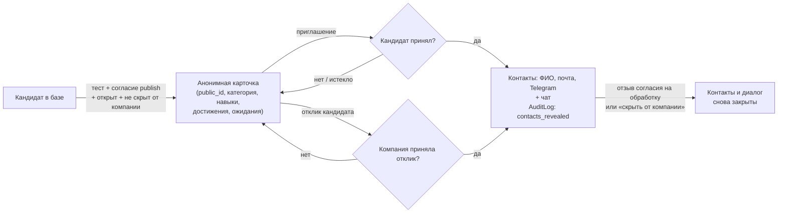

# 9. Безопасность и 152-ФЗ

ТЗ (п. 3.5) требует соблюдать 152-ФЗ «О персональных данных», получать согласие пользователя на обработку и публикацию профиля, разграничивать права по ролям, защищать от несанкционированного доступа, безопасно хранить пароли и токены. Раздел описывает, как это сделано в коде и где проходят границы MVP.

Термины:

- **ПДн** — персональные данные: ФИО, почта, Telegram, текст резюме кандидата, контакты рекрутера.
- **HMAC** — хеш с секретным ключом. Без ключа его нельзя ни подделать, ни перебрать.
- **Перец** — серверный секретный ключ `SECRET_KEY`, который хранится вне базы.

## 9.1. Согласия кандидата

### Три раздельных согласия

| Цель | Флаг и версия в `Candidate` | Что разрешает |
|---|---|---|
| Обработка ПДн (`processing`) | `consent_152`, `consent_version`, дата `consent_152_at` | хранить и обрабатывать профиль; без неё профиль не создаётся (422) |
| Публикация карточки (`publish`) | `consent_publish`, `consent_publish_version` | показывать обезличенную карточку работодателям в подборке, поиске и лотерее |
| Внешние данные (`external`) | `consent_external`, `consent_external_version` | привязывать Codeforces и CTFtime, принимать достижения из протоколов ФСП, хакатонов и из ФСП ID |

Согласия даются отдельными галочками при регистрации, а меняются в настройках:

- `PATCH /api/candidate/consents` — обработка и публикация;
- `POST /api/achievements/consent` — внешние данные.

Публикация и внешние данные зависят от обработки. Включить их без действующего согласия на обработку нельзя (422 или 403).

### Версия текста

Текущая редакция текста согласия — `catalog.CONSENT_VERSION` (сейчас `"2026-10"`). Согласие действует, только если и флаг включён, и версия этой цели совпадает с текущей. Проверка — одна функция `matching.consent_ok(c, purpose)`.

Если текст согласия сменили, у всех кандидатов `consent_ok` становится ложным. Они пропадают из выдачи и не могут менять свои ПДн, пока не подтвердят согласие заново (`OUTDATED` в `routers/candidate.py`). У каждой цели своя версия: повторное согласие на обработку не «оживляет» публикацию, данную на старую редакцию.

### Журнал согласий

Каждое изменение по любой цели пишется в `ConsentEvent`: кандидат, цель, выдано или отозвано, версия текста, время. Это бывает при создании профиля, изменении, повторном согласии на новую редакцию и отзыве. Таблица только дополняется и не имеет внешнего ключа на кандидата: доказательство согласия переживает удаление аккаунта. Дополнительно в `AuditLog` пишется `consent_changed` со снимком флагов и версий до и после (без ПДн).

### Отзыв согласия

Отзыв согласия на обработку (`candidate._withdraw_processing`):

- снимает публикацию;
- отзывает согласие на внешние данные и удаляет внешние аккаунты и достижения всех внешних источников (Codeforces, CTFtime, хакатоны, ФСП — `integrations/consent.py`);
- переводит профиль в статус «скрыт».

После отзыва запрещена любая запись ПДн (`_require_152`). Разрешены только действия, сужающие обработку: смена согласий, удаление аккаунта, скрытие профиля, отказ от приглашения, отзыв отклика, исключение мест работы из PDF. Чтение своих данных тоже остаётся: `/me`, выгрузка, PDF-профиль. Работодатель перестаёт видеть контакты и диалог (`chat.may_talk` требует действующего согласия).

Сами данные профиля при отзыве не стираются. Полное удаление — отдельным действием «Удалить аккаунт» (9.3).

Отзыв и принятие приглашения сериализуются блокировкой строки кандидата (`SELECT … FOR UPDATE`, `consent.lock_candidate`). Поэтому отзыв не может «проскочить» между проверкой согласия и раскрытием контактов.

## 9.2. Что видит работодатель

### До принятия приглашения или отклика

Работодатель видит только анонимную карточку `matching.card`. Она собирается по белому списку полей:

- анонимный код `public_id` (вида `A-1042`);
- специализация, трек, грейд по тесту, заявленный грейд;
- перцентиль, θ ± SE (θ — оценка уровня по IRT, SE — её погрешность, раздел 2), компетенции;
- подтверждённые тестом и заявленные навыки, роли и софт-скиллы со слов кандидата;
- достижения (ФСП, рейтинг Codeforces, бейджи, разряд);
- ожидания по зарплате, формат работы, город;
- нагрузка открытыми приглашениями;
- оценка соответствия и её объяснение;
- сигналы доверия (тест, подтверждения работодателей, решённые задания).

ФИО, почты, Telegram и резюме в карточке нет.

Как это защищено:

- **Поиск по банку не читает ПДн из БД.** Колонки ФИО, почты, Telegram, резюме, эмбеддинга и `truth` отложены с `raiseload` (`employer.SEARCH_SKIP`): случайное обращение к ним — ошибка, а не утечка.
- **Видимость кандидата.** Кандидат виден работодателю только при выполнении `matching.visible`: профиль открыт, тест пройден, действует согласие на публикацию (а значит, и на обработку), компания не внесена в его список «скрыть профиль от» (по ИНН). Иначе — 404 в карточке, нет в подборке, поиске, лотерее, и приглашение не отправить.
- **Заметка к отклику.** Кандидат мог по просьбе фиктивной вакансии вписать контакты в заметку. До принятия отклика почта, телефон, Telegram, ссылки и слова ФИО самого кандидата в заметке маскируются (`vacancies._note`, `parsing.mask_contacts`).
- **Лотерея.** Публичная часть оперирует псевдонимами `sha256(salt + public_id)`: без соли псевдоним не связать с кандидатом и с другими лотереями.
- **В ранжировании нет ФИО, пола, возраста и вуза** (раздел 3).

### После согласия кандидата

Контакты (ФИО, почта, Telegram) открываются работодателю по одному из двух оснований (ТЗ, п. 2.2):

| Основание | Где открываются | Условие |
|---|---|---|
| Кандидат принял приглашение | статусы приглашений, `GET /api/employer/pipeline` (`employer._row`) | `status = accepted` и `chat.may_talk` |
| Компания приняла отклик кандидата | отклики на вакансию (`vacancies._shown`) | `status = accepted` и `chat.may_talk` |

`may_talk` — одно правило для контактов и чата. Оно требует трёх условий: согласие на обработку действует, компании нет в «скрыть от», компания не заблокирована по отзывам. Если кандидат позже отзовёт согласие или скроет профиль от компании, контакты и диалог закрываются снова, а работодатель видит причину без подробностей.

Отклик без ответа контакты не открывает. Это сознательное отступление от буквы ТЗ («…или откликнулся сам»): иначе фиктивная вакансия собирала бы контакты всех откликнувшихся (раздел 11). Отказ компании и просмотр отклика контакты тоже не открывают.

Сам кандидат ещё до ответа видит название компании, вилку и контакт рекрутера. Контакт рекрутера — часть приглашения, а не ПДн кандидата.

### Журнал раскрытий

Каждое раскрытие контактов пишется в `AuditLog` с действием `contacts_revealed`:

- по приглашению — в момент принятия (`candidate.accept`), с `invitation_id` и `company_id`;
- по отклику — один раз на отклик (`vacancies._reveal`, условный `UPDATE … WHERE contacts_revealed_at IS NULL`): повторные просмотры запись не дублируют.

`AuditLog` только дополняется и не имеет внешних ключей, поэтому запись переживает удаление аккаунта. Другие действия в журнале: `data_exported`, `account_deleted`, `consent_changed`, `test_reset`, `grade_lowered`, `role_changed`, `fsp_id_linked`, `fsp_id_unlinked`, `protocol_imported`, `company_blocked`, `company_unblocked`. В `detail` пишутся только идентификаторы и основания, без ПДн.

## 9.3. Права субъекта ПДн: выгрузка и удаление

- **Выгрузка своих данных** (`GET /api/candidate/me/export`, ст. 14 152-ФЗ) — один JSON со всеми данными кандидата: аккаунт, профиль, вектор эмбеддинга, журнал согласий, записи `AuditLog` о нём, достижения, внешние аккаунты, приглашения, отклики, переписка, решения заданий, сессии теста. Не выгружаются только секреты: хеши токена и кода, код подтверждения внешнего профиля. Ответ помечается `Cache-Control: no-store`. Факт выгрузки пишется в журнал (`data_exported`) до снимка, поэтому сам попадает в выгрузку.
- **Удаление аккаунта** (`DELETE /api/candidate/me`). Удаляются кандидат и пользователь. Каскадом уходят достижения, внешние аккаунты, приглашения, отклики, сообщения чата, решения заданий и сессии теста. В журнале остаётся `account_deleted` только с идентификаторами. `public_id` удалённого переносится в `RetiredPublicId` и повторно не выдаётся: иначе старая лотерея или воронка «узнала» бы в новом человеке прежнего.
- **Резюме до согласия не хранится.** PDF, загруженный до создания профиля, сервер разбирает и возвращает текстом (`no-store`), но не сохраняет. Резюме записывается только вместе с согласием на обработку в `POST /api/candidate/profile`.
- Кандидат может скрыть профиль целиком (`PATCH /api/candidate/status`), скрыть его от конкретных компаний по ИНН (`PATCH /api/candidate/hidden-from`) и исключить распознанные места работы из PDF-профиля (`PATCH /api/candidate/pdf`).

## 9.4. Хранение секретов

| Секрет | Как хранится | Где |
|---|---|---|
| Токен сессии (Bearer) | в БД — только sha256 (`deps.hash_secret`); открытое значение отдаётся клиенту один раз; срок 30 дней; новый вход отзывает прежний токен, выход стирает | `users.token`, `deps.issue_token` |
| Код входа (6 цифр) | HMAC-SHA256 с перцем `SECRET_KEY` и адресом (`deps.otp_hash`): шестизначный код по голому sha256 перебирается за секунды; срок 10 минут, 5 попыток; попытка списывается атомарно до сравнения, верный код удаляется атомарно; новый код — не чаще раза в 60 с на адрес | `login_challenges.code_hash` |
| Код подтверждения Codeforces | sha256, срок 24 часа, не больше 5 проверок на код, после успешной проверки стирается | `external_accounts.verify_code` |
| Поток входа через ФСП ID | `state`, кука браузера `fsp_flow` (HttpOnly, SameSite=Lax) и одноразовый билет на обмен — только sha256; PKCE-верификатор и nonce не хранятся вовсе, а выводятся HMAC от `state`; билет живёт 60 с | `fsp_logins` |
| Ключ API для ATS | `fsp_` + 32 случайных байта; в БД — только sha256 (`deps.hash_secret`) и начало ключа для списка; полный ключ показывается один раз при выпуске; отзыв — `revoked_at`; не больше 10 активных на компанию | `api_keys` |
| Общий демо-токен | HMAC адреса демо-персонажа на `SECRET_KEY`; при `DEMO=0` отвергается в `deps.current_user` | — |
| Пароли | паролей нет: вход по коду на почту или через ФСП ID | — |
| Ключи и пароли интеграций | только из окружения: `SECRET_KEY`, `SMTP_PASSWORD`, `FSP_ID_CLIENT_SECRET`, `LLM_API_KEY`, `GIGACHAT_AUTH_KEY`, `ORGANIZER_TOKEN`, `SANDBOX_TOKEN` | `backend/app/config.py`, `.env.example` |

Секретные токены (организатора, песочницы, nonce ФСП ID, хеши лотереи) сравниваются за постоянное время: `secrets.compare_digest` и `hmac.compare_digest`.

Если `SECRET_KEY` не задан, ключ генерируется случайно при старте процесса. Коды входа и демо-токены тогда сгорают при перезапуске. На стенде ключ задаётся постоянным.

В тестах токен выдаётся через `deps.issue_token`. Утечка дампа БД не даёт войти ни по токену, ни по коду.

Интеграция с ATS (раздел 11.3) не расширяет права работодателя: события в ленте `/api/ats/v1/events` собираются при чтении по правилам кабинета. Анонимная карточка отдаётся только при действующем согласии кандидата и если компания не скрыта; контакты — только после принятия отклика или приглашения. Выпуск и отзыв ключа пишутся в `AuditLog` (`api_key_issued`, `api_key_revoked`, в detail — идентификаторы, без ПДн). Хранение данных, выгруженных в ATS, — ответственность работодателя как оператора ПДн.

## 9.5. Роли и разграничение доступа

Аутентификация — Bearer-токен в заголовке `Authorization`. Права проверяют зависимости FastAPI в `backend/app/deps.py`:

| Зависимость | Что проверяет | Ответ при отказе |
|---|---|---|
| `current_user` | токен есть, его хеш найден, срок не истёк; общий демо-токен вне `DEMO=1` не действует | 401 |
| `current_candidate` | у пользователя есть профиль кандидата | 403 |
| `current_company` | у пользователя есть компания | 403 |
| `active_company` | компания не заблокирована по отзывам — для действий, доходящих до кандидатов: приглашения, вакансии, задания, лотерея, ответы на отклики | 403 |
| `achievements.organizer` | `ORGANIZER_TOKEN` из окружения или пользователь с ролью `admin` — для импорта протоколов и (вне демо) пересчёта валидации | 401 / 403 |
| Ключ API (`X-Api-Key`, `/api/ats/v1`) | ключ найден по sha256 и не отозван; у него есть нужная область (`vacancies:write`, `applications:read`, `applications:write`, `invites:read`, `invites:write`); записывающие запросы заблокированной компании отклоняются, как у `active_company` | 401 / 403 |
| `mock_ats` | демо-приёмник ATS включён (`ATS_MOCK=1`, по умолчанию вместе с `DEMO=1`) | 404 |
| `mock_fsp_id._enabled` | мок-провайдер ФСП ID включён (`DEMO=1` или `FSP_ID_MOCK=1`) | 404 |

Дополнительно:

- **Роль при создании профиля и компании.** Профиль кандидата создаёт только пользователь с ролью `candidate`, компанию — только `employer`. Роль закрепляется при первом входе: пользователь создаётся только после подтверждения кода, так что роль выбирает владелец адреса. Роль меняется, лишь пока нет ни профиля, ни компании.
- **Владелец записи.** Каждый объект проверяется на принадлежность: чужое приглашение, отклик, потребность, вакансия, задание, лотерея — 404. Кандидат видит только свои приглашения и отклики (ТЗ, п. 2.1).
- **Неподтверждённая компания** работает сразу, но с урезанной квотой (3 приглашения в неделю) и лимитом 2 открытых вакансий. Кандидат видит отдельные факты, а не общее «компания проверена»: «почта на домене подтверждена / не подтверждена» и, если не сходится, «ИНН: контрольные цифры не сходятся» (`employer.company_trust`). Подтверждение — контрольная сумма ИНН плюс почта входа на домене сайта компании, подтверждённая нашим кодом. Почте из Keycloak и сторонних IdP («Trust Email») для статуса компании не доверяем.
- **Защита от предзахвата аккаунта через ФСП ID.** Если ФСП ID привязали к аккаунту, почту которого владелец не подтверждал кодом, при первом входе владельца по коду привязка сбрасывается (`fsp_id_unlinked` в журнале). Подробности OIDC-клиента (проверка подписи id_token по JWKS, iss/aud/azp/exp/nonce, PKCE S256, только https у боевого issuer) — раздел 5.
- **Заголовки безопасности** на каждый ответ (`main.security_headers`):
  - `X-Frame-Options: DENY` и `Content-Security-Policy: frame-ancestors 'none'` — чужой сайт не встроит кабинет в невидимый фрейм и не подставит под клик кнопку «Принять и открыть мои контакты»;
  - `X-Content-Type-Options: nosniff`;
  - `Referrer-Policy: same-origin`.
- **Размер запроса.** Тело больше 6 МБ отвергается (413, `main.limit_body`). Файл резюме — до 5 МБ, протокол организатора — до 2 МБ.
- **Наружу отдаются только страница и `/assets`:** `node_modules`, e2e-сценарии и отчёты тестов из каталога фронта не видны.
- **Фронт экранирует все строки из API** (`esc()`). E2E-сценарии включают проверку XSS.
- **Проверка в тестах.** `backend/tests/test_privacy.py` обходит все ответы компании до и после принятия и проверяет отсутствие ПДн. Тест `test_search_does_not_load_pii_columns` проверяет, что поиск не читает колонки ПДн.

## 9.6. ПДн не в логах и не в LLM

**Логи.** В логи и `AuditLog.detail` пишутся только идентификаторы, типы ошибок и коды ответов, без самих данных:

- сбой письма — тип исключения без адреса (`mail.py`);
- сбой OCR, LLM, песочницы — тип ошибки и HTTP-код;
- PDF-профиль — `public_id` и число незнакомых символов.

**LLM.** Модель необязательна (раздел 10). Если она включена, в неё уходит только:

| Вызов | Что отправляется |
|---|---|
| Разбор потребности и резюме (`parsing.parse_need`, `parse_cv`) | текст после `parsing.mask_pii`: ФИО, почта, телефон, Telegram, ссылки на профили, адрес, дата рождения, гражданство заменяются метками. Контакты для формы кандидата распознаются правилами локально, до маскировки |
| Реранк подборки (`matching._llm_scores`) | только структурные поля: `public_id`, грейд, трек, θ, навыки; без ФИО и без текста потребности |
| Эмбеддинги | строка «специализация · трек · грейд. Навыки: …» |

Маскировка сделана на правилах, а не на NER. Редкое имя вне шапки резюме может пройти (`table.md`, строка «Маскировка ПДн — правила, не NER»). Для облачной модели в бою планируется подключить NER (Natasha).

**OCR** — исключение: картинку скана не замаскировать. Поэтому `OCR_URL` допускается только self-hosted (свой vLLM), не облачный API. В README и в `config.py` это сказано прямо.

**Внешние песочницы** (e2b и подобные) отклонены по той же причине: код кандидата не должен уходить за пределы нашей инфраструктуры.

## 9.7. Песочница для кода кандидатов

Задачи на код в тесте исполняют недоверенный код. Модель безопасности (`sandbox/`, nsjail 3.4, подробно — README «Песочница»):

- **Сеть.** Отдельный контейнер `sandbox` во внутренней сети compose (`internal: true`): портов на хост нет, выхода наружу нет. Говорит с ним только `api` по общему секрету `SANDBOX_TOKEN` (заголовок `X-Sandbox-Token`, сравнение за постоянное время).
- **Изоляция каждого теста.** Каждый тест — отдельный запуск nsjail со своими пространствами имён (пустая сеть, pid, mount, user, uts, ipc, cgroup). Пользователь uid/gid 65534 без capabilities и с `no_new_privs`, окружение очищено. Корень собран только из нужного на чтение. Решение лежит в `/task` на чтение, запись разрешена только в tmpfs `/tmp` на 8 МБ. Корень самого контейнера тоже только на чтение.
- **Лимиты на тест:** 3 с по часам, RLIMIT_CPU, 256 МБ в cgroup v2 без свопа, 32 процесса и потока, 1 CPU, файлы и вывод до 8 МБ, 64 дескриптора.
- **Лимиты на запрос:** код до 20 КБ, до 50 тестов. Одновременно 4 прогона, очередь до 32 запросов, дальше 503.
- **seccomp.** Процесс убивается на ptrace, mount, unshare/setns, bpf, perf_event_open, userfaultfd, keyctl, загрузке модулей ядра, kexec, clone с новыми пространствами имён и др. На `socket` возвращается EPERM.
- **Утечки ответов.** Ожидаемые ответы внутрь nsjail не попадают: решение получает только аргументы, сравнение идёт снаружи. Журнал nsjail пишется в отдельный файл, поэтому подделать «сбой песочницы» через stderr нельзя.
- **Обход оценки.** Отклонённое песочницей решение (4xx) засчитывается как неверный ответ, а не «пропуск». Нарочно неприемлемым кодом задачу не обойти.
- **Проверено тестами против настоящего nsjail** (CI job `sandbox`): сеть наружу и к соседним сервисам, fork-бомба, бесконечный цикл, 2 ГБ памяти, запись вне `/tmp`, чтение `/etc/passwd` и секретов из окружения, `os.system` и `child_process`, ptrace/unshare/mount через ctypes, подделка строки результата.

Ограничения песочницы:

- nsjail работает в privileged-контейнере: без этого в Docker нет пространств имён и cgroup.
- Ядро общее с хостом, поэтому уязвимость ядра даёт выход наружу. seccomp и непривилегированный uid сужают поверхность атаки, но виртуализацию не заменяют.
- Политика seccomp — запретительный список поверх сброса capabilities, а не белый список.
- При боевой нагрузке песочницу следует вынести на отдельную ВМ или gVisor/Firecracker (`table.md`, ⬜).

## 9.8. Демо-режим — только явно

`DEMO=1` нужен только стенду жюри. По умолчанию (`DEMO=0` в `config.py`, `docker-compose.yml` и `.env.example`) режим выключен. Только в демо:

- код входа возвращается прямо в ответе API, а не письмом. Вне демо без SMTP вход по почте отвечает 503;
- работает вход за демо-персонажей (`POST /api/auth/demo/{role}`) с общим демо-токеном. Вне демо эндпоинт отвечает 404, а уже выданный демо-токен отвергается;
- включён мок-провайдер ФСП ID `/mock-fsp-id`, если не задан боевой `FSP_ID_ISSUER`. Рядом с боевым issuer мок выключен всегда, чтобы не принять боевой секрет клиента;
- пересчёт валидации на `/v` открыт без входа (вне демо — только организатору);
- включён демо-приёмник ATS `/mock-ats` (`ATS_MOCK`, по умолчанию вместе с `DEMO`): страница опрашивает ленту событий по ключу API, который вводит пользователь; ключ хранится только в `sessionStorage` вкладки;
- отзыв о компании доступен сразу после принятия, а не через 7 дней.

Письма демо-персонажам не уходят: их адреса не настоящие. Все данные стенда синтетические, реальные ПДн в репозиторий, сид и тесты не попадают.

## 9.9. Известные ограничения

Перечислены осознанные упрощения MVP из `table.md` (➖ — отложено с причиной, ⬜ — план). Это продакшен-доводка, к сдаче она не требуется.

| Ограничение | Статус | Как закрывается |
|---|---|---|
| Токен — Bearer в `localStorage`, а не HttpOnly-cookie; полного CSP нет (только запрет фреймов) | ➖ | cookie-сессии + CSRF + CSP с хешем inline-скрипта. Сейчас XSS не найдено, все строки экранируются |
| Ограничение частоты: код входа — только по адресу (пауза 60 с, 5 попыток); по IP и устройству лимита нет; нет лимита на `POST /api/auth/fsp/start` | ➖ / ⬜ | rate limit на reverse proxy перед публичным стендом |
| Тело запроса без `Content-Length` (chunked) не ограничивается приложением | ➖ | `client_max_body_size` на прокси |
| HSTS не выставляется приложением | — | на прокси (Traefik в Dokploy) |
| Маскировка ПДн перед LLM — правила, не NER | ➖ | NER (Natasha) в `mask_pii` для облачной модели |
| Песочница — privileged-контейнер, ядро общее с хостом; seccomp — запретительный список | ⬜ | отдельная ВМ или gVisor/Firecracker; белый список по strace |
| Связь ИНН с юрлицом не проверяется (только контрольная сумма и домен почты) | ⬜ | проверка по реестру ЕГРЮЛ |
| Пересчёт валидации на демо-стенде открыт всем (один прогон за раз) | ➖ | только для стенда жюри; на публичном — лимит на прокси или вернуть пересчёт организатору |
| Автопроверка задания работодателя: новый аккаунт даёт новую попытку, варианты `choice`/`number` перебираются | ⬜ | ограничение по почте или ФСП ID, ротация вариантов |
| SSE чата: нет лимита потоков на пользователя и перепроверки токена на открытом потоке | ➖ | поток передаёт только сигнал «есть новое» без данных |
| ФСП ID: claim `fsp_achievements` считается доверенным | ⬜ | в Keycloak — protocol mapper только из атрибута, который правит реестр |
| Несовершеннолетние (15–17 лет): согласие законного представителя | ➖ | возраст в профиле и согласие представителя — при поддержке |
| Регулярное выражение для почты, а не RFC 5322 | ➖ | адрес всё равно подтверждается кодом |

Проверки безопасности закреплены тестами: `backend/tests/test_privacy.py`, `test_auth.py`, `test_fsp_id.py`, `test_chat.py`, `test_vacancies_tasks.py`, `test_code.py`, тесты песочницы `sandbox/tests/`. Тестовые наборы бэкенда и e2e описаны в разделе 8.
