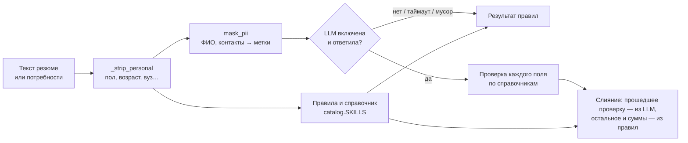

# 10. ML и LLM в решении

ТЗ (п. 3.2) называет преимуществом машинное обучение и обработку естественного языка для разбора резюме, категоризации и подбора. Постановщики в письменных ответах попросили описать, какие модели используются, где и зачем. Коротко:

- **категоризацию делает статистическая модель, а не LLM.** Грейд и категорию задаёт адаптивный тест на модели IRT 2PL (см. раздел 2). Языковая модель на грейд не влияет ни в одном месте;
- **LLM необязательна и помогает в четырёх местах:** разбор текста потребности, разбор резюме, эмбеддинги для поиска кандидатов и реранк топ-30 подборки. Отдельно от LLM есть OCR сканов резюме vision-моделью;
- **у каждого вызова есть фолбэк на правила.** По умолчанию (`LLM_PROVIDER=none`, так поднят и стенд жюри) всё работает на правилах и справочниках, без GPU и ключей;
- **персональные данные в модель не уходят.** Свободный текст перед вызовом проходит маскировку `parsing.mask_pii`, подбор отправляет только структурные поля без ФИО.

## Провайдеры и модели

Все провайдеры подключаются через один OpenAI-совместимый клиент `backend/app/services/llm.py` (эндпоинты `/chat/completions` и `/embeddings`). Провайдер выбирается переменной `LLM_PROVIDER`. Модели по умолчанию заданы пресетами в `backend/app/config.py` и переопределяются переменными `LLM_MODEL` и `EMBED_MODEL`.

| `LLM_PROVIDER` | Что нужно | Модель чата / эмбеддингов по умолчанию | Где обрабатываются данные |
|---|---|---|---|
| `none` (по умолчанию, в compose тоже) | — | — | модель не вызывается, работают правила |
| `ollama` | `ollama serve`, `ollama pull mistral:7b bge-m3`; адрес — `OLLAMA_URL` (в compose `http://host.docker.internal:11434/v1`) | `mistral:7b` / `bge-m3` | локально, данные не покидают инфраструктуру |
| `openai_compatible` | `LLM_BASE_URL` (vLLM и т. п.), при необходимости `LLM_API_KEY`, `LLM_MODEL`, `EMBED_MODEL` | задаются явно | свой шлюз |
| `yandexgpt` | Yandex AI Studio: `LLM_API_KEY` (API-ключ сервисного аккаунта с ролью `ai.languageModels.user`), `YANDEX_FOLDER_ID` | `yandexgpt-lite/latest` / `text-search-doc/latest` | облако Yandex; логирование запросов для дообучения выключено заголовком `x-data-logging-enabled: false` |
| `gigachat` | `GIGACHAT_AUTH_KEY`, `GIGACHAT_SCOPE` (по умолчанию `GIGACHAT_API_PERS`); OAuth-токен клиент получает и обновляет сам; `LLM_CA_BUNDLE` — сертификат «Russian Trusted Root CA» добавляется к системным корням, проверка TLS не отключается | `GigaChat` / `Embeddings` | облако Сбера |

Почему так. Mistral 7B и bge-m3 — открытые модели, которые запускаются локально через Ollama: данные кандидатов не покидают нашу инфраструктуру. bge-m3 — многоязычная модель эмбеддингов, ей подходят русские и английские названия навыков. YandexGPT и GigaChat — российские облачные модели, им не нужен GPU на стенде. Постановщики разрешили облачные модели, включая зарубежные, с предпочтением открытых (письменные ответы постановщиков). Поэтому набор провайдеров — наш выбор, а не требование, и `openai_compatible` подключает любой совместимый шлюз.

`EMBED_MODEL=none` выключает эмбеддинги, тогда кандидаты ищутся по навыкам. `LLM_TIMEOUT` (по умолчанию 60 с) — таймаут запроса.

### OCR сканов резюме

OCR не зависит от `LLM_PROVIDER` и по умолчанию выключен (`backend/app/services/ocr.py`). Он нужен для PDF без текстового слоя (скан). Включается адресом своего vLLM с vision-моделью:

```
vllm serve Qwen/Qwen2.5-VL-7B-Instruct --max-model-len 8192     # GPU ~24 ГБ
OCR_URL=http://<хост>:8000/v1 docker compose up -d
```

Переменные: `OCR_MODEL` (по умолчанию `Qwen/Qwen2.5-VL-7B-Instruct`), `OCR_API_KEY` (если vLLM запущен с `--api-key`) и `OCR_TIMEOUT` — общий срок на документ, 120 с. Из PDF берутся встроенные картинки страниц (`page.images` из pypdf, страница не рендерится): не больше 4 страниц и 40 млн пикселей на картинку. Каждая картинка уменьшается до 1600 px по длинной стороне и уходит отдельным запросом `/chat/completions` с `image_url` в base64. Распознанный текст разбирается как обычное резюме (`parse_cv`, перед LLM — `mask_pii`).

**152-ФЗ: `OCR_URL` — только self-hosted контур.** Картинку замаскировать нельзя: ФИО, контакты и фото уходят в модель как есть. Поэтому OCR подключается только к своему серверу, не к облачному API. В логи пишутся только тип ошибки и код ответа, текст скана — нет.

## Где вызывается модель



| Функция | Где в коде | Модель | Вход | Выход | Фолбэк |
|---|---|---|---|---|---|
| Разбор потребности работодателя | `parsing.parse_need`; `POST /api/employer/needs/parse`, план теста по тексту вакансии `POST /api/quest/plan` | `LLM_MODEL` | текст потребности после `_strip_personal` и `mask_pii` | JSON: специализация, трек, грейд, обязательные и желательные навыки, вилка, формат, город | правила `_rules_need`. Поле LLM берётся, только если проходит проверку по справочнику `catalog` (кроме города: свободный текст до 64 символов, если правила город не нашли); суммы всегда из регулярных выражений, если правила нашли хоть одну |
| Разбор резюме | `parsing.parse_cv`; `POST /api/candidate/cv` | `LLM_MODEL` | первые 9000 символов резюме после `mask_pii`, обрезанные до 8000 | JSON: навыки, стаж, специализация, трек, роли, софт-скиллы | правила: навыки, роли и софт-скиллы объединяются с найденными правилами (только из справочников); контакты, места работы и подсказка грейда — всегда правилами |
| Эмбеддинги для поиска | `matching.embed_need` (при сохранении потребности), `matching.embed_candidate` (при сохранении профиля) | `EMBED_MODEL` | строка из структурных полей: «специализация · трек · грейд. Навыки: …» | вектор в `Need.embedding` / `Candidate.embedding` | отбор по косинусу векторов навыков из справочника. Включается сам, если вектора нет у потребности или у кого-то в пуле либо размерность не совпала (сменили модель) |
| Реранк топ-30 подборки | `matching._llm_scores` | `LLM_MODEL` | структура потребности (специализация, трек, грейд, навыки — без текста) и 30 анонимных профилей: публичный id, грейд, трек, θ, подтверждённые и только заявленные навыки | оценка 0–1 на кандидата; подмешивается к структурному соответствию с весом 0,3 (`LLM_BLEND`), штрафы за грейд и трек сохраняются | структурное соответствие без LLM. Ответ кэшируется в памяти процесса, сбой не кэшируется |
| OCR скана резюме | `ocr.recognize`; `POST /api/candidate/cv`, только если в PDF нет текста | `OCR_MODEL` на своём vLLM | картинки страниц (без маскировки — только self-hosted) | текст страниц → дальше `parse_cv` | 422 «Не удалось распознать скан резюме… заполните поля вручную» |

Отбор в подборе берёт топ-200 кандидатов пула по близости (`RETRIEVE_K`). Структурный реранк сортирует их по соответствию, и только первые 30 (`RERANK_K`) уходят в LLM. Реранк вызывается, только если в потребности есть навыки. Подробно конвейер описан в разделе 3.

Что разбор отдаёт пользователю. Ответ разбора содержит поле `parsed_by` (`rules` или `llm`): работодатель и кандидат видят распознанную структуру в форме и правят её до сохранения. Автоматически ничего не применяется.

### Где модели нет

- **Грейд и категория.** Только адаптивный тест (IRT 2PL, EAP-оценка θ ± SE, см. раздел 2). Резюме и LLM дают лишь подсказку грейда для предвыбора в форме (`parsing.grade_hint`, правила). Решает тест.
- **Достижения ФСП, Codeforces, CTFtime** — импорт и правила оценки (`integrations/`, раздел 5).
- **Автопроверка заданий работодателя** (`services/autocheck.py`) — правила: текст, число с допуском, выбор вариантов, шаблон.
- **Валидация.** Эталон релевантности считается правилами, а на время прогона LLM-реранк и эмбеддинги выключены. Метрики детерминированы и меряют структурный подбор (раздел 4).
- **Публичный предпросмотр плана теста** `/plan/preview` (только `DEMO=1`) — без LLM.
- **Лотерея, чат, регуляторы рынка** — без моделей.

### NLP без LLM

Режим по умолчанию — это тоже обработка естественного языка, только на правилах (`backend/app/services/parsing.py`):

- справочник навыков `catalog.SKILLS`: 51 навык и 117 синонимов и написаний («Postgres», «k8s», русские варианты); навык ищется с учётом границ слов на кириллице и латинице;
- распознавание специализации, трека и грейда по маркерам («бэкендер», «сеньор», «тимлид»). Упоминания о других людях («менторил джунов») не считаются грейдом кандидата;
- вилка из текста («до 300 на руки», «250–320 тыс», «от 350 до 450к») с дозаполнением по рынку `catalog.market`;
- обязательные и желательные навыки по словам-маркерам («хорошо бы», «плюсом», «желательно»);
- места работы по периодам («03.2019 – н. в.») без учёбы, роли и софт-скиллы по справочникам `catalog.ROLES` и `catalog.SOFT_SKILLS`;
- `_strip_personal` вырезает до разбора признаки, которые подбору запрещены: возраст, пол, вуз, фото, национальность. Работодатель видит подсказку «Персональные признаки не используются в подборе».

## Фолбэк: модель никогда не обязательна

Контракт `llm.py`: любая функция возвращает `None`, если модель выключена, недоступна, не ответила за `LLM_TIMEOUT`, вернула не JSON или JSON не той формы. Вызывающий код обязан иметь фолбэк на правила, и так устроены все четыре вызова из таблицы. После сетевого сбоя или ошибки HTTP модель не вызывается минуту (`_down_until`), чтобы запросы не копили таймауты. В лог пишется только тип ошибки и код ответа: в тексте ошибки бывает адрес. Для GigaChat при ответе 401 токен обновляется один раз. Запрос токена идёт под общей блокировкой: при истечении токена потоки ждут один запрос OAuth, а не шлют десятки.

Ответ модели не принимается на веру. Специализация, трек, грейд, формат, навыки, роли и софт-скиллы принимаются, только если они есть в справочниках `catalog`. Стаж — только в пределах 0–50 лет, зарплата — в допустимом диапазоне. Всё, что не прошло проверку, добирают правила.

## Персональные данные и модель

- **Свободный текст маскируется.** Перед каждым вызовом с текстом (`parse_cv`, `parse_need`) работает `parsing.mask_pii`. ФИО (имя из шапки, подписи «ФИО:», отчества, инициалы, «Фамилия Имя» по окончаниям, частые имена и все повторы этих слов), почта, телефон, Telegram, ссылки на профили, подписанные контакты, строки с адресом, датой рождения и гражданством заменяются метками вроде `[имя]`, `[почта]`, `[личное]`. Контакты для формы кандидата распознаются правилами локально, до маскировки, и в модель не уходят. Контакты HR в тексте потребности тоже маскируются.
- **Подбор отправляет только структуру.** В реранк и эмбеддинги не идут ни ФИО, ни текст резюме, ни текст потребности (в нём бывают «пол/возраст»), только специализация, трек, грейд, θ и навыки. ФИО, пол, возраст и вуз в ранжировании не участвуют вообще.
- **OCR — только свой сервер** (см. выше).
- **Тесты.** `test_cv_pii_not_sent_to_model` и `test_need_pii_not_sent_to_model` (`backend/tests/test_llm_parsing.py`) проверяют, что в исходящем запросе к модели нет ни одного ПДн кандидата и контактов HR. `test_scan_text_masked_before_llm` (`backend/tests/test_flows.py`) проверяет то же для распознанного скана.

Ограничение: маскировка сделана на правилах, а не на NER. Редкое имя не из списка, без фамилии и отчества вне шапки, или фамилия без «фамильного» окончания вне шапки пройдут. Для облачной модели в боевом режиме план — подключить NER (Natasha) в `mask_pii` (`table.md`, ➖ «Маскировка ПДн — правила, не NER»).

## LLM-читер как инструмент валидации

LLM учитывается и как угроза: кандидат может проходить тест с подсказками модели. Валидация моделирует такого «читера» (`validation.cheater`). Реальная модель при этом не запускается, вероятности верного ответа по типам заданий заданы руками. Итог (README):

| Тип заданий | Грейд |
|---|---|
| Вопросы с вариантами | Senior |
| Ревью кода | Intern |
| Задачи с контекстом | Intern |
| Задачи на код (песочница) | Junior |
| Смешанный адаптивный тест | Junior |

Поэтому банк заданий построен на ревью кода с тонкими багами и задачах с логами и графиками, где LLM помогает мало. Проверка на несогласованность ответов ловит 30 % читеров при 2 % ложных тревог. Подробности и ограничения модели читера — в разделе 4, механика защиты — в разделе 2. План — заменить заданные руками вероятности долями верных ответов реальной модели на нашем банке.

Не реализовано (концепция): асинхронный «разбор решения» — 3–4 уточняющих вопроса от LLM по попытке с флагом `review_required`. Сейчас это только флаг (`# ponytail` в `routers/quest.py`).

## Как включить и проверить

Локальная модель:

```
ollama serve
ollama pull mistral:7b bge-m3
LLM_PROVIDER=ollama docker compose up -d --build
```

Облачная модель, на примере GigaChat (файл сертификата смонтируйте в контейнер):

```
LLM_PROVIDER=gigachat GIGACHAT_AUTH_KEY=… LLM_CA_BUNDLE=/certs/russian_trusted_root_ca.pem docker compose up -d
```

Все переменные с пояснениями собраны в `.env.example`. Ключи берутся только из окружения. Векторы считаются при сохранении профиля и потребности. Засеянная синтетика векторов не имеет, и подбор по ней идёт по навыкам. После пересдачи теста вектор кандидата не пересчитывается (`table.md`, ➖).

В CI модели нет: все провайдеры замоканы (`backend/tests/test_llm_parsing.py`). Тесты покрывают формат запросов YandexGPT и GigaChat, обновление токена, сертификаты, фолбэк при сбое и мусоре, проверку ответа по справочнику и отсутствие ПДн в запросе. Живой смоук запускается только вручную:

```
cd backend && LIVE_LLM=1 LLM_PROVIDER=ollama uv run pytest -q -s tests/test_llm_live.py
cd backend && LIVE_LLM=1 OCR_URL=http://localhost:8000/v1 uv run pytest -q -s tests/test_ocr_live.py
```

Замер смоука на `mistral:7b` (Ollama, 07.10.2026, Apple M2 Pro с Metal; `table.md`):

| Что | Результат |
|---|---|
| Валидный JSON | 10/10 разборов, 30/30 оценок реранка |
| `parse_need` | 6,4 с в среднем (макс. 15,7) |
| `parse_cv` | 4,3 с в среднем (макс. 7,5) |
| Реранк топ-30 | 37 с |
| Поля проходят проверку по справочнику | 25 из 35 (чаще всего мимо — трек: модель пишет «Frontend» вместо «React», недостающее добирают правила) |
| Только CPU | 60–160 с на разбор, под нагрузкой больше 10 мин: дольше `LLM_TIMEOUT`, срабатывают правила |

Поэтому на стенде жюри LLM выключена. 7B-модель на CPU отвечает минутами, для интерактивного разбора это неприемлемо, а реранк топ-30 на CPU не укладывается в таймаут. Облачные YandexGPT и GigaChat работают без GPU, но требуют ключей.

## Ограничения

- YandexGPT и GigaChat вживую не проверены: ключей у команды нет. Формат запросов сверен с документацией и замокан в тестах (`table.md`, ⬜).
- Живой смоук OCR на Qwen2.5-VL-7B не прогнан: на стенде нет GPU (`table.md`, ⬜).
- OCR распознаёт только встроенные растровые картинки страниц. Текст в кривых, страница из нескольких тайлов, JBIG2 и страницы после 4-й не распознаются: такой PDF получает 422 и предложение заполнить поля вручную (`table.md`, ➖).
- Вклад LLM-реранка и эмбеддингов в качество выдачи не измерен: валидация идёт без модели (раздел 4).
- Маскировка ПДн сделана правилами, а не NER (см. выше).
