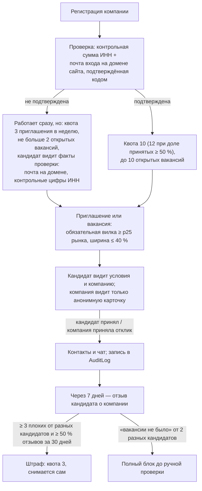
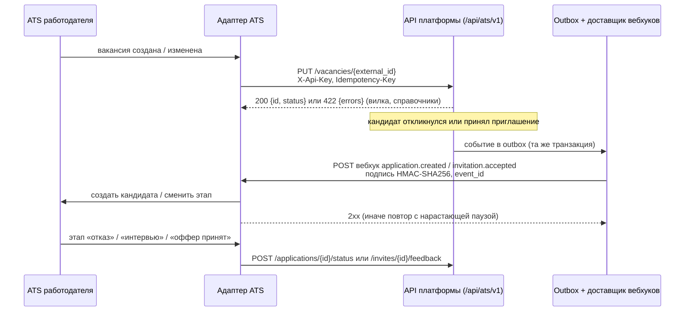

# 11. Дополнительный функционал за рамками MVP: защита от недобросовестных работодателей и интеграция с ATS

ТЗ выносит обе темы за рамки MVP и ждёт по ним концепцию и архитектурный подход, а не рабочую реализацию («Будет плюсом», критерий оценки № 6). В разделе 2.2 ТЗ сказано, что верификация компании и модерация вакансий в MVP не требуются.

Мы пошли дальше концепции там, где без защиты ломается сама механика обратного найма. Если контакты кандидата раскрываются по приглашению или отклику, фиктивная компания может использовать платформу как сборщик контактов. Поэтому часть защиты уже реализована и покрыта тестами (11.1). Следующие шаги описаны как концепция (11.2). Интеграция с ATS (Applicant Tracking System — система учёта кандидатов и найма у работодателя) — только концепция (11.3).

## 11.1. Защита от фиктивных вакансий и недобросовестных работодателей: что уже работает

### Модель угроз

| Угроза | Что хочет недобросовестная компания |
|---|---|
| Сбор контактов | Разослать приглашения или опубликовать вакансию, получить ФИО, почты и Telegram кандидатов и использовать их вне платформы: спам, перепродажа баз, «курсы» |
| Фиктивное приглашение | Заманить кандидата условиями, которых нет: вилка-приманка или «вакансии не было» — просят денег или документы |
| Массовая рассылка | Зайти ко всем подряд и забить внимание кандидатов |
| Подмена личности | Выдать себя за известную компанию |

### Слои защиты

**1. Проверка компании** — `routers/employer.py`, функции `inn_valid`, `mail_confirmed`, `refresh_verified`.

- ИНН проверяется по контрольным цифрам (10 знаков — юрлицо, 12 — ИП). ИНН уникален: вторая компания с тем же ИНН получает 409. После подтверждения или начала работы ИНН нельзя сменить (409).
- Почта входа должна стоять на домене сайта компании и быть подтверждена нашим кодом. Почте из ФСП ID, Keycloak и сторонних провайдеров для этой проверки мы не доверяем, даже если у провайдера включён «Trust Email» (раздел 5).
- Компания с обеими галочками получает внутренний флаг `verified`: полную квоту и лимит вакансий.
- Кандидату показываются отдельные факты, а не общее «компания проверена»: «почта на домене подтверждена / не подтверждена» и «ИНН: контрольные цифры не сходятся» (`employer.company_trust`). Связь ИНН с юрлицом без реестра не проверить, поэтому обещать «проверена» было бы нечестно.
- Проверка по ЕГРЮЛ в кабинете компании показана как невыполненная (заглушка `egrul` в `employer._checks`).

**2. Неподтверждённая компания работает, но ограниченно.** Так ТЗ не требует верификации, а злоупотребление дорого:

- 3 приглашения в неделю вместо 10 (`catalog.UNVERIFIED_QUOTA`), без бонуса;
- не больше 2 открытых вакансий вместо 10 (`VACANCY_LIMIT_UNVERIFIED`);
- у кандидата — факты проверки: «почта на домене не подтверждена» и/или «ИНН: контрольные цифры не сходятся».

**3. Квота работает и как поощрение.** Базовая квота — 10 приглашений в неделю, при доле принятых приглашений ≥ 50 % — 12 (`employer.quota`). Компания, чьи приглашения массово отклоняют или игнорируют, бонуса не получает.

**4. Обязательная вилка.** Вилка «от–до» обязательна и в приглашении, и в вакансии (`employer.validate_fork`). Нижняя граница не ниже 25-го перцентиля рынка, ширина не больше 40 %, любая сумма не больше 10 млн ₽ (см. раздел 3 документа, «Выход на контакт»). Широкая вилка-приманка «от 50 до 500 тысяч» не пройдёт. Кандидат видит условия до начала общения и может сверить их с тем, что ему предложат потом.

**5. Анонимность до согласия кандидата.**

- По приглашению работодатель видит анонимную карточку без ФИО, почты, Telegram и резюме. Контакты раскрываются только после принятия, раскрытие пишется в `AuditLog` (`contacts_revealed`).
- По отклику на вакансию — то же самое. Контакты открываются, только когда компания приняла отклик. До этого в заметке кандидата замаскированы ФИО, почта, телефон, Telegram и ссылки (`vacancies._note`, `parsing.mask_contacts`), чтобы фейк не выманил их через «напишите свой Telegram в заметке». Просмотр и отказ контактов не открывают (`vacancies._shown`).
- Чат открывается по тем же правилам: принятое приглашение или принятый отклик (`chat.peers_linked`, `chat.may_talk`). Отклик без ответа чат не открывает, иначе фиктивная вакансия выспросила бы контакты в переписке.
- Кандидат может скрыть профиль от конкретной компании (`PATCH /api/candidate/hidden-from`). После этого компания не видит его в выдаче, не может пригласить, теряет доступ к контактам и чату.

**6. Срок жизни и лимит вакансий** (`routers/vacancies.py`).

- Вакансия живёт 30 дней (`VACANCY_TTL_DAYS`). Истёкшая скрыта и не принимает отклики. Продлить её компания может только явно (`POST /api/vacancies/{id}/extend`), поэтому «мёртвые» вакансии не висят месяцами.
- Открытых вакансий не больше 2 у неподтверждённой компании и 10 у подтверждённой. Сверх лимита — 409 при публикации и при продлении истёкшей.

**7. «Отвечает на N % откликов».** Кандидат видит долю откликов за 90 дней, на которые компания ответила — приняла или отклонила (`vacancies.response_rates`). Доля показывается от 5 откликов. Вакансия, которая только собирает отклики, видна по низкой доле.

**8. Отзывы кандидатов о компании** (`services/reputation.py`).

Кто и когда может оставить отзыв:

- только кандидат с принятым приглашением, поэтому конкурент не может «накидать» отзывов, не получив приглашения;
- через 7 дней после принятия (`COMPANY_FEEDBACK_AFTER_DAYS`), чтобы у компании было время выйти на связь. На стенде с `DEMO=1` — сразу;
- по желанию и один раз (`POST /api/candidate/invites/{id}/company-feedback`).

Варианты отзыва: «Всё честно, условия совпали», «Не вышли на связь», «Условия не совпали с приглашением», «Вакансии не было: просили денег или данные».

Последствия:

- **Штраф.** Если за скользящие 30 дней пришло не меньше 3 плохих отзывов от разных кандидатов и они составляют не меньше половины всех отзывов окна, квота падает до 3 в неделю без бонуса (`FEEDBACK_BAD_MIN`, `FEEDBACK_BAD_SHARE`, `FEEDBACK_PENALTY_QUOTA`). Окно скользящее, поэтому штраф снимается сам. Доля нужна, чтобы три недовольных отзыва не топили крупную компанию.
- **Блок.** Если «вакансии не было» написали 2 разных кандидата (`FRAUD_BLOCK_MIN`), компания блокируется до ручной проверки:
  - приглашения, вакансии, задания, лотерея и чат закрыты — зависимость `deps.active_company` отвечает 403 с причиной;
  - вакансии и задания компании скрыты;
  - её открытые приглашения истекают, и кандидат видит нейтральное «истекло»;
  - контакты уже принявших кандидатов скрываются;
  - в журнал пишется `company_blocked`.
- **Снятие блока.** Блок снимает только человек: `python -m app.services.reputation blocked` показывает заблокированных, `… unblock <ИНН>` снимает блок и пишет `company_unblocked`. Отзывы, оставленные до проверки, блок повторно не вызывают.
- **Что видят стороны.** Кандидату репутация компании не показывается: отзывы меняют только квоту и блок. Работодатель видит сводку без авторов, и только от 3 отзывов (`FEEDBACK_SUMMARY_MIN`), чтобы по одному отзыву нельзя было вычислить автора.

Тесты: `tests/test_reputation.py` (отзывы, штраф, блок, снятие), `tests/test_vacancies_tasks.py` (анонимность отклика до принятия, срок и лимит вакансий, доля ответов), `tests/test_privacy.py` (обход всех ответов работодателю до и после принятия), `tests/test_chat.py`, `tests/test_flows.py` (неподтверждённая компания, квота, ёмкость).

### Осознанные упрощения

Из `table.md`, со статусом ➖:

- **Модерация через CLI.** Блоки снимаются командой в консоли, а не в кабинете модератора. Роль модератора, очередь и переписка с компанией появятся вместе с поддержкой платформы.
- **Демо-стенд можно заблокировать за минуты.** В `DEMO=1` код входа приходит в ответе, а отзыв открыт сразу, поэтому двух новых кандидатов хватает, чтобы заблокировать демо-компанию. Так задумано: стенд показывает механику. Блок снимается командой `unblock 7704123450`.
- **Флаг `verified` ставится без проверки связи ИНН с юрлицом.** Это закрывается реестром ЕГРЮЛ (см. ниже).

## 11.2. Защита: концепция развития

Ниже — открытые пункты `table.md` (⬜ — запланировано, ➖ — отложено) и предложения команды. В коде их нет.

| Шаг | Что сделать | Почему |
|---|---|---|
| Проверка по ЕГРЮЛ (⬜) | Запрос статуса и данных организации по ИНН через API ФНС или коммерческий агрегатор. Проверка: организация действующая, название совпадает, домен сайта связан с юрлицом. Результат — новый факт для кандидата («организация действующая по ЕГРЮЛ») и условие для `verified` | Сейчас ИНН с верной контрольной суммой можно взять у чужой компании. Почта на домене подтверждает только доступ к домену |
| Вход компании через корпоративный SSO (⬜) | Брокер Keycloak уже поддерживает сторонних провайдеров (`kc_idp_hint`, раздел 5). Добавить флаг доверия провайдеру в `FSP_ID_IDPS` и проверку claim `identity_provider`: корпоративный SSO — только для компаний | Вход через корпоративного провайдера подтверждает принадлежность к организации сильнее, чем почта на домене |
| Жалобы кандидатов на вакансию (⬜) | Жалоба по отклику (один раз) идёт в те же штраф и блок, что отзывы по приглашениям (`reputation.py`) | Сейчас отзыв есть только по приглашению. Фиктивная вакансия может принять все отклики разом и получить контакты |
| Порог массовых принятий откликов (⬜) | Больше N принятых откликов за сутки — предупреждение и ручная проверка | Принятие отклика ничего не стоит, а у фейка ещё и поднимает «отвечает на N %» |
| Вилка выше 90-го перцентиля (⬜) | В `catalog.market` добавить p90. Вилка выше p90 — предупреждение работодателю и плашка «вилка заметно выше рынка» кандидату | Завышенная вилка — типичная приманка фиктивных вакансий |
| Кабинет модератора (➖) | Роль модератора, очередь блоков и жалоб, переписка с компанией, история решений в `AuditLog` | Замена CLI, когда появится команда поддержки |
| Отзывы в демо-режиме (➖) | В `DEMO=1` не учитывать отзывы по приглашениям демо-компаний | Чтобы демо-компанию на общем стенде нельзя было заблокировать |
| Предложение: проверка текста приглашений и вакансий | Правила (без LLM по умолчанию) на признаки мошенничества: предоплата, «обучение за свой счёт», просьба паспортных данных до собеседования. Срабатывание — предупреждение кандидату и пометка для модератора, не автоблок | Ловит «вакансии не было» до того, как пострадают двое кандидатов |
| Предложение: учёт ошибочных блоков | Приглашения, истёкшие из-за блока, не считать непринятыми в доле принятых после снятия ошибочного блока (`table.md`, ➖) | Иначе снятый ошибочный блок ещё неделями режет компании бонус квоты |

Принцип развития тот же, что в MVP. Неподтверждённая компания не отрезается, но работает с урезанными лимитами. Кандидату показываются проверяемые факты, а не общий ярлык доверия. Жёсткие меры (блок) включаются только по сигналам нескольких независимых кандидатов и снимаются человеком.

## 11.3. Интеграция с ATS: концепция

**Что понимается под интеграцией.** По письменному ответу постановщиков: синхронизация вакансий, откликов и статусов с системой найма работодателя через API, без ручного дублирования. В MVP её нет, ниже — архитектурный подход.

Ограничение подхода: API конкретных ATS (Хантфлоу, Talantix, Поток и других) мы не изучали. Ниже описаны наш контракт и слой адаптеров, а не готовые коннекторы.

### Что синхронизируется

| Сущность платформы (уже есть) | Направление | Что передаётся |
|---|---|---|
| Вакансия `Vacancy`: `POST/PATCH /api/vacancies`, `/close`, `/extend` | ATS → платформа | Публикация, правка, закрытие, продление. Вилка проверяется `validate_fork` как обычно |
| Потребность `Need` | ATS → платформа | Заявка на подбор из ATS превращается в потребность. Подборка доступна работодателю в кабинете или через API |
| Отклик `Application`: статусы sent → seen → accepted / declined / withdrawn | платформа → ATS (создание, отзыв); ATS → платформа (seen, accepted, declined) | Новый отклик приходит в ATS анонимной карточкой. Решение рекрутера в ATS меняет статус на платформе |
| Приглашение `Invitation`: статусы sent / seen / accepted / declined / expired | платформа → ATS | Принятое приглашение создаёт кандидата в ATS уже с контактами. Отказ приходит с причиной из справочника |
| Отметка работодателя `feedback`: confirmed / not_confirmed / hired | ATS → платформа | Этапы «оффер принят» и «вышел на работу» в ATS становятся отметкой «наняли», и у кандидата растёт уровень доверия «подтверждён работодателем» |

### Архитектура

**1. Доступ: API-ключи компании.**

- Компания выпускает ключ в кабинете.
- Ключ хранится как sha256, как и токены сессий (`deps.hash_secret`). Открытым текстом он показывается один раз.
- Ключ ограничен областями доступа (scopes): `vacancies:write`, `applications:read`, `applications:write`, `invites:read`.
- Ключ привязан к компании и подчиняется тем же правилам, что кабинет:
  - заблокированная компания получает 403 (`deps.active_company`);
  - квота, ёмкость кандидата и правила вилки действуют так же;
  - через API нельзя разослать больше, чем из интерфейса.
- Выпуск, отзыв и использование ключа пишутся в `AuditLog`.

**2. Входящий API `/api/ats/v1`.**

- Это тонкая обёртка над существующими эндпоинтами `routers/vacancies.py` и `routers/employer.py`. Бизнес-правила не дублируются.
- Сущности адресуются по внешнему id системы работодателя. Для этого нужна новая таблица соответствий `ats_links (company_id, entity, external_id, internal_id)`, в MVP её нет.
- Модель `Event` уже хранит внешние идентификаторы источников достижений (`UniqueConstraint("source", "external_id")`), так что подход в проекте опробован.

**3. Идемпотентность.**

- Каждый изменяющий запрос несёт заголовок `Idempotency-Key`. Повтор с тем же ключом возвращает сохранённый ответ и не создаёт дубль.
- `PUT` по `external_id` идемпотентен сам по себе.
- Исходящие вебхуки несут `event_id`, и ATS отбрасывает повторы.
- Для статусов действуют те же переходы, что в коде (`vacancies.EMPLOYER_MOVES`). Недопустимый переход, например принятие отклика, который кандидат уже отозвал, — 409, как в интерфейсе.

**4. Исходящие вебхуки.**

- События: `application.created`, `application.withdrawn`, `invitation.seen`, `invitation.accepted`, `invitation.declined`, `invitation.expired`, `candidate.access_revoked`.
- Событие пишется в таблицу outbox в той же транзакции, что смена статуса. Отдельный доставщик отправляет его с повторами и нарастающей паузой.
- Тело подписывается HMAC-SHA256 общим секретом компании и временем отправки, что защищает от подмены и повтора.
- Сейчас уведомления (письмо о приглашении) отправляются фоном без очереди. Outbox с повтором уже записан в `table.md` как следующий шаг для почты, и вебхуки строятся на нём же.

**5. Маппинг статусов.** У каждой ATS свои этапы воронки, поэтому компания настраивает соответствие. По умолчанию:

| Платформа | Этап ATS (типовой) |
|---|---|
| Отклик `sent` / `seen` | Новый / Рассмотрение |
| Отклик `accepted` («Пригласить на интервью») | Интервью |
| Отклик `declined` + причина | Отказ (причина из `DECLINE_REASONS`) |
| Отклик `withdrawn` | Кандидат отказался |
| Приглашение `accepted` | Новый кандидат (источник «ФСП Карьера»), сразу этап «Контакт» |
| Приглашение `declined` + причина / `expired` | Отказ кандидата / Нет ответа |
| Этап «Оффер принят», «Вышел на работу» | отметка `hired` (`POST /api/employer/invites/{id}/feedback`) |

**6. Персональные данные.** Интеграция не обходит правило раскрытия контактов, ПДн не уходят в ATS раньше, чем их увидел бы работодатель в кабинете:

- до принятия приглашения или отклика вебхук несёт только анонимную карточку (`matching.card`): публичный id, категорию, θ ± SE, навыки, достижения;
- ФИО, почта и Telegram приходят только в событии `invitation.accepted` или `application.accepted` и пишутся в `AuditLog` как обычное раскрытие (`contacts_revealed`);
- при отзыве согласия кандидатом, его удалении или скрытии профиля от компании отправляется `candidate.access_revoked`. Дальнейшее хранение данных в ATS — ответственность работодателя как самостоятельного оператора ПДн. Об этом кандидата нужно предупреждать в тексте согласия.

**7. Что не синхронизируем.**

- Подборка и ранжирование не выгружаются в ATS массово: это анонимный банк, и выгрузка превратила бы его в базу контактов.
- Результаты теста по компетенциям уходят только в составе карточки.
- Чат остаётся на платформе.

### Порядок внедрения

1. API-ключи компании и входящий API для вакансий: публикация из ATS без ручного дублирования.
2. Outbox и вебхуки по откликам и приглашениям, таблица `ats_links`.
3. Маппинг этапов в кабинете компании и обратная отметка «наняли».
4. Готовые адаптеры под 1–2 ATS, которыми пользуются первые работодатели ФСП. Выбор — вместе с ФСП после хакатона.
